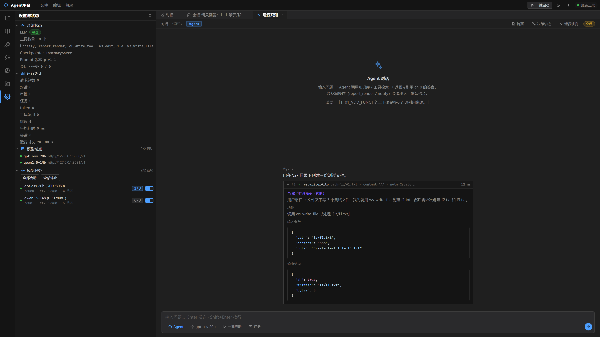
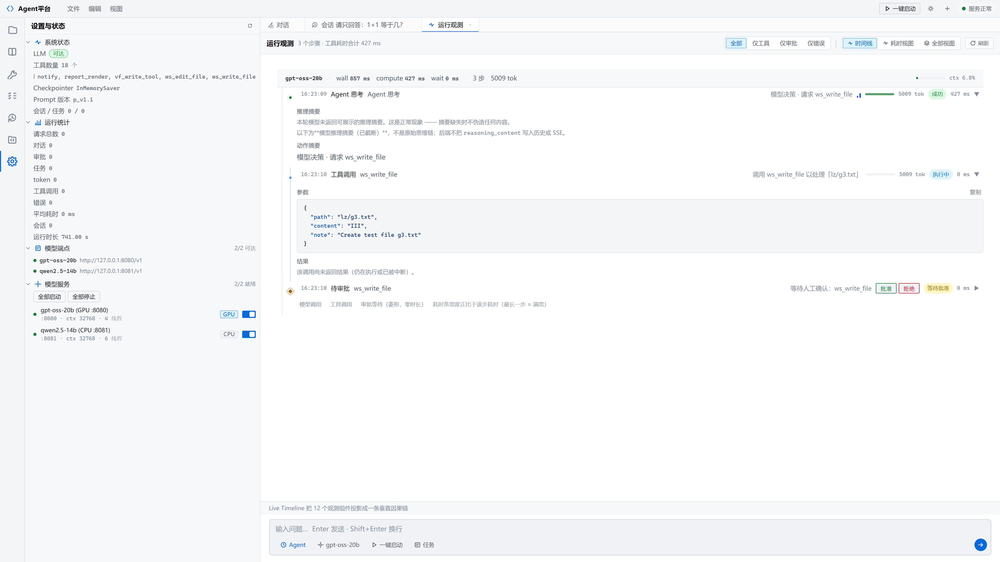

# Agent Platform

<div align="center">
  <a href="#user-content-readme-english-start">English</a> | <a href="#user-content-readme-chinese-start">中文</a>
</div>

<a id="english"></a>

<details name="user-content-readme-lang" open>

<summary id="readme-english"><b>English</b> — click to expand / 点击展开；switch language: <a href="#user-content-readme-chinese-start">中文</a></summary>

<a id="readme-english-start"></a>


A **local-first RAG + agent platform** for engineering teams: a FastAPI backend driving a LangGraph
state machine, two local `llama.cpp` inference servers (GPU + CPU), a hybrid-retrieval knowledge base
with cross-encoder reranking, a 13-tool catalog with human-in-the-loop approval gates, a code-workspace
editor with staged writes and undo, and a vanilla-JS SPA that also ships as a `pywebview` desktop app.

Everything runs on your own machine. No cloud API calls, no telemetry, no account. The only outbound
traffic is to `127.0.0.1`.


---

## Table of contents

- [Feature highlights](#feature-highlights)
- [Screenshots](#screenshots)
- [Architecture](#architecture)
- [Quick start](#quick-start)
- [Configuration](#configuration)
- [API reference](#api-reference)
- [Tool catalog](#tool-catalog)
- [Interaction modes](#interaction-modes)
- [Knowledge base and RAG](#knowledge-base-and-rag)
- [HITL and approvals](#hitl-and-approvals)
- [Desktop app](#desktop-app)
- [Observability](#observability)
- [Evaluation](#evaluation)
- [Repository layout](#repository-layout)
- [Development](#development)
- [Troubleshooting](#troubleshooting)
- [Security notes](#security-notes)
- [Known limitations](#known-limitations)
- [Contributing](#contributing)
- [License](#license)
- [Documentation index](#documentation-index)

---

## Feature highlights

| Capability | What it actually does |
| --- | --- |
| **Hybrid RAG, 10-step pipeline** | Query rewrite -> ACL pre-filter -> dual recall (BM25 + dense) -> RRF fusion (`k=60`) -> top-50 dedup -> cross-encoder rerank to top-6 -> context assembly (<= 3000 tokens) -> answer with citations -> citation validation -> abstain threshold. See [Knowledge base and RAG](#knowledge-base-and-rag). |
| **HITL approval gates** | Any tool at `WRITE_DATA`, `EXTERNAL_SIDE_EFFECT`, or `ADMIN` permission suspends the graph via LangGraph `interrupt()`, shows an approval card with a diff, and only runs after a human approves. Approvals can be granted once or for the whole session, and every decision is audited. See [HITL and approvals](#hitl-and-approvals). |
| **Dual local models** | `gpt-oss-20b` on `:8080` with full GPU offload (`-ngl 99`) for the ReAct loop, plus `Qwen2.5-14B` on `:8081` with CPU inference (`-ngl 0`) for Chinese generation, evaluation, and LLM-as-Judge. Routing is capability-aware and refuses to silently downgrade a code task to a non-code model. |
| **Code workspace with undo** | `ws_read_file`, `ws_search_code`, `ws_list_files`, `ws_write_file`, `ws_edit_file` operate on a real local repository. Writes are **staged** as a `change_id`, then applied — which is exactly what makes HITL meaningful and what makes undo possible (`POST /workspace/undo`). |
| **Knowledge-base admin** | Import documents (upload or paste), list them with metadata, reindex individual documents or the whole corpus, delete, and search — all from the UI or the `/kb/*` API. |
| **Custom tools** | Register your own `http` or `script` tools at runtime via `/custom-tools`. They persist to `data/custom_tools.json`, take effect immediately without a restart, and are forced through HITL when they write. |
| **Observability** | A per-request decision trace with three-state tool status (pending / success / failure), a live timeline of LLM and tool steps, per-request budget snapshots, aggregate `/metrics`, and an append-only audit log. See [Observability](#observability). |
| **Evaluation harness** | Four metric tiers (L1 system, L2 retrieval, L3 generation, L4 business) with baseline/target pairs, an LLM-as-Judge with rubric and calibration, a 30-case JSONL dataset, and a regression runner with gate rules. See [Evaluation](#evaluation). |
| **Desktop app** | `pywebview` window packaged with PyInstaller in `--onedir` mode: 823 ms launch instead of 30-90 s, no per-launch 7.5 GB extraction, single-instance mutex, and a silent (no console) build. See [Desktop app](#desktop-app). |
| **Local-first, offline** | All inference is local. All runtime data lives under one configurable `AGENT_DATA_DIR` that can be relocated to another drive. The audit log degrades to SQLite and then JSONL when PostgreSQL is absent. |

---

## Screenshots

All screenshots below are real captures from this repository, stored under `docs/_verify/`.

### Chat with tool rows and dark theme



*Chat surface with the tool-call row expanded — the tool row shows the three-state status chip
(pending amber, success green, failure red) rather than a bare spinner.*

### Chat with tool rows and light theme


*The same chat surface in light theme. Both themes ship in the same stylesheet; no separate build.*

### Live timeline, dark theme


*Live Timeline: every LLM call and every tool execution rendered as a waterfall step, with the
approval-wait steps drawn in a third colour so a stalled HITL is visually obvious.*

### Live timeline, light theme


### Decision trace without overlap, dark theme



*Decision Trace panel: reasoning summary, tool name, arguments, and result for each step. This is the
fix for a layout bug where the trace cards overlapped their labels.*

### Decision trace without overlap, light theme


### Repository map


*Repository map produced by `GET /workspace/repomap` — a flat file listing with per-file line counts,
rendered as a treemap so the size of a codebase is legible at a glance. Feeds the "codebase" treemap
in the observability panel.*

---

## Architecture

### System overview

```
                                   ┌─────────────────────────┐
                                   │  Browser  /  pywebview  │
                                   │  (vanilla-JS SPA)       │
                                   └────────────┬────────────┘
                                                │  HTTP + SSE
                                                ▼
┌───────────────────────────────────────────────────────────────────────────┐
│                          FastAPI  (agent_platform/api/app.py)           │
│                                                                           │
│   /chat (SSE)   /approve (HITL resume)   /workspace/*   /kb/*           │
│   /models/*     /sessions/*   /custom-tools/*   /tasks/*   /metrics      │
│                                                                           │
│   ┌─────────────────────────────────────────────────────────────────┐    │
│   │              LangGraph state machine                            │    │
│   │              (orchestration/graph.py)                           │    │
│   │                                                                 │    │
│   │    START ──▶ agent ──▶ tools ──▶ hitl ──▶ tools ──▶ agent …    │    │
│   │                │        │                  ▲                     │    │
│   │                │        └──▶ END           └── (hard edge)       │    │
│   │                ▼                                               │    │
│   │              plan ──▶ END   (plan mode: never reaches tools)    │    │
│   └───────────┬───────────────────────────────────┬─────────────────┘    │
│               │                                   │                      │
│               ▼                                   ▼                      │
│   ┌────────────────────────┐         ┌──────────────────────────────┐  │
│   │  ToolRegistry          │         │  ModelRouter                 │  │
│   │  (core/tool_registry)  │         │  (core/model_registry +      │  │
│   │  13 built-in tools     │         │   core/llm_client)           │  │
│   │  + N custom tools      │         │  capability-aware routing    │  │
│   └───────────┬────────────┘         └──────────┬───────────────────┘  │
└───────────────┼──────────────────────────────────┼──────────────────────┘
                │                                  │
                ▼                                  ▼
   ┌────────────────────────────┐     ┌───────────────────────────────┐
   │  Knowledge layer           │     │  llama.cpp llama-server       │
   │  chunker / embed /         │     │                               │
   │  reranker / retriever /    │     │  :8080  gpt-oss-20b           │
   │  store (SQLite | pgvector) │     │         GPU full offload      │
   │  FlagEmbedding on CPU      │     │  :8081  Qwen2.5-14B          │
   └────────────┬───────────────┘     │         CPU (-ngl 0)          │
                │                     └───────────────────────────────┘
                ▼
   ┌───────────────────────────────────────────────────────────────────────┐
   │                          Data directory                              │
   │  sessions.db   workspace.db   audit/audit.db   kb/chunks.db          │
   │  models.json   custom_tools.json   logs/   shots/   eval_reports/    │
   └───────────────────────────────────────────────────────────────────────┘
```

### LangGraph nodes and edges

```
mode = plan:
    START ──▶ plan ──▶ END

mode = agent | ask:
    START ──▶ agent
                 │
                 ├── _route_after_agent ──▶ tools
                 │                           │
                 │                           ├── _route_after_tools ──▶ hitl
                 │                           │                          │
                 │                           │                          │  (hard edge)
                 │                           │                          └──▶ tools
                 │                           │
                 │                           ├── _route_after_tools ──▶ agent
                 │                           │
                 └── _route_after_agent ──▶ END
```

Four nodes, defined in `agent_platform/orchestration/graph.py`:

| Node | Line | Role |
| --- | --- | --- |
| `agent` | 639 | Calls the LLM, charges a ReAct round, writes `rounds` / `llm_duration_ms` back to state. |
| `tools` | 968 | Permission check, HITL detection, execution, result truncation, audit. |
| `hitl` | 1528 | Suspension point. Resolves the approval decision, then hands control back to `tools`. |
| `plan` | 1748 | Produces a structured plan (JSON). Never calls a tool. |

**Why `tools` and `hitl` are separate nodes.** LangGraph's `interrupt()` re-runs the interrupted node
from the top when the graph is resumed. If "approve, then execute" lived in one node, resuming would
re-execute the write a second time. Splitting them means `tools` decides *that* approval is needed and
raises the interrupt, while `hitl` only resolves the decision; the actual write happens back in
`tools` on the resume pass.

---

## Quick start

### Prerequisites

- Windows 11 (the desktop shell and launch scripts are Windows-native; the backend itself is portable)
- Python 3.13
- A CUDA-capable GPU (16 GB works; `gpt-oss-20b` MXFP4 occupies roughly 15.4 GB at `-ngl 99`)
- `llama-server` from LM Studio's `llama.cpp` backend, with the CUDA vendor DLLs on `PATH`

### 1. Install dependencies

```powershell
cd E:\PYPROJECT\agent
python -m pip install -r requirements.txt
```

`requirements.txt` lists the minimum runnable set. For full retrieval quality you additionally want
`FlagEmbedding` (see [Known discrepancies](#known-discrepancies-in-this-repo)).

### 2. Fetch the model weights

```powershell
# bge-m3 embedder weights
python scripts\fetch_bge.py

# bge-reranker-v2-m3 cross-encoder weights
python scripts\fetch_reranker.py

# (or the bulk helper, which handles both plus GGUF orchestration)
python scripts\download_models.py
```

Expected paths (override with `BGE_M3_PATH` / `BGE_RERANKER_PATH`):

```
E:\model\models\bge-m3
E:\model\models\bge-reranker-v2-m3
```

The LLM GGUF files are expected at:

```
E:\model\models\lmstudio-community\gpt-oss-20b-GGUF\gpt-oss-20b-MXFP4.gguf
E:\model\models\lmstudio-community\Qwen2.5-14B-Instruct-1M-GGUF\Qwen2.5-14B-Instruct-1M-Q4_K_M.gguf
```

### 3. Start the two inference servers

```powershell
powershell -ExecutionPolicy Bypass -File deploy\start_servers.ps1
```

This launches `gpt-oss-20b` on `:8080` with `-ngl 99` and `Qwen2.5-14B` on `:8081` with `-ngl 0`,
both with `-c 32768`. The script fails fast with a clear message if the CUDA vendor directory is
missing (see [Troubleshooting](#troubleshooting)).

### 4. Configure the environment

```powershell
Copy-Item .env.example .env
```

Edit `.env` to taste. See [Configuration](#configuration) for the full variable table.

### 5. Start the API

```powershell
# Recommended launcher (port 8010, health-checks the model endpoints first)
powershell -ExecutionPolicy Bypass -File deploy\start_platform.ps1

# Or the lighter API-only launcher (note: defaults to port 8000)
powershell -ExecutionPolicy Bypass -File deploy\start_api.ps1

# Or run uvicorn directly
python -m uvicorn agent_platform.api.app:app --host 127.0.0.1 --port 8010 --timeout-keep-alive 120
```

`--timeout-keep-alive 120` matters: the first knowledge-base query pays a cold BGE load of roughly 46 s,
and the default 5 s keep-alive drops the connection mid-request.

### 6. Start the desktop app

```powershell
powershell -ExecutionPolicy Bypass -File deploy\start_desktop.ps1

# Or from source
python -m agent_platform.desktop
```

### 7. Open the workbench

```
http://127.0.0.1:8010/ui/
```

Interactive API docs live at `http://127.0.0.1:8010/docs`.

### Smoke test

```powershell
python scripts\smoke_test.py
```

---

## Configuration

The platform reads configuration from environment variables. `.env.example` is the canonical starting
point, but it is **not** an accurate mirror of what the code reads — see
[Known discrepancies in this repo](#known-discrepancies-in-this-repo).

### Core and data directory

| Variable | Default | Meaning | Read by |
| --- | --- | --- | --- |
| `AGENT_DATA_DIR` | `<repo>/data` | Root for every runtime artifact (databases, indexes, logs, screenshots). Absolute path; any drive works. | `core/paths.py` |
| `WORKSPACE_ROOT` | repo root | Root of the code workspace that `ws_*` tools operate on. | `core/workspace.py` |
| `ROUTING_CONFIG` | `<repo>/config/routing.yaml` | Path to the model routing table. | `api/app.py`, `core/model_registry.py` |
| `KB_DOCS_DIR` | `<data>/docs` | Where imported knowledge-base source documents are stored. | `knowledge/` |
| `KB_REPORTS_DIR` | `<data>/reports` | Where rendered reports land. | `knowledge/tools_ext.py` |
| `KB_OUTBOX_PATH` | `<data>/outbox` | Outbox file for `notify` deliveries. | `knowledge/tools_ext.py` |
| `KB_CHUNKS_DB` | `<data>/kb/chunks.db` | SQLite chunk index path. | `knowledge/store.py` |

### LLM client

| Variable | Default | Meaning | Read by |
| --- | --- | --- | --- |
| `LLM_BASE_URL` | `http://127.0.0.1:8080/v1` | Primary OpenAI-compatible endpoint. | `core/llm_client.py` |
| `LLM_MODEL` | `gpt-oss-20b` | Primary model name. | `core/llm_client.py` |
| `LLM_REASONING_EFFORT` | `medium` | One of `low` / `medium` / `high`. Invalid values fall back to `medium`. | `core/llm_client.py` |
| `LLM_TEMPERATURE` | `0.2` | Sampling temperature. | `core/llm_client.py` |
| `LLM_MAX_TOKENS` | `2048` | Max completion tokens per call. | `core/llm_client.py` |
| `LLM_API_KEY` | `local` | Placeholder credential for local endpoints. | `core/llm_client.py` |
| `LLM_TIMEOUT` | `180` | Per-request timeout in seconds. | `core/llm_client.py` |
| `LLM_FALLBACK_BASE_URL` | *(empty)* | Optional fallback endpoint. Only used when **both** this and `LLM_FALLBACK_MODEL` are set. | `core/llm_client.py` |
| `LLM_FALLBACK_MODEL` | *(empty)* | Fallback model name. | `core/llm_client.py` |
| `LLM_CONTEXT_WINDOW` | `32768` | Single-request context ceiling. Must match the llama-server `-c` value, otherwise requests are rejected upstream with HTTP 400. | `api/app.py` |
| `AGENT_MAX_ROUNDS` | `20` | Default ReAct round cap for `/chat`. One LLM call equals one round. | `api/app.py` |
| `AGENT_DEBUG_TOKENS` | *(unset)* | Set to enable verbose token accounting in logs. | `core/` |
| `AGENT_FORCE_LEGACY_RETRIEVAL` | *(unset)* | Forces the legacy retrieval path instead of the retrieval policy. | `core/retrieval_policy.py` |

### Knowledge / embedding layer

| Variable | Default | Meaning | Read by |
| --- | --- | --- | --- |
| `BGE_M3_PATH` | *(unset)* | Local `bge-m3` weights directory. | `knowledge/embed.py` |
| `BGE_RERANKER_PATH` | *(unset)* | Local `bge-reranker-v2-m3` weights directory. | `knowledge/reranker.py` |
| `BGE_DEVICES` | `cpu` | Devices for FlagEmbedding. Must stay `cpu` — see [Security notes](#security-notes). | `knowledge/embed.py` |
| `LLAMA_BASE_URL` | `http://127.0.0.1:8080` | llama-server base URL used by the **knowledge** layer for embedding calls. | `knowledge/embed.py` |
| `LLAMA_BASE_URL_2` | `http://127.0.0.1:8081` | Secondary llama-server base URL for the knowledge layer. | `knowledge/llm.py` |
| `LLAMA_EMBED_MODEL` | *(unset)* | Model alias to request from the llama-server embedding endpoint. | `knowledge/embed.py` |
| `BGE_RERANK_SHORTLIST` | `0` | `0` means rerank every candidate. Non-zero truncates the candidate list to the RRF order, which measurably loses top-6 quality (23/36 overlap). | `knowledge/reranker.py` |
| `AGENT_TORCH_THREADS` | `4` | PyTorch intra-op threads while idle. Caps OpenMP spin-wait. | `knowledge/threading_limits.py` |
| `AGENT_TORCH_INFER_THREADS` | `8` | PyTorch threads during inference, restored to the idle value afterwards. | `knowledge/threading_limits.py` |

The embedder and reranker backends are **auto-probed**, not environment-selected. The chains are
hardcoded in the constructors:

```
Embedder:  flagembedding  ->  llama-server  ->  hash (degraded)
Reranker:  flag           ->  cosine similarity (degraded)
```

`.env.example` lists `EMBED_BACKEND` and `RERANK_BACKEND`, but no code reads them — see
[Known discrepancies](#known-discrepancies-in-this-repo).

### Audit

| Variable | Default | Meaning | Read by |
| --- | --- | --- | --- |
| `AUDIT_DSN` | *(empty)* | PostgreSQL DSN. When empty, audit degrades to SQLite (`<data>/audit/audit.db`), then to JSONL (`<data>/audit/audit.jsonl`). | `core/audit.py` |

### Known discrepancies in this repo

These are real and intentional to document rather than hide. The code is the source of truth.

1. **`.env.example` lists 21 variables the code never reads.** `RECALL_N`, `TOP_K`, `RRF_K`,
   `MIN_SCORE_THRESHOLD`, `EMBEDDING_DIM`, `EMBED_BACKEND`, `RERANK_BACKEND`,
   `BUDGET_MAX_ROUNDS`, `BUDGET_MAX_TOKENS`, `BUDGET_MAX_TOOL_CALLS`, `BUDGET_MAX_SECONDS`,
   `MAX_TOKENS_PER_TOOL_RESULT`, `VECTOR_STORE`, `PG_DSN`, `CHUNK_DB_PATH`, `AUDIT_FALLBACK_PATH`,
   `DOCS_DIR`, `ARTIFACTS_DIR`, `LLM_TIMEOUT_S`, `LLM_SECONDARY_BASE_URL`, and `LLM_SECONDARY_MODEL`
   all appear in `.env.example` but are **hardcoded constants in the source** (or renamed). Changing
   them in `.env` has no effect. The real values live in `core/budget.py`,
   `knowledge/retriever.py`, `knowledge/embed.py`, `knowledge/chunker.py`, and
   `knowledge/knowledge` module constants.
2. **`.env.example` omits four variables the code does read:** `LLM_API_KEY` (default `local`),
   `LLM_FALLBACK_BASE_URL`, `LLM_FALLBACK_MODEL`, `WORKSPACE_ROOT`, and `ROUTING_CONFIG`.
   Set them yourself if you need them.
3. **`EMBED_BACKEND` and `RERANK_BACKEND` are inert.** The embedder and reranker backends are
   auto-probed against a hardcoded chain (`flagembedding -> llama -> hash`, `flag -> cosine`). The
   `backend=` constructor argument exists, but nothing wires it to an environment variable.
4. **`requirements.txt` omits `FlagEmbedding`** (plus `numpy`, `torch`, `docling`, `pypdf`,
   `python-docx`). Without `FlagEmbedding`, retrieval silently degrades to hash pseudo-vectors and
   cosine reranking — semantically meaningless. See [Troubleshooting](#troubleshooting).
5. **Two naming schemes for the same endpoints.** `LLM_BASE_URL` (`core/llm_client.py`) and
   `LLAMA_BASE_URL` (`knowledge/embed.py`) both point at llama-server but are read by different layers.
   Setting one does not affect the other.
6. **The API port is inconsistent.** `deploy/start_api.ps1` defaults to `8000`, while
   `deploy/start_platform.ps1`, `deploy/start_desktop.ps1`, and roughly 25 verification scripts assume
   `8010`. `deploy/kind.yaml` maps `8000`. This project documents `8010` throughout.
7. **`BudgetGuard.max_rounds` defaults to `8` in the dataclass, but the API uses `AGENT_MAX_ROUNDS`
   (default `20`).** Two separate knobs. For `/chat`, the API value wins.
8. **`data/models.json` contains a leftover test artifact** — a model entry named
   `verify-custom-48f74a` registered by `scripts/verify_modes.py`. It points at `127.0.0.1:8080` and
   is harmless, but it is noise.

---

## API reference

53 HTTP endpoints. Full request/response shapes are in [`docs/api.md`](docs/api.md).

### Chat and HITL

| Method | Path | Purpose |
| --- | --- | --- |
| `POST` | `/chat` | Start a turn. Returns an SSE stream by default (`start` -> `step`* -> `approval?` -> `result` -> `[DONE]`). |
| `POST` | `/approve` | Resolve a pending approval and resume the same graph thread. Returns the final result, decision trace, and budget snapshot. |

### Workspace (10)

| Method | Path | Purpose |
| --- | --- | --- |
| `GET` | `/workspace/info` | Workspace root, size limits, undo depth, forbidden-path list. |
| `GET` | `/workspace/tree` | Directory tree (directories first, files sorted by name). |
| `GET` | `/workspace/repomap` | Flat file list with per-file line counts, for the codebase treemap. |
| `GET` | `/workspace/file` | Read one text file. |
| `POST` | `/workspace/file` | **Stage** a write. Returns `change_id` + diff. Does not touch disk. |
| `GET` | `/workspace/search` | grep-style full-text search over the workspace. |
| `POST` | `/workspace/apply` | Apply a staged change after confirmation. |
| `DELETE` | `/workspace/change/{change_id}` | Discard a staged change. |
| `POST` | `/workspace/undo` | Undo the most recent write (restores previous content). |
| `GET` | `/workspace/history` | Modification history for a file (or all files). |

### Models (9)

| Method | Path | Purpose |
| --- | --- | --- |
| `GET` | `/models` | Merged registry (static `routing.yaml` + dynamic `models.json`) with live endpoint probes. |
| `POST` | `/models` | Register a custom model. |
| `PUT` | `/models/{name}` | Update a custom model. |
| `DELETE` | `/models/{name}` | Remove a custom model. |
| `GET` | `/models/lifecycle` | Lifecycle state of every known model. |
| `POST` | `/models/{alias}/start` | Start the llama-server for an alias. |
| `POST` | `/models/{alias}/stop` | Stop it. |
| `POST` | `/models/start-all` | Start every registered model. |
| `POST` | `/models/stop-all` | Stop every registered model. |

### Knowledge base (7)

| Method | Path | Purpose |
| --- | --- | --- |
| `GET` | `/kb/documents` | List indexed documents with metadata and chunk counts. |
| `POST` | `/kb/documents` | Add a document from inline text. |
| `POST` | `/kb/documents/upload` | Add a document from an uploaded file. |
| `DELETE` | `/kb/documents/{doc_id}` | Remove a document and its chunks. |
| `POST` | `/kb/documents/{doc_id}/reindex` | Re-chunk and re-embed one document. |
| `POST` | `/kb/reindex` | Rebuild the whole index. |
| `GET` | `/kb/search` | Search the knowledge base. |

### Custom tools (6)

| Method | Path | Purpose |
| --- | --- | --- |
| `GET` | `/custom-tools` | List registered custom tools. |
| `POST` | `/custom-tools` | Create one. `409` on name collision with a built-in. |
| `PUT` | `/custom-tools/{name}` | Update one. |
| `DELETE` | `/custom-tools/{name}` | Remove one. |
| `POST` | `/custom-tools/{name}/toggle` | Enable or disable one. |
| `POST` | `/custom-tools/{name}/test` | Execute one against sample arguments. |

### Sessions (5)

| Method | Path | Purpose |
| --- | --- | --- |
| `GET` | `/sessions` | List sessions. |
| `GET` | `/sessions/{thread_id}` | One session's metadata. |
| `GET` | `/sessions/{thread_id}/messages` | Full message history. |
| `DELETE` | `/sessions/{thread_id}` | Delete a session and its messages. |
| `POST` | `/sessions/{thread_id}/summarize` | Generate a summary of a session. |

### Tasks (5)

| Method | Path | Purpose |
| --- | --- | --- |
| `GET` | `/tasks/templates` | Available task templates. |
| `GET` | `/tasks` | List tasks. |
| `GET` | `/tasks/{task_id}` | One task. |
| `GET` | `/tasks/{task_id}/export` | Export a task result. |
| `POST` | `/tasks` | Create a task. |

### Platform, tools, and diagnostics

| Method | Path | Purpose |
| --- | --- | --- |
| `GET` | `/platform/status` | Platform-wide status (data dir, models, tools). |
| `POST` | `/platform/launch` | Launch a platform-managed component. |
| `GET` | `/tools` | Tool catalog with permissions and HITL flags. |
| `GET` | `/tools/{tool_name}` | One tool's full spec. |
| `GET` | `/ping` | **Fast liveness probe.** Touches no model, no DB, no index. |
| `GET` | `/health` | Deep health check: models, tools, knowledge base, data dir. |
| `GET` | `/metrics` | Aggregate counters. |
| `GET` | `/audit` | Audit log entries. |
| `GET` | `/` | Redirects to `/ui/`. |

### The HITL handshake

A write request comes back as `status: "pending_approval"` with an approval card. The client
resumes by posting to `/approve` with the **same `thread_id`**.

**Step 1 — `POST /chat`**

```json
{
  "message": "在 lz/demo.py 写一个张量自动微分的示例",
  "thread_id": "th-a1b2c3d4e5f6",
  "mode": "agent",
  "max_rounds": 20,
  "stream": false
}
```

**Step 2 — response with a pending approval**

```json
{
  "status": "pending_approval",
  "answer": "文件尚未写入。\n\n以下写操作已发起，但正挂在人工审批上、尚未执行：ws_write_file。\n\n请在下方审批卡片上点击「批准」后才会真正落盘；在对话里回复「确认执行」不会自动放行。",
  "thread_id": "th-a1b2c3d4e5f6",
  "approvals": [
    {
      "tool_call_id": "call_9f3a",
      "tool_name": "ws_write_file",
      "args": { "path": "lz/demo.py", "content": "..." },
      "permission": "WRITE_DATA",
      "impact": "写入 lz/demo.py",
      "reversible": true,
      "diff": { "added": 42, "removed": 0 }
    }
  ],
  "tokens_used": 1180,
  "tool_calls_used": 0,
  "rounds": 2,
  "stop_reason": "pending_approval"
}
```

**Step 3 — `POST /approve`**

```json
{
  "thread_id": "th-a1b2c3d4e5f6",
  "tool_call_id": "call_9f3a",
  "approved": true,
  "actor": "operator",
  "reason": "确认",
  "session_grant": false,
  "summarize": false
}
```

**Step 4 — response**

```json
{
  "status": "done",
  "answer": "已写入 lz/demo.py（42 行新增）。如需回滚，请调用 POST /workspace/undo。",
  "thread_id": "th-a1b2c3d4e5f6",
  "approvals": [],
  "tokens_used": 1180,
  "tool_calls_used": 1,
  "rounds": 2,
  "stop_reason": "done",
  "fast_path": true,
  "trace": [ { "seq": 1, "kind": "llm", "ok": true, "duration_ms": 812 }, "..." ],
  "budget": {
    "rounds": 2, "max_rounds": 20,
    "tokens_used": 1180, "max_tokens": 60000,
    "tool_calls_used": 1, "max_tool_calls": 24,
    "context_window": 32768
  }
}
```

Notes:

- `tool_calls_used` stays at `0` in step 2 — the tool has not executed yet. Approval waits do not
  consume the tool-call budget.
- `summarize: false` selects the **fast path**: the write tool's own result is already a complete,
  self-describing JSON payload, so the platform skips the second LLM call that would otherwise
  rewrite it as prose. That took the approve round trip from 1.06-2.33 s down to 0.08 s. Set
  `summarize: true` to force the old behaviour.
- `/approve` reuses the **same graph instance** that produced the approval, so `max_rounds`, the model,
  and the mode all survive the round trip.

---

## Tool catalog

13 built-in tools. `HITL` marks tools that suspend the graph for human approval.

The registry registers `kb_search` and `kb_read` from the knowledge layer
(`knowledge/tools.py`), the five domain tools (`tp_lookup`, `spec_extract`, `case_lint`,
`report_render`, `notify`) from `knowledge/tools_ext.py`, and six platform tools (`sql_query` plus
the five `ws_*` workspace tools) from `tools/__init__.py`. `tools/__init__.py` also carries
placeholder specifications for `kb_search` and `kb_read`, but those are skipped when the knowledge
layer has already registered the same names.

| Tool | Permission | HITL | Description |
| --- | --- | --- | --- |
| `kb_search` | `READ_ONLY` | No | Hybrid search (BM25 + dense -> RRF -> rerank) over the internal knowledge base; returns candidates with `chunk_id`. |
| `kb_read` | `READ_ONLY` | No | Read one full chunk plus its parent context by `chunk_id`. |
| `sql_query` | `READ_ONLY` | No | Execute a read-only `SELECT`/`WITH` query against the semantic warehouse. DDL/DML and multi-statements are rejected. |
| `tp_lookup` | `READ_ONLY` | No | Look up test-program item definitions and limits (lower/upper/typ/unit/dft_method). |
| `ws_list_files` | `READ_ONLY` | No | List directories and files in the code workspace as a tree. |
| `ws_read_file` | `READ_ONLY` | No | Read a workspace text file with line numbers. Binary files and files over 512 KB are rejected explicitly. |
| `ws_search_code` | `READ_ONLY` | No | grep-style full-text search over workspace code; returns matching files with line numbers and hit content. |
| `spec_extract` | `COMPUTE` | No | Extract structured parameters (code/min/typ/max/unit/condition) from a device datasheet, with source page and quoted text; missing parameters are listed under `gaps`. |
| `case_lint` | `COMPUTE` | No | Static quality check of a test-case set against rules R01-R10 (limit traceability, units, bound sanity, step reproducibility, PVT conditions, sample size, failure-mode coverage, duplication, binary pass/fail, TP consistency). |
| `report_render` | `WRITE_DATA` | **Yes** | Render a structured report (daily / weekly / customer / spec); returns a report ID, storage URI, and Markdown preview. |
| `ws_write_file` | `WRITE_DATA` | **Yes** | Write a whole file (replaces all content). Staged, then applied only after approval. |
| `ws_edit_file` | `WRITE_DATA` | **Yes** | Replace an exact `old_text` fragment with `new_text`, leaving every other byte unchanged. Staged, then applied only after approval. |
| `notify` | `EXTERNAL_SIDE_EFFECT` | **Yes** | Send an alert or notification to recipients over WeCom, Feishu, or email. |

### Permission levels

| Level | Meaning |
| --- | --- |
| `READ_ONLY` | Reads data. Runs automatically, is audited. |
| `COMPUTE` | Pure computation or model inference. Runs automatically, cost is metered. |
| `WRITE_DATA` | Writes files or databases. Requires idempotency, a rollback path, and audit. |
| `EXTERNAL_SIDE_EFFECT` | Sends messages, creates tickets. Requires HITL. |
| `ADMIN` | Changes configuration or permissions. Administrators only. Requires HITL. |

`HITL_REQUIRED = (WRITE_DATA, EXTERNAL_SIDE_EFFECT, ADMIN)`. A tool's `hitl_required` flag defaults
to whether its permission is in that set, and can be overridden explicitly.

### Custom tools

Users can register their own tools at runtime. Two kinds:

- **`http`** — an HTTP call to a user-supplied URL, with templated arguments
  (`{{ args.foo }}`), a method, headers, and a JSON body template. Default timeout 15 s.
- **`script`** — a local Python script executed as a subprocess. Output is capped at 1,000,000 bytes.
  Default timeout 15 s, hard ceiling 120 s.

Definitions persist to `data/custom_tools.json` and take effect **immediately** in the running
process: the manager unregisters then re-registers the tool it manages, so no restart is needed.
Built-in tool names are protected — a custom tool cannot shadow one, and the API returns `409` with
code `NAME_CONFLICT` on collision. Custom tools with write permissions are forced through HITL
regardless of what the definition declares.

**Security posture.** Custom script tools execute arbitrary local code with the privileges of the
API process, and custom HTTP tools can reach any host the machine can reach. The platform does not
restrict `base_url` to a whitelist — that is a deliberate choice for a local-only deployment, and
it means the registry should only be populated in a trusted environment. The `api_key` field of a
registered model is never echoed back in plaintext by `GET /models`; only whether one is configured.

---

## Interaction modes

Three modes, mirroring the Cursor-style Agent / Ask / Plan split. Defined in `core/modes.py`.

| Mode | Tools | Rounds | Behaviour |
| --- | --- | --- | --- |
| `agent` | Any tool | `AGENT_MAX_ROUNDS` (default 20) | Full ReAct loop. Reads and writes. Writes go through HITL. |
| `ask` | `READ_ONLY` and `COMPUTE` only | `ASK_MAX_TOOL_ROUNDS = 2` | Read-only Q&A. After two tool rounds the model is told to answer from what it has. |
| `plan` | **None** | n/a | Emits a structured JSON plan and stops. The plan node is not connected to the tools node, so a tool call is structurally impossible. |

**Ask mode** whitelists tools by *permission class*, not by hard-coded name, so newly added read-only
tools join automatically. One "round" means one agent-to-tools round trip (a batch of tool calls),
not one tool call — a single round may invoke several different tools.

**Plan mode** produces a JSON object with `goal`, `steps` (1-8 entries, each with `title`, `detail`,
`tools`, `risk`), `risks`, and `questions`. The frontend renders it as a plan card. Steps that write
data must be marked `risk` of 中 or 高.

**Retrieval gating.** `core/retrieval_policy.py` decides per turn whether knowledge-base retrieval
is needed. When retrieval is not needed, the model does not even receive the retrieval tool schema,
so general questions consume no tool rounds. The decision, its rule name, and a human-readable reason
travel to the client as `retrieval_needed` / `retrieval_rule` / `retrieval_reason` /
`retrieval_policy_version`.

---

## Knowledge base and RAG

### Chunking

Parent-child chunking, implemented in `knowledge/chunker.py`:

| Level | Size | Purpose |
| --- | --- | --- |
| Child | ~300 tokens (overlap 80, minimum 50) | The retrieval unit. Small enough to rank precisely. |
| Parent | ~1200 tokens (minimum 200) | The refill unit. A hit child pulls its parent in for full context. |

Splitting prefers markdown heading levels and PDF paragraph boundaries. The heading path is stored in
`metadata.title_path`.

### Embedding and reranking

| Component | Model | Fallback chain |
| --- | --- | --- |
| Embedder | `bge-m3`, `EMBEDDING_DIM = 1024` | `flagembedding` -> `llama` (llama-server `/embedding` or `/v1/embeddings`) -> `hash` |
| Reranker | `bge-reranker-v2-m3` | `flag` -> `cosine` (embedding similarity) |

The `hash` fallback produces deterministic pseudo-vectors: the same text always yields the same
vector, and overlapping vocabulary produces some similarity signal. It is **not** semantic similarity
and must not be used to judge retrieval quality. The embedder logs a warning whenever it degrades.

Both models run on **CPU**, always. `bge-m3` is a pure encoder and retrieval is low-frequency, while
the single 16 GB GPU is reserved for `gpt-oss-20b`. Putting BGE on the GPU produced
`CUDA error: an illegal memory access` and took down both inference servers (reproduced twice).

### Retrieval constants

| Constant | Value | Where |
| --- | --- | --- |
| `RRF_K` | `60` | RRF fusion constant |
| `RECALL_N` | `50` | Candidates recalled per branch |
| `FINAL_TOP_K` | `6` | Candidates kept after reranking |
| `RETRIEVAL_TOKEN_BUDGET` | `3000` | Context assembly ceiling |
| `MIN_SCORE_THRESHOLD` | `0.012` | Abstain threshold on the RRF score |

The abstain threshold is on the **RRF score**, not on reranker logits. RRF scores have a stable
magnitude (`sum 1/(60+rank)`): a dual-branch top-1 hit is about `0.033`, a single-branch hit about
`0.016`. `0.012` corresponds to a weak single-branch top-3 hit; below it, the platform explicitly
answers "not found in the knowledge base" rather than confabulating.

### The 10-step chain

1. **Query understanding and rewrite** — extract entity / model / time / product-line slots, then
   produce 2-3 rewritten queries. A rule channel always works; a small-model channel supplements it.
2. **Pre-retrieval ACL and confidentiality filter** — pushed down into the store, so unauthorised
   chunks never enter the candidate pool.
3. **Dual recall** — BM25 and dense vector search run independently.
4. **RRF fusion** — `score = sum_i 1/(60 + rank_i)`.
5. **Dedup and top-50** — by `chunk_id` plus content hash.
6. **Cross-encoder rerank** — `bge-reranker-v2-m3` reorders to top-6.
7. **Context assembly** — packed up to 3000 tokens; over-budget chunks are dropped.
8. **Answer generation** — with inline citations.
9. **Citation validation** — chunk existence is checked; invalid citations are collected separately
   in `invalid_citations`.
10. **Abstain threshold** — if the top RRF score is below `0.012`, refuse rather than guess.

### Degradation behaviour

| Missing dependency | Effect |
| --- | --- |
| `FlagEmbedding` | Embedder falls back to `hash`, reranker to `cosine`. Retrieval still runs but semantic quality is gone. A warning is logged. |
| Model weights not on disk | Same as above — the package can be installed while the weights are absent. |
| `psycopg` | Audit falls back to SQLite, then JSONL. |
| `langgraph-checkpoint-postgres` | Checkpointer falls back to `MemorySaver` (in-memory). Sessions still persist via `data/sessions.db`. |
| `pyyaml` | Routing table falls back to the in-code `DEFAULT_ROUTES` constant. |
| `sqlglot` | `sql_query` degrades to a conservative regex-based read-only check. |
| `pywebview` | The desktop shell falls back to opening the default browser. |

### Importing documents

- **From the UI**: the knowledge-base panel has an import modal with an "Upload file" tab and a
  "Paste text" tab.
- **From the API**: `POST /kb/documents` (inline text) or `POST /kb/documents/upload` (multipart).
- **Rebuilding**: `POST /kb/documents/{doc_id}/reindex` for one document, `POST /kb/reindex` for the
  whole corpus.

Source documents live under `<data>/docs`; the chunk index is `<data>/kb/chunks.db`.

---

## HITL and approvals

### The two-stage split

```
tools node                        hitl node                     tools node
──────────                        ─────────                     ──────────
1. detect tool needs approval
2. build PendingApproval
3. raise interrupt()  ─────────▶  4. resolve the decision
                                    (approve / reject /
                                     session grant)
                                ─────────────────────────▶  5. execute the tool
                                                                6. truncate result
                                                                7. audit
```

LangGraph's `interrupt()` re-runs the interrupted node from the top on resume. If "approve and
execute" were one node, resuming would execute the write twice. The split makes the resume pass
idempotent: `hitl` only reads the decision, `tools` performs the write.

### The approval card

A pending approval carries `tool_call_id`, `tool_name`, `args`, `permission`, `impact`,
`reversible`, and `diff` (added/removed line counts, and a full diff for workspace writes). The
frontend renders it as a card with Approve / Reject buttons.

### Session grants

`session_grant: true` on an approval grants that tool permission for the rest of the session.
Grants are keyed by `session_id` and expire after `SESSION_GRANT_TTL_SECONDS`. The decision is
recorded in the audit log as a session grant, not a per-call approval.

### Approval fast path

When the approved action is itself terminal — a write tool whose result is already a complete,
self-describing JSON payload such as
`{"status":"applied","path":...,"change_id":...,"undo_id":...,"size":N,"added":N,"removed":N}` —
the platform skips the second LLM call and uses the tool result directly as the answer.

The gate is **intent-based, not heuristic**: the fast path only fires when exactly one approval is
pending *and* the agent's message contained exactly that one tool call. Multi-step plans (write two
files, then read one back to verify) never take the shortcut. The tool whitelist is an explicit
constant (`_WRITE_TOOLS_BY_PATH` and the fast-path tool list), never a guess based on whether the
result "looks like JSON".

Measured: `/approve` went from 1.06-2.33 s to 0.08 s.

### Audit trail

Every approval decision is written to the audit log with the tool name, arguments, decision,
approver (`actor`), reason, and whether it was a session grant. The audit log is append-only:
there is no update or delete entry point. Storage is PostgreSQL when `AUDIT_DSN` is set, otherwise
SQLite, otherwise JSONL.

### Tools that require approval

`report_render`, `ws_write_file`, `ws_edit_file`, `notify` — plus any custom tool whose permission
is `WRITE_DATA`, `EXTERNAL_SIDE_EFFECT`, or `ADMIN`.

---

## Desktop app

A `pywebview` shell around the same SPA, in `agent_platform/desktop/`.

### Build

```powershell
powershell -ExecutionPolicy Bypass -File deploy\build_desktop.ps1

# Output:
dist\desktop\AgentPlatform\AgentPlatform.exe
```

### Why onedir, not onefile

The previous build used `--onefile`. Every launch extracted the entire runtime into
`%TEMP%\_MEIxxxxxx` — roughly **7.5 GB** — which meant:

- **30 to 90 seconds** to start.
- Clicking the desktop icon several times spawned several concurrent instances, each extracting its
  own copy, competing for disk I/O and space. When extraction failed the bootloader exited
  **silently**, with no error shown.

`--onedir` writes the runtime to disk at build time (`dist\desktop\AgentPlatform\`) and launching is
just an ordinary exe load — measured at **823 ms** in this session, and 1-2 s in the build script's
own estimate. There is no temporary extraction directory and no `_MEI*` residue.

`--runtime-tmpdir` is deliberately **not** used: it only applies to onefile, PyInstaller warns about
it in onedir mode, and it was the original source of the "C: disk full" problem.

### Single instance

A Win32 named mutex `Local\AgentPlatformDesktopSingleton` guards the app. On a second launch,
`CreateMutexW` returns `ERROR_ALREADY_EXISTS` (183); the new process finds the existing window by
title, restores it (`ShowWindow(SW_RESTORE)`) and brings it to the front (`SetForegroundWindow`),
prints a one-line notice, and exits cleanly.

The `Local\` namespace is used so different users on a terminal server do not block each other.

The mutex handle is **never closed**. Closing it would release the mutex immediately and make the
single-instance protection useless — the handle must die with the process.

### Silent mode

The build passes `--window`, so double-clicking the exe no longer spawns a console window alongside
the app. The consequence is that `sys.stdout` / `sys.stderr` are `None` in a windowed build, so
`desktop/entry_point.py` redirects them to a log file **before** anything else runs — otherwise the
first `print()` raises `AttributeError` and the app dies.

Logs: `%LOCALAPPDATA%\AgentPlatform\logs\desktop.log`.

For a console-visible run, use the launcher script instead of the packaged exe.

---

## Observability

### Decision trace

Every turn produces a trace: an ordered list of entries, each tagged with a `kind`:

| `kind` | Meaning |
| --- | --- |
| `llm` | One model call. Carries `duration_ms`, `started_at`, `ended_at`, token count, and the reasoning summary. |
| `tool` | One tool call. Carries arguments, result, and error. |
| `approval` | An approval wait. Carries permission, impact, reversibility. |

**Tool status is three-state**, not boolean:

| `ok` | `status` | Rendered as |
| --- | --- | --- |
| `true` | `success` | Green check |
| `false` | `error` | Red cross |
| `null` | `pending_approval` | Amber "awaiting approval" |

This matters: the trace entry for a tool call is created when the agent node emits the call, which
happens *before* the tools node discovers the call needs approval. The old code computed `ok=True`
at creation time, so the UI showed a green "success" for a file that was never written. Now the
approval event rewrites the matching entry in place to `ok=null` / `pending_approval`.

Approval waits do not consume the tool-call budget.

### Live timeline

A waterfall view of the same data: LLM calls and tool executions as time bars, plus approval waits
as a third step type. The LLM entries matter because model thinking is usually the largest share of
wall-clock time — in one measured multi-tool turn the LLM took 11.9 s while all tools together took
9 ms. Without LLM entries the waterfall is badly skewed.

### Budget snapshot

`rounds`, `max_rounds`, `tokens_used`, `max_tokens`, `tool_calls_used`, `max_tool_calls`,
`context_window`, and `system_prompt_chars` (a real measurement, not an estimate). `rounds` is read
from graph state, where the agent node writes the true count after each LLM call; the trace-based
fallback counts only `kind == "llm"` entries, so a nine-entry trace never displays as "9/8".

### SSE events

| Event | Payload highlights |
| --- | --- |
| `start` | `thread_id`, `ts`, `message`, `mode`, `model` |
| `step` | `node`, `tokens_used`, `tool_calls_used`, `ts`, optional `llm_duration_ms` / `llm_started_at` / `llm_ended_at`, optional `retrieval_*`, optional `tool_calls` / `tool_results` / `reasoning_summary` |
| `approval` | `thread_id`, `approvals[]` (each with `tool_call_id`, `tool_name`, `args`, `permission`, `impact`, `reversible`, `diff`) |
| `plan` | `thread_id`, `plan` (plan mode only) |
| `result` | `status`, `answer`, `approvals`, `tokens_used`, `tool_calls_used`, `rounds`, `stop_reason`, `trace`, `budget`, optional `plan`, optional `retrieval_*` |
| `[DONE]` | Terminal sentinel |

### Metrics and audit

- `GET /metrics` — counters such as `chat_total`, `approve_total`, `total_duration_ms`, plus token
  and tool-call aggregates.
- `GET /audit` — recent audit entries.
- `GET /health` — deep status across models, tools, the knowledge base, and the data directory.
- `GET /ping` — liveness only. It touches no model, no database, and no index, and returns in
  milliseconds. The desktop shell probes `/ping` with a 3 s timeout; probing `/health` instead
  caused spurious "API unreachable" exits when a model endpoint was busy.

---

## Evaluation

Four metric tiers, implemented in `agent_platform/eval/`.

| Tier | Scope | Examples |
| --- | --- | --- |
| **L1** | System | TTFT P50/P95, end-to-end latency P50/P95, tool calls per request, tool success rate, cache hit rate, token cost |
| **L2** | Retrieval | Recall@5 / @10, Precision@5, MRR, NDCG@10, ground-truth support rate, traceable rate, empty-recall rate, ACL filter correctness |
| **L3** | Generation | SQL executable rate, SQL semantic correctness, execution accuracy, tolerance accuracy, multi-hop accuracy, time-semantics accuracy; case field completeness, format validity, limit traceability, unit consistency, limit sanity, duplication; root-cause Top1/Top3, wrong-attribution rate, correct-abstain rate, evidence rate; numeric / citation / logical hallucination rates, unsupported-claim rate |
| **L4** | Business | Analysis time reduction, case workload reduction, expert rewrite rate, adoption rate, first-pass rate, self-serve rate |

Every metric has a `(baseline, target)` pair in `METRIC_TARGETS`. The targets come from the design
documents in `docs/02`; they are not invented locally.

### LLM-as-Judge

`eval/judge.py` scores free-text answers against a rubric (`RUBRIC`), producing `JudgeResult`
objects. A `CalibrationStore` records human-verified judgements and `cohens_kappa` measures judge
agreement with those references. Failed cases are attributed to a layer with `attribute_failure`,
closing the loop from symptom to cause.

### Dataset and runner

The dataset is `agent_platform/eval/datasets/v1.jsonl` — 30 cases, each with `id`, `category`,
`query`, `gold_answer`, `gold_chunks`, `gold_sql`, `tags`, and `unanswerable`. The runner applies
`GATE_RULES` so a regression that breaks a gate fails the run.

```powershell
python scripts\run_eval.py
python scripts\run_regression.py
```

---

## Repository layout

```
agent_platform/
├── api/
│   ├── app.py                     FastAPI app: 53 endpoints, SSE /chat, HITL /approve
│   └── static/                    Vanilla-JS SPA (no build step, no framework)
│       ├── index.html             Shell markup and view containers
│       ├── app.js                 ~4000 lines: chat, SSE client, views, workbench
│       ├── app.css                Full theme (light and dark in one stylesheet)
│       ├── approval.js            Unified approval entry point, broadcasts hitl-resolved
│       ├── observability.js       Decision trace, Live Timeline, metrics, treemaps
│       ├── timeline.js            Waterfall timeline rendering
│       ├── trace_view.js          Decision-trace card rendering
│       ├── workspace.js           Code workspace explorer and editor
│       ├── workbench.js           Task workbench
│       ├── kb_admin.js            Knowledge-base administration
│       └── custom_tools.js        Custom tool management UI
├── core/
│   ├── tool_registry.py           ToolSpec, Permission, JSON-Schema validation, registry
│   ├── llm_client.py              OpenAI-compatible client, reasoning effort, fallbacks
│   ├── model_registry.py          Merges routing.yaml + models.json, capability tagging
│   ├── model_lifecycle.py         Start/stop/health for llama-server processes
│   ├── budget.py                  BudgetGuard: rounds, tokens, tool calls, time, context
│   ├── audit.py                   Append-only audit with PG -> SQLite -> JSONL fallback
│   ├── session_store.py           SQLite session and message persistence
│   ├── workspace.py               Staged writes, path safety, atomic apply, undo
│   ├── paths.py                   Single data-directory resolver
│   ├── modes.py                   Agent / Ask / Plan semantics and limits
│   ├── retrieval_policy.py        Per-turn decision on whether retrieval is needed
│   ├── custom_tools.py            Runtime http/script tool registry and persistence
│   ├── script_runner.py            Subprocess execution for script tools
│   ├── citations.py               Citation parsing and validation
│   └── event_loop.py              Async event-loop helper
├── orchestration/
│   ├── graph.py                   LangGraph: 4 nodes, routes, AgentState
│   ├── hitl.py                    HITLGate: approvals, session grants, interrupts
│   └── prompts/                   System prompt (system.md) and prompt builders
├── knowledge/
│   ├── chunker.py                 Parent-child chunking
│   ├── embed.py                   Embedder with backend fallback chain
│   ├── reranker.py                Cross-encoder reranker with fallback
│   ├── retriever.py               10-step retrieval pipeline
│   ├── store.py                   SQLite and pgvector chunk stores
│   ├── admin.py                   Knowledge-base administration
│   ├── ingest.py                  Document ingestion pipeline
│   ├── tools.py                   kb_search / kb_read tool specs and handlers
│   ├── tools_ext.py               tp_lookup / spec_extract / case_lint / report_render / notify
│   ├── threading_limits.py         PyTorch thread capping (idle vs inference)
│   ├── schema.sql                 Chunk store schema
│   └── README.md                  Knowledge-layer notes (Chinese, preserved)
├── tools/__init__.py              register_all() and the 12 in-module tool specs
├── eval/
│   ├── metrics.py                 L1-L4 metric implementations and targets
│   ├── judge.py                   LLM-as-Judge, rubric, calibration
│   ├── runner.py                  Evaluation and regression runner, gate rules
│   └── datasets/v1.jsonl          30-case evaluation dataset
└── desktop/
    ├── __main__.py                Entry point
    ├── launcher.py                API and model bootstrapping for the desktop build
    ├── window.py                  pywebview window
    ├── single_instance.py          Win32 mutex and window activation
    ├── console_redirect.py        stdout/stderr redirection for windowed builds
    └── entry_point.py             PyInstaller entry point

config/routing.yaml                Static model registry and capability-aware routes
deploy/
├── start_servers.ps1              Launch both llama-server processes
├── start_api.ps1                  Launch the API only
├── start_platform.ps1             Launch models + API + desktop
├── start_desktop.ps1              Launch the desktop shell
├── build_desktop.ps1              PyInstaller onedir build
├── create_shortcut.py             Desktop shortcut helper
├── enable_k8s.ps1, k8s.yaml, kind.yaml   Optional container deployment

scripts/                            67 verification, diagnostic, and utility scripts
data/                               Runtime data (relocatable via AGENT_DATA_DIR)
docs/                               Chinese design documents plus the English docs listed below
```

---

## Development

### Running the API with reload

```powershell
python -m uvicorn agent_platform.api.app:app --host 127.0.0.1 --port 8010 --reload
```

### Tests and verification

```powershell
python scripts\smoke_test.py          # Fast smoke test
python scripts\run_all_tests.py       # Full verification sweep
python scripts\run_eval.py            # Evaluation
python scripts\run_regression.py      # Regression with gate rules
```

The `scripts/` directory holds 61 files (60 Python, 1 JavaScript), grouped by purpose:

| Group | Examples |
| --- | --- |
| Feature verification | `verify_e2e.py`, `verify_rag.py`, `verify_tools.py`, `verify_workspace.py`, `verify_modes.py`, `verify_kb_admin.py`, `verify_model_routing.py`, `verify_model_lifecycle.py`, `verify_observability.py`, `verify_trace_view.py`, `verify_desktop.py`, `verify_platform_launch.py`, `verify_web_ui.py`, `verify_retrieval_policy.py` |
| Health and performance | `verify_api_responsiveness.py`, `verify_cold_health.py`, `verify_health_during_cold.py`, `verify_kb_search_latency.py`, `diag_health_cpu.py`, `diag_health_breakdown.py` |
| Diagnostics | `diag_warmup_lock.py`, `dump_api_stacks.py`, `probe_reranker.py`, `probe_search.py`, `sessions_db_dump.py`, `modes_behavior_evidence.py`, `selfhost_verify.py` |
| Model fetching | `fetch_bge.py`, `fetch_bge_ms.py`, `fetch_bge_shards.py`, `fetch_reranker.py`, `download_models.py` |
| UI capture | `ui_shots.py`, `ui_shots_task.py`, `ui_newfeatures_shots.py`, `ui_overlap_check.py`, `ui_input_check.py`, `ui_style_check.py`, `ui_ws_check.py`, `tl_shots.py`, `capture_observability.py`, `capture_delivery.py`, `capture_desktop_window.py`, `cdp_shot.py` |
| Maintenance | `migrate_data_dir.py`, `build_index.py`, `clean_c_drive.py`, `restart_api.py`, `kill_stale_tests.py`, `js_syntax_check.py`, `desktop_title.py` |

Script environment variables:

| Variable | Default | Meaning |
| --- | --- | --- |
| `MODEL_ROOT` | `E:\model\models` | Where the model-fetch scripts download weights. |
| `AGENT_API_BASE` | `http://127.0.0.1:8010` | API base URL for verification scripts. |
| `AGENT_UI_BASE` | `http://127.0.0.1:8010` | UI base URL for capture scripts. |
| `PIP_CACHE_DIR` | *(pip default)* | pip cache location. |
| `HF_HOME` | *(HF default)* | HuggingFace cache location. |

### Building the desktop bundle

```powershell
powershell -ExecutionPolicy Bypass -File deploy\build_desktop.ps1
powershell -ExecutionPolicy Bypass -File deploy\build_desktop.ps1 -SkipInstall   # reuse current env
```

Output: `dist\desktop\AgentPlatform\AgentPlatform.exe`.

### Adding a tool

1. Write a `ToolSpec` factory in `agent_platform/tools/__init__.py` (or
   `agent_platform/knowledge/tools_ext.py` for domain tools). Set `name`, `description`,
   `input_schema`, `permission`, `timeout_ms`, and `metadata`.
2. Implement the handler as `(args: dict, ctx: dict) -> Any`.
3. Register it in `register_all()`'s `pairs` list, or expose a `register_knowledge_ext_tools`
   function if it lives in the knowledge layer.
4. Verify with `GET /tools/{name}` and `python scripts\verify_tools.py`.

Choosing the permission correctly is what determines whether HITL fires: `WRITE_DATA`,
`EXTERNAL_SIDE_EFFECT`, and `ADMIN` suspend the graph.

### Adding an endpoint

Endpoints live in `agent_platform/api/app.py` as decorated functions inside the `create_app`
factory. Use `response_model=None` for handlers that return a `JSONResponse` directly.

### Adding a model alias

Add an entry under `models:` in `config/routing.yaml`, including `capabilities`. If a route should
use it, add it to that route's `fallback` list. If the route declares `requires:`, the router will
strip any model lacking those capability tags — and raise `RoutingCapabilityError` if nothing is
left, rather than silently downgrading.

---

## Troubleshooting

### `llama-server` exits immediately with `0xC0000135`

**Symptom.** The process starts and dies with no output. Windows exit code `0xC0000135` is
`STATUS_DLL_NOT_FOUND`.

**Cause.** `cublas64_12.dll` / `cudart64_12.dll` are not on `PATH`. LM Studio ships them in a
separate vendor directory that is not added automatically.

**Fix.** Add both directories to `PATH` before launching:

```
C:\Users\admin\.lmstudio\extensions\backends\llama.cpp-win-x86_64-nvidia-cuda12-avx2-2.65.1
C:\Users\admin\.lmstudio\extensions\backends\vendor\win-llama-cuda12-vendor-v2
```

`deploy/start_servers.ps1` does this for you and fails fast with
`找不到 CUDA vendor DLL 目录` if the directory is missing. The PyInstaller build needs the same
treatment — see the DLL fix in the [CHANGELOG](CHANGELOG.md).

### The API process burns ~32% CPU while completely idle

**Symptom.** With no requests, the API process holds roughly 32% of 16 logical cores. Inside the
process, 106 threads and 20 CPU-seconds accumulate over a 20 s window.

**Cause.** Not request handling. PyTorch opens its intra-op thread pool to every logical core by
default, and the resident `bge-m3` / `bge-reranker-v2-m3` OpenMP pools **spin-wait** after the model
loads. `nice` does not help: it lowers scheduling weight but does not stop the spin.

**Fix.** `knowledge/threading_limits.py` caps threads to 4 while idle and raises them to 8 during
inference, restoring 4 afterwards. Override with `AGENT_TORCH_THREADS` and
`AGENT_TORCH_INFER_THREADS`. Idle consumption drops from 32% to below 0.03%.

The inference window is worth keeping: a cross-encoder is pure CPU matrix work, and 4 threads is
nearly 2x slower than 8 (measured `n=20, max_length=256`: 19.1 s at 4 threads vs 10.8 s at 8).
16 threads is slower still — oversubscription eats the gain.

### `CUDA error: an illegal memory access` when both models are loaded

**Symptom.** Both inference servers crash at once.

**Cause.** `bge-m3` was placed on the GPU. Together they need 22.3 GB on a 16 GB card.

**Fix.** Keep BGE on CPU. `BGE_DEVICES=cpu` is the default and `resolve_flag_devices` forces it.
The GPU is for `gpt-oss-20b` alone.

### The first knowledge-base query times out

**Symptom.** `[TIMEOUT] 工具 'kb_search' 执行超时` on a cold index.

**Cause.** The first call pays the BGE weight load — about 46 seconds. The knowledge tool timeout
was raised from 20 s to 60 s precisely because 20 s killed a healthy load.

**Fix.** Nothing to change in the config. If the connection still drops, check that the API was
started with `--timeout-keep-alive 120`; the default 5 s keep-alive reclaims the socket while the
client is still waiting, producing `ReadError: [WinError 10054]`.

### `MAX_ROUNDS` fires after only a few steps

**Symptom.** "Budget exhausted" after what looks like four rounds, with `max_rounds=8`.

**Cause.** This was a double-count bug. Both the agent node and the tools node called
`BudgetGuard.check()`, which tests `rounds >= max_rounds`. But rounds are only charged by the agent
node, so one agent-to-tools round trip triggered the check twice — 8 rounds of budget gave 4 usable
rounds.

**Fix.** `check_no_rounds()` now exists for the tools node: it checks tool calls, elapsed time, and
the context window, but not rounds. Rounds are charged and judged in the agent node only. The
default cap was also raised from 8 to 20 via `AGENT_MAX_ROUNDS`, and `/chat` now accepts a
per-request `max_rounds` (1-64).

### An approval appears to hang

**Symptom.** The approval card shows, the file never appears on disk, and the trace shows the write
as successful.

**Causes and fixes.**

- The trace shows a green check for a file that was never written. This was the three-state bug:
  the trace entry was created with `ok=True` before the tools node discovered the approval
  requirement. It now renders as amber "pending approval", with `ok=null`.
- The write never ran because the approval was never granted. Clicking Approve on the card is the
  only thing that releases it — replying "确认执行" in the chat does not.
- The approval was granted but the tool still did not run, because the graph instance was rebuilt on
  resume. `/approve` now reuses the graph registered for that `thread_id`.
- The trace panel did not update after approval, because `/approve` ran through `graph.invoke()`
  and produced no trace. `/approve` now rebuilds the trace from the final state and returns it.

### The C: drive fills up

**Symptom.** `C:` runs out of space after using the desktop app.

**Cause.** The old `--onefile` build extracted about 7.5 GB into `%TEMP%\_MEIxxxxxx` on every launch,
and abandoned `_MEI*` directories accumulated.

**Fix.** Switched to `--onedir` — no runtime extraction at all. To clean up leftovers from earlier
builds, run `python scripts\clean_c_drive.py`. Also consider relocating the data directory with
`AGENT_DATA_DIR`; see [`docs/04_数据目录外置.md`](docs/04_数据目录外置.md).

### Retrieval quality is poor and embeddings look meaningless

**Symptom.** `kb_search` returns odd results; the logs warn that embedding has degraded.

**Cause.** `FlagEmbedding` is not installed, or the `bge-m3` weights are not on disk. The embedder
fell back to hash pseudo-vectors and the reranker to cosine similarity.

**Fix.** `python -m pip install FlagEmbedding` and fetch the weights
(`python scripts\fetch_bge.py`, `python scripts\fetch_reranker.py`). Confirm the paths with
`BGE_M3_PATH` and `BGE_RERANKER_PATH`. `requirements.txt` intentionally lists only the minimum
runnable set, so this is an expected gap.

### The desktop app opens a console window as well as the app window

**Fix.** Build with `--window` (the current `deploy/build_desktop.ps1` default). If you built
without it, rebuild. The consequence of `--window` is that stdout and stderr are `None`, so
`desktop/entry_point.py` redirects them to
`%LOCALAPPDATA%\AgentPlatform\logs\desktop.log`.

### The second desktop launch does nothing

**Fix.** That is the intended behaviour. The second instance finds the existing window, restores it,
and exits. If the first instance was killed abnormally, the mutex dies with the process and the next
launch starts normally.

---

## Security notes

- **Local-first by design.** All inference is local (`127.0.0.1`). No telemetry, no analytics, no
  outbound calls to any third party.
- **The workspace tools execute on the local filesystem.** `ws_write_file` and `ws_edit_file` modify
  real files under `WORKSPACE_ROOT`. They are staged rather than written directly, and they require
  approval, but a user who approves a write is approving a real filesystem mutation. Point
  `WORKSPACE_ROOT` at a scratch directory if that is not what you want.
- **Custom script tools run local code.** A `script`-kind custom tool executes a Python file as a
  subprocess with the API process's privileges. There is no sandbox. Treat `data/custom_tools.json`
  as executable configuration and review it before deploying.
- **Custom HTTP tools can reach any host.** There is no URL allowlist. This is deliberate for a
  local-only deployment; do not populate the registry in an untrusted environment.
- **`.env` must never be committed.** It can contain real `api_key` values for non-local endpoints.
  Keep it out of version control.
- **`api_key: local` is a placeholder.** The default `LLM_API_KEY=local` exists only because the
  OpenAI-compatible client requires an Authorization header. It grants no access to anything. Real
  credentials belong in `LLM_API_KEY` for the specific endpoint being used.
- **The model registry does not echo secrets.** `GET /models` reports whether an `api_key` is
  configured, never its value.
- **BGE models stay on CPU.** This is a resource decision, but it also means the GPU is dedicated to
  the LLM. Do not "optimise" BGE onto the GPU on a 16 GB card.
- **Path traversal is blocked.** `Workspace.resolve_path()` resolves symlinks and junctions first,
  then verifies the result is still inside the workspace root. Writes into the data directory and
  into forbidden path names are rejected outright.
- **The audit log is append-only.** There is no update or delete API. It is a local record, so an
  attacker with write access to the data directory can still tamper with the file — it is an
  accountability record, not a tamper-proof log.

---

## Known limitations

- **The knowledge layer needs `FlagEmbedding`, which `requirements.txt` does not list.** Without it
  retrieval quality is not meaningful.
- **Single-node only.** The LangGraph checkpointer falls back to `MemorySaver` unless
  `langgraph-checkpoint-postgres` is installed. The API does not scale horizontally.
- **Windows-native tooling.** The desktop shell, the single-instance mutex, the console redirect, and
  the launch scripts are Windows-specific. The backend runs elsewhere; the desktop shell does not.
- **`qwen2.5-coder-14b` is a placeholder.** It is declared in `routing.yaml` with
  `installed: false`, but the endpoint on `:8082` does not exist. Code tasks fall back to
  `gpt-oss-20b`.
- **PostgreSQL and pgvector are optional.** SQLite is the default. The pgvector path exists in the
  store layer but is not the tested default.
- **The knowledge base targets one domain.** The `spec_extract` / `case_lint` / `tp_lookup` tools are
  built for semiconductor test-program analysis, not for general-purpose RAG.
- **`sql_query` needs a semantic warehouse.** It is read-only by construction, but its usefulness
  depends entirely on the warehouse being present and reachable.
- **The API port is inconsistent across scripts.** See
  [Known discrepancies](#known-discrepancies-in-this-repo).
- **Retrieval constants are hardcoded.** `RECALL_N`, `TOP_K`, `RRF_K`, and `MIN_SCORE_THRESHOLD`
  cannot be tuned through the environment despite what `.env.example` implies.
- **`data/models.json` ships a test artifact.** `verify-custom-48f74a` is leftover from
  `scripts/verify_modes.py`.
- **The in-process HITL gate is not durable.** Approval decisions live in process memory alongside
  the graph. A process restart during an approval loses the decision and the pending state.

---

## Contributing

See [`CONTRIBUTING.md`](CONTRIBUTING.md) for the full guide: coding conventions, how to add tools and
endpoints, commit and PR conventions, and documentation expectations.

The short version:

- Comment **why**, not **what**. The house style is a Chinese comment that explains the reasoning
  behind a non-obvious decision, usually with the date and the concrete failure it prevents.
- Reference the design document section you are implementing.
- Include the measured numbers when you claim a performance property.
- Update the documentation in the same change. If you changed a constant, a default, or an endpoint,
  the English docs and `CHANGELOG.md` need updating too.

---

## License

**This project has no license file. All rights are reserved.**

The code, documentation, configuration, and build scripts in this repository are the property of
their authors. No permission is granted to use, copy, modify, merge, publish, distribute,
sublicense, or sell any part of this work, in any form, without prior written permission from the
copyright holders.

This is the default under copyright law when a project ships no license. It is not an oversight and
it is not a placeholder — it is a deliberate restriction. If you would like to use this project,
fork it, or contribute to it, please contact the maintainers first and obtain explicit permission.
Contributions submitted to this repository are understood to be offered under the same terms.

The third-party components this project depends on — FastAPI, LangGraph, llama.cpp, FlagEmbedding,
bge-m3, bge-reranker-v2-m3, gpt-oss-20b, and Qwen2.5 — carry their own licenses, which apply to
those components and not to this repository's code.

---

## Documentation index

### English documentation

| Document | Contents |
| --- | --- |
| [`docs/architecture.md`](docs/architecture.md) | Component diagram, request lifecycle, LangGraph node/edge/state reference, budget accounting, tool and retrieval pipelines, data flow and storage. |
| [`docs/api.md`](docs/api.md) | Full endpoint reference with request and response shapes, the SSE event schema, and the HITL handshake with real JSON. |
| [`docs/configuration.md`](docs/configuration.md) | Every environment variable with defaults and the layer that reads it, the data-directory externalization guide, the model registry file formats, and the known discrepancies. |
| [`docs/development.md`](docs/development.md) | Dev setup, the script inventory by purpose, how to add a tool / endpoint / model alias, how to build the desktop bundle, and the observed coding conventions. |
| [`docs/troubleshooting.md`](docs/troubleshooting.md) | Each issue as symptom, cause, and fix, with the actual error strings. |
| [`CONTRIBUTING.md`](CONTRIBUTING.md) | Contribution guide, conventions, commit and PR conventions, documentation expectations. |
| [`CHANGELOG.md`](CHANGELOG.md) | Release history in Keep a Changelog format. |
| [`README.md`](README.md) | This file. Both the English and the Simplified Chinese versions live on this single page, in two collapsible sections. |
| [`README.md`](README.md) | This file. Both the English and the Simplified Chinese versions live on this single page, in two collapsible sections. |

### Chinese design documents (preserved as written)

These are the original design documents. They remain the authoritative source for the domain
requirements, and they are kept in Chinese deliberately.

| Document | Abstract |
| --- | --- |
| [`docs/01_架构方案_RAG_Agent.md`](docs/01_架构方案_RAG_Agent.md) | **Architecture design for the RAG + Agent platform.** Component layering, the retrieval pipeline, the budget and timeout gate, context-window management, and the technology selection rationale. |
| [`docs/02_场景方案_STDF分析与测试用例生成.md`](docs/02_场景方案_STDF分析与测试用例生成.md) | **Domain scenario: STDF analysis and test-case generation.** The tool contract and permission model, the HITL card fields, the four-tier metric definitions, and the retrieval design for each knowledge source. |
| [`docs/03_显存与模型选型计算表.md`](docs/03_显存与模型选型计算表.md) | **VRAM budget and model selection worksheet.** Why `gpt-oss-20b` at MXFP4 fits a 16 GB card, what the Qwen2.5-14B CPU path costs, and the headroom analysis for adding a code-specialised model. |
| [`docs/04_数据目录外置.md`](docs/04_数据目录外置.md) | **Data-directory externalization.** How to relocate every runtime artifact off the system drive with `AGENT_DATA_DIR`, and how to migrate existing data. |
| [`docs/05_Agent_UI_设计调研与规格.md`](docs/05_Agent_UI_设计调研与规格.md) | **UI design research and specification.** Layout, the interaction model, the observability panels, the empty and error states, and the dark and light theme rules. |
| [`docs/06_代码模型接入策略.md`](docs/06_代码模型接入策略.md) | **Code-model integration strategy.** How to add a code-specialised model, the capability-tagging scheme, and the degradation protection that refuses to route code tasks to a non-code model. |
| [`docs/07_C盘空间治理.md`](docs/07_C盘空间治理.md) | **System-drive disk governance.** What consumes space on `C:`, the PyInstaller onefile problem, and the migration path to an onedir build. |
| [`agent_platform/knowledge/README.md`](agent_platform/knowledge/README.md) | **Knowledge-layer notes.** Chunking, embedding, reranking, and the retrieval chain, from the module that implements them. |


</details>


<a id="chinese"></a>

<details name="user-content-readme-lang">

<summary id="readme-chinese"><b>中文</b> — 点击展开 / click to expand；切换语言：<a href="#user-content-readme-english-start">English</a></summary>

<a id="readme-chinese-start"></a>


面向工程团队的**本地优先（local-first）RAG + 智能体平台**：FastAPI 后端驱动一套 LangGraph
状态机，两台本地 `llama.cpp` 推理服务器（GPU + CPU），一个带交叉编码器重排的混合检索知识库，
一个带人工介入（HITL）审批闸门的 13 个工具目录，一个支持暂存写入与撤销的代码工作区编辑器，
以及一个同样能打包成 `pywebview` 桌面应用的原生 JavaScript 单页应用。

所有东西都跑在你自己的机器上。没有云端 API 调用，没有遥测，不需要账号。唯一的出站流量指向
`127.0.0.1`。


---

## 目录

- [功能亮点](#功能亮点)
- [截图](#截图)
- [架构](#架构)
- [快速开始](#快速开始)
- [配置](#配置)
- [API 参考](#api-参考)
- [工具目录](#工具目录)
- [交互模式](#交互模式)
- [知识库与 RAG](#知识库与-rag)
- [HITL 与审批](#hitl-与审批)
- [桌面应用](#桌面应用)
- [可观测性](#可观测性)
- [评测](#评测)
- [仓库结构](#仓库结构)
- [开发](#开发)
- [故障排查](#故障排查)
- [安全说明](#安全说明)
- [已知限制](#已知限制)
- [贡献指南](#贡献指南)
- [许可](#许可)
- [文档索引](#文档索引)

---

## 功能亮点

| 能力 | 实际做了什么 |
| --- | --- |
| **混合 RAG，10 步流水线** | 查询改写 -> ACL 前置过滤 -> 双路召回（BM25 + 稠密）-> RRF 融合（`k=60`）-> top-50 去重 -> 交叉编码器重排到 top-6 -> 上下文拼装（<= 3000 token）-> 带引用的答案 -> 引用校验 -> 弃答阈值。参见[知识库与 RAG](#知识库与-rag)。 |
| **HITL 审批闸门** | 任何权限为 `WRITE_DATA`、`EXTERNAL_SIDE_EFFECT` 或 `ADMIN` 的工具，都会通过 LangGraph `interrupt()` 挂起整个图，展示一张带 diff 的审批卡片，只有在人工批准后才真正执行。审批可以单次授予，也可以对整个会话生效，每一次决定都会被审计。参见[HITL 与审批](#hitl-与审批)。 |
| **双本地模型** | `:8080` 上的 `gpt-oss-20b` 全量卸载到 GPU（`-ngl 99`）负责 ReAct 循环；`:8081` 上的 `Qwen2.5-14B` 以 CPU 推理（`-ngl 0`）负责中文生成、评测与 LLM-as-Judge。路由是能力感知的，拒绝把代码任务静默降级给非代码模型。 |
| **带撤销的代码工作区** | `ws_read_file`、`ws_search_code`、`ws_list_files`、`ws_write_file`、`ws_edit_file` 直接操作真实本地仓库。写入先以 `change_id` **暂存**，再落盘 —— 这正是 HITL 有意义、撤销得以实现的原因（`POST /workspace/undo`）。 |
| **知识库管理** | 导入文档（上传或粘贴）、按元数据列出、单篇或全量重建索引、删除、检索 —— 全部可在界面或 `/kb/*` API 中完成。 |
| **自定义工具** | 通过 `/custom-tools` 在运行时注册自己的 `http` 或 `script` 工具。定义持久化到 `data/custom_tools.json`，无需重启即可生效；只要涉及写入就会被强制走 HITL。 |
| **可观测性** | 每请求的决策轨迹，工具状态为三态（待处理 / 成功 / 失败）；LLM 与工具步骤的实时时间线；每请求的预算快照；聚合的 `/metrics`；以及只追加的审计日志。参见[可观测性](#可观测性)。 |
| **评测框架** | 四层指标（L1 系统、L2 检索、L3 生成、L4 业务），每项带基线/目标配对；带评分细则与校准的 LLM-as-Judge；30 条用例的 JSONL 数据集；以及带闸门规则的回归执行器。参见[评测](#评测)。 |
| **桌面应用** | `pywebview` 窗口用 PyInstaller 以 `--onedir` 模式打包：启动 823 ms 而不是 30-90 s，不再每次启动解压 7.5 GB，单实例互斥量，以及静默（无控制台）构建。参见[桌面应用](#桌面应用)。 |
| **本地优先、可离线** | 全部推理都在本地。全部运行时数据集中在一个可配置的 `AGENT_DATA_DIR` 下，可以整体迁移到其他盘。没有 PostgreSQL 时，审计日志会依次降级到 SQLite 再到 JSONL。 |

---

## 截图

下面所有截图都是本仓库的真实抓取结果，存放在 `docs/_verify/` 下。

### 带工具行的对话界面（深色主题）


*对话界面展开了工具调用行 —— 工具行显示的是三态状态标签
（待处理为琥珀色，成功为绿色，失败为红色），而不是一个光秃秃的加载动画。*

### 带工具行的对话界面（浅色主题）


*同一个对话界面的浅色主题。两种主题共用同一份样式表，不需要单独构建。*

### 实时时间线（深色主题）


*实时时间线：每一次 LLM 调用、每一次工具执行都渲染为一个瀑布图步骤，
审批等待的步骤用第三种颜色绘制，让卡住的 HITL 一眼就能看出来。*

### 实时时间线（浅色主题）


### 不重叠的决策轨迹（深色主题）


*决策轨迹面板：每一步的推理摘要、工具名称、参数和结果。这是针对一个布局缺陷的修复 ——
此前轨迹卡片会压住自己的标签。*

### 不重叠的决策轨迹（浅色主题）


### 仓库地图


*由 `GET /workspace/repomap` 生成的仓库地图 —— 一份带每个文件行数的扁平文件清单，
以矩形树图渲染，让代码库的体量一眼可读。它为可观测性面板中的"代码库"矩形树图提供数据。*

---

## 架构

### 系统总览

```
                                   ┌─────────────────────────┐
                                   │  Browser  /  pywebview  │
                                   │  (vanilla-JS SPA)       │
                                   └────────────┬────────────┘
                                                │  HTTP + SSE
                                                ▼
┌───────────────────────────────────────────────────────────────────────────┐
│                          FastAPI  (agent_platform/api/app.py)           │
│                                                                           │
│   /chat (SSE)   /approve (HITL resume)   /workspace/*   /kb/*           │
│   /models/*     /sessions/*   /custom-tools/*   /tasks/*   /metrics      │
│                                                                           │
│   ┌─────────────────────────────────────────────────────────────────┐    │
│   │              LangGraph state machine                            │    │
│   │              (orchestration/graph.py)                           │    │
│   │                                                                 │    │
│   │    START ──▶ agent ──▶ tools ──▶ hitl ──▶ tools ──▶ agent …    │    │
│   │                │        │                  ▲                     │    │
│   │                │        └──▶ END           └── (hard edge)       │    │
│   │                ▼                                               │    │
│   │              plan ──▶ END   (plan mode: never reaches tools)    │    │
│   └───────────┬───────────────────────────────────┬─────────────────┘    │
│               │                                   │                      │
│               ▼                                   ▼                      │
│   ┌────────────────────────┐         ┌──────────────────────────────┐  │
│   │  ToolRegistry          │         │  ModelRouter                 │  │
│   │  (core/tool_registry)  │         │  (core/model_registry +      │  │
│   │  13 built-in tools     │         │   core/llm_client)           │  │
│   │  + N custom tools      │         │  capability-aware routing    │  │
│   └───────────┬────────────┘         └──────────┬───────────────────┘  │
└───────────────┼──────────────────────────────────┼──────────────────────┘
                │                                  │
                ▼                                  ▼
   ┌────────────────────────────┐     ┌───────────────────────────────┐
   │  Knowledge layer           │     │  llama.cpp llama-server       │
   │  chunker / embed /         │     │                               │
   │  reranker / retriever /    │     │  :8080  gpt-oss-20b           │
   │  store (SQLite | pgvector) │     │         GPU full offload      │
   │  FlagEmbedding on CPU      │     │  :8081  Qwen2.5-14B          │
   └────────────┬───────────────┘     │         CPU (-ngl 0)          │
                │                     └───────────────────────────────┘
                ▼
   ┌───────────────────────────────────────────────────────────────────────┐
   │                          Data directory                              │
   │  sessions.db   workspace.db   audit/audit.db   kb/chunks.db          │
   │  models.json   custom_tools.json   logs/   shots/   eval_reports/    │
   └───────────────────────────────────────────────────────────────────────┘
```

### LangGraph 的节点与边

```
mode = plan:
    START ──▶ plan ──▶ END

mode = agent | ask:
    START ──▶ agent
                 │
                 ├── _route_after_agent ──▶ tools
                 │                           │
                 │                           ├── _route_after_tools ──▶ hitl
                 │                           │                          │
                 │                           │                          │  (hard edge)
                 │                           │                          └──▶ tools
                 │                           │
                 │                           ├── _route_after_tools ──▶ agent
                 │                           │
                 └── _route_after_agent ──▶ END
```

四个节点，定义在 `agent_platform/orchestration/graph.py`：

| 节点 | 行号 | 职责 |
| --- | --- | --- |
| `agent` | 639 | 调用 LLM，计费一个 ReAct 轮次，把 `rounds` / `llm_duration_ms` 写回状态。 |
| `tools` | 968 | 权限检查、HITL 判定、执行、结果截断、审计。 |
| `hitl` | 1528 | 挂起点。解析审批决定，然后把控制权交还给 `tools`。 |
| `plan` | 1748 | 生成结构化计划（JSON）。绝不调用任何工具。 |

**为什么 `tools` 和 `hitl` 是两个独立的节点。** 图恢复时，LangGraph 的 `interrupt()` 会从节点开头
重新执行被中断的节点。如果"批准再执行"写在同一个节点里，恢复时就会把写入执行第二遍。拆开之后，
`tools` 只负责判定*是否*需要审批并抛出中断，而 `hitl` 只负责解析决定；真正的写入发生在恢复回合的
`tools` 中。

---

## 快速开始

### 前置条件

- Windows 11（桌面外壳与启动脚本是 Windows 原生的；后端本身是可移植的）
- Python 3.13
- 一块支持 CUDA 的 GPU（16 GB 可用；`gpt-oss-20b` 的 MXFP4 在 `-ngl 99` 下大约占用 15.4 GB）
- LM Studio 的 `llama.cpp` 后端提供的 `llama-server`，且 CUDA vendor DLL 需在 `PATH` 中

### 1. 安装依赖

```powershell
cd E:\PYPROJECT\agent
python -m pip install -r requirements.txt
```

`requirements.txt` 列的是最小可运行集合。想要完整的检索质量，还需要额外安装 `FlagEmbedding`
（参见[本仓库中的已知偏差](#本仓库中的已知偏差)）。

### 2. 下载模型权重

```powershell
# bge-m3 embedder weights
python scripts\fetch_bge.py

# bge-reranker-v2-m3 cross-encoder weights
python scripts\fetch_reranker.py

# (or the bulk helper, which handles both plus GGUF orchestration)
python scripts\download_models.py
```

期望路径（可用 `BGE_M3_PATH` / `BGE_RERANKER_PATH` 覆盖）：

```
E:\model\models\bge-m3
E:\model\models\bge-reranker-v2-m3
```

LLM 的 GGUF 文件期望位于：

```
E:\model\models\lmstudio-community\gpt-oss-20b-GGUF\gpt-oss-20b-MXFP4.gguf
E:\model\models\lmstudio-community\Qwen2.5-14B-Instruct-1M-GGUF\Qwen2.5-14B-Instruct-1M-Q4_K_M.gguf
```

### 3. 启动两台推理服务器

```powershell
powershell -ExecutionPolicy Bypass -File deploy\start_servers.ps1
```

该脚本会在 `:8080` 上以 `-ngl 99` 启动 `gpt-oss-20b`，在 `:8081` 上以 `-ngl 0` 启动
`Qwen2.5-14B`，两者都带 `-c 32768`。如果 CUDA vendor 目录缺失，脚本会立即失败并给出明确提示
（参见[故障排查](#故障排查)）。

### 4. 配置环境

```powershell
Copy-Item .env.example .env
```

按需编辑 `.env`。完整的环境变量表参见[配置](#配置)。

### 5. 启动 API

```powershell
# Recommended launcher (port 8010, health-checks the model endpoints first)
powershell -ExecutionPolicy Bypass -File deploy\start_platform.ps1

# Or the lighter API-only launcher (note: defaults to port 8000)
powershell -ExecutionPolicy Bypass -File deploy\start_api.ps1

# Or run uvicorn directly
python -m uvicorn agent_platform.api.app:app --host 127.0.0.1 --port 8010 --timeout-keep-alive 120
```

`--timeout-keep-alive 120` 很重要：首次知识库查询要承担约 46 s 的 BGE 冷加载，
而默认的 5 s keep-alive 会在请求进行到一半时断掉连接。

### 6. 启动桌面应用

```powershell
powershell -ExecutionPolicy Bypass -File deploy\start_desktop.ps1

# Or from source
python -m agent_platform.desktop
```

### 7. 打开工作台

```
http://127.0.0.1:8010/ui/
```

交互式 API 文档位于 `http://127.0.0.1:8010/docs`。

### 冒烟测试

```powershell
python scripts\smoke_test.py
```

---

## 配置

平台从环境变量读取配置。`.env.example` 是规范的起点，但它**并不是**代码实际读取内容的准确镜像 ——
参见[本仓库中的已知偏差](#本仓库中的已知偏差)。

### 核心与数据目录

| 变量 | 默认值 | 含义 | 读取位置 |
| --- | --- | --- | --- |
| `AGENT_DATA_DIR` | `<repo>/data` | 所有运行时产物（数据库、索引、日志、截图）的根目录。必须是绝对路径；可以放在任意盘符上。 | `core/paths.py` |
| `WORKSPACE_ROOT` | 仓库根目录 | `ws_*` 工具所操作的代码工作区根目录。 | `core/workspace.py` |
| `ROUTING_CONFIG` | `<repo>/config/routing.yaml` | 模型路由表的路径。 | `api/app.py`, `core/model_registry.py` |
| `KB_DOCS_DIR` | `<data>/docs` | 导入的知识库源文档存放位置。 | `knowledge/` |
| `KB_REPORTS_DIR` | `<data>/reports` | 渲染后的报告落地位置。 | `knowledge/tools_ext.py` |
| `KB_OUTBOX_PATH` | `<data>/outbox` | `notify` 投递使用的发件箱文件。 | `knowledge/tools_ext.py` |
| `KB_CHUNKS_DB` | `<data>/kb/chunks.db` | SQLite 分块索引路径。 | `knowledge/store.py` |

### LLM 客户端

| 变量 | 默认值 | 含义 | 读取位置 |
| --- | --- | --- | --- |
| `LLM_BASE_URL` | `http://127.0.0.1:8080/v1` | 主 OpenAI 兼容端点。 | `core/llm_client.py` |
| `LLM_MODEL` | `gpt-oss-20b` | 主模型名称。 | `core/llm_client.py` |
| `LLM_REASONING_EFFORT` | `medium` | 取值 `low` / `medium` / `high` 之一。非法值回退为 `medium`。 | `core/llm_client.py` |
| `LLM_TEMPERATURE` | `0.2` | 采样温度。 | `core/llm_client.py` |
| `LLM_MAX_TOKENS` | `2048` | 单次调用的最大补全 token 数。 | `core/llm_client.py` |
| `LLM_API_KEY` | `local` | 本地端点用的占位凭据。 | `core/llm_client.py` |
| `LLM_TIMEOUT` | `180` | 单请求超时时间，单位秒。 | `core/llm_client.py` |
| `LLM_FALLBACK_BASE_URL` | *(空)* | 可选的回退端点。只有当**它和** `LLM_FALLBACK_MODEL` 同时设置时才会生效。 | `core/llm_client.py` |
| `LLM_FALLBACK_MODEL` | *(空)* | 回退模型名称。 | `core/llm_client.py` |
| `LLM_CONTEXT_WINDOW` | `32768` | 单请求上下文上限。必须与 llama-server 的 `-c` 值一致，否则请求会被上游以 HTTP 400 拒绝。 | `api/app.py` |
| `AGENT_MAX_ROUNDS` | `20` | `/chat` 的默认 ReAct 轮次上限。一次 LLM 调用计为一个轮次。 | `api/app.py` |
| `AGENT_DEBUG_TOKENS` | *(未设置)* | 设置后可在日志中启用详细的 token 统计。 | `core/` |
| `AGENT_FORCE_LEGACY_RETRIEVAL` | *(未设置)* | 强制走旧的检索路径，而不是检索策略。 | `core/retrieval_policy.py` |

### 知识库 / 嵌入层

| 变量 | 默认值 | 含义 | 读取位置 |
| --- | --- | --- | --- |
| `BGE_M3_PATH` | *(未设置)* | 本地 `bge-m3` 权重目录。 | `knowledge/embed.py` |
| `BGE_RERANKER_PATH` | *(未设置)* | 本地 `bge-reranker-v2-m3` 权重目录。 | `knowledge/reranker.py` |
| `BGE_DEVICES` | `cpu` | FlagEmbedding 使用的设备。必须保持 `cpu` —— 参见[安全说明](#安全说明)。 | `knowledge/embed.py` |
| `LLAMA_BASE_URL` | `http://127.0.0.1:8080` | **知识层**发起嵌入调用时使用的 llama-server 基础 URL。 | `knowledge/embed.py` |
| `LLAMA_BASE_URL_2` | `http://127.0.0.1:8081` | 知识层使用的第二个 llama-server 基础 URL。 | `knowledge/llm.py` |
| `LLAMA_EMBED_MODEL` | *(未设置)* | 向 llama-server 嵌入端点请求时使用的模型别名。 | `knowledge/embed.py` |
| `BGE_RERANK_SHORTLIST` | `0` | `0` 表示对每个候选都重排。非零值会按 RRF 顺序截断候选列表，这会明显损失 top-6 质量（重合度仅 23/36）。 | `knowledge/reranker.py` |
| `AGENT_TORCH_THREADS` | `4` | 空闲时的 PyTorch intra-op 线程数。用于限制 OpenMP 的自旋等待。 | `knowledge/threading_limits.py` |
| `AGENT_TORCH_INFER_THREADS` | `8` | 推理期间的 PyTorch 线程数，推理结束后恢复为空闲值。 | `knowledge/threading_limits.py` |

嵌入器与重排器的后端是**自动探测**的，而不是由环境变量选择。链路在构造函数中写死：

```
Embedder:  flagembedding  ->  llama-server  ->  hash (degraded)
Reranker:  flag           ->  cosine similarity (degraded)
```

`.env.example` 列了 `EMBED_BACKEND` 和 `RERANK_BACKEND`，但没有任何代码读取它们 ——
参见[本仓库中的已知偏差](#本仓库中的已知偏差)。

### 审计

| 变量 | 默认值 | 含义 | 读取位置 |
| --- | --- | --- | --- |
| `AUDIT_DSN` | *(空)* | PostgreSQL DSN。为空时，审计依次降级到 SQLite（`<data>/audit/audit.db`），再到 JSONL（`<data>/audit/audit.jsonl`）。 | `core/audit.py` |

### 本仓库中的已知偏差

这些偏差是真实存在的，我们选择记录而不是隐藏。代码才是唯一的事实来源。

1. **`.env.example` 列了 21 个代码从不读取的变量。** `RECALL_N`、`TOP_K`、`RRF_K`、
   `MIN_SCORE_THRESHOLD`、`EMBEDDING_DIM`、`EMBED_BACKEND`、`RERANK_BACKEND`、
   `BUDGET_MAX_ROUNDS`、`BUDGET_MAX_TOKENS`、`BUDGET_MAX_TOOL_CALLS`、`BUDGET_MAX_SECONDS`、
   `MAX_TOKENS_PER_TOOL_RESULT`、`VECTOR_STORE`、`PG_DSN`、`CHUNK_DB_PATH`、`AUDIT_FALLBACK_PATH`、
   `DOCS_DIR`、`ARTIFACTS_DIR`、`LLM_TIMEOUT_S`、`LLM_SECONDARY_BASE_URL` 和 `LLM_SECONDARY_MODEL`
   都出现在 `.env.example` 里，但它们在源码中是**硬编码常量**（或者改了名字）。在 `.env` 中修改它们
   不会有任何效果。真实取值位于 `core/budget.py`、`knowledge/retriever.py`、`knowledge/embed.py`、
   `knowledge/chunker.py` 以及 `knowledge/knowledge` 模块的常量中。
2. **`.env.example` 漏掉了四个代码确实会读取的变量：** `LLM_API_KEY`（默认 `local`）、
   `LLM_FALLBACK_BASE_URL`、`LLM_FALLBACK_MODEL`、`WORKSPACE_ROOT` 和 `ROUTING_CONFIG`。
   如果需要，请自行设置。
3. **`EMBED_BACKEND` 和 `RERANK_BACKEND` 是无效的。** 嵌入器与重排器的后端会沿着写死的链路
   自动探测（`flagembedding -> llama -> hash`，`flag -> cosine`）。`backend=` 这个构造参数确实存在，
   但没有任何代码把它接到环境变量上。
4. **`requirements.txt` 漏掉了 `FlagEmbedding`**（以及 `numpy`、`torch`、`docling`、`pypdf`、
   `python-docx`）。没有 `FlagEmbedding`，检索会静默降级为哈希伪向量和余弦重排 —— 语义上毫无意义。
   参见[故障排查](#故障排查)。
5. **同一批端点有两套命名方案。** `LLM_BASE_URL`（`core/llm_client.py`）和 `LLAMA_BASE_URL`
   （`knowledge/embed.py`）都指向 llama-server，但由不同的层读取。设置其中一个不会影响另一个。
6. **API 端口不一致。** `deploy/start_api.ps1` 默认是 `8000`，而 `deploy/start_platform.ps1`、
   `deploy/start_desktop.ps1` 以及大约 25 个验证脚本都假定是 `8010`。`deploy/kind.yaml` 映射的是
   `8000`。本项目全文统一记录 `8010`。
7. **`BudgetGuard.max_rounds` 在 dataclass 中的默认值是 `8`，但 API 使用 `AGENT_MAX_ROUNDS`
   （默认 `20`）。** 这是两个独立的旋钮。对 `/chat` 而言，API 的取值优先。
8. **`data/models.json` 中残留了一个测试产物** —— 一个名为 `verify-custom-48f74a` 的模型条目，
   由 `scripts/verify_modes.py` 注册。它指向 `127.0.0.1:8080`，无害，但属于噪音。

---

## API 参考

共 53 个 HTTP 端点。完整的请求/响应结构见 [`docs/api.md`](docs/api.md)。

### 对话与 HITL

| 方法 | 路径 | 用途 |
| --- | --- | --- |
| `POST` | `/chat` | 开始一个回合。默认返回 SSE 流（`start` -> `step`* -> `approval?` -> `result` -> `[DONE]`）。 |
| `POST` | `/approve` | 解决一个待处理审批并恢复同一个图线程。返回最终结果、决策轨迹和预算快照。 |

### 工作区（10 个）

| 方法 | 路径 | 用途 |
| --- | --- | --- |
| `GET` | `/workspace/info` | 工作区根目录、体积限制、撤销深度、禁止路径列表。 |
| `GET` | `/workspace/tree` | 目录树（目录在前，文件按名称排序）。 |
| `GET` | `/workspace/repomap` | 带每个文件行数的扁平文件清单，用于代码库矩形树图。 |
| `GET` | `/workspace/file` | 读取一个文本文件。 |
| `POST` | `/workspace/file` | **暂存**一次写入。返回 `change_id` 和 diff。不触碰磁盘。 |
| `GET` | `/workspace/search` | 在工作区上做 grep 风格的全文搜索。 |
| `POST` | `/workspace/apply` | 确认后落盘一个已暂存的变更。 |
| `DELETE` | `/workspace/change/{change_id}` | 丢弃一个已暂存的变更。 |
| `POST` | `/workspace/undo` | 撤销最近一次写入（恢复之前的内容）。 |
| `GET` | `/workspace/history` | 某个文件（或全部文件）的修改历史。 |

### 模型（9 个）

| 方法 | 路径 | 用途 |
| --- | --- | --- |
| `GET` | `/models` | 合并后的注册表（静态 `routing.yaml` + 动态 `models.json`），并带实时端点探测。 |
| `POST` | `/models` | 注册一个自定义模型。 |
| `PUT` | `/models/{name}` | 更新一个自定义模型。 |
| `DELETE` | `/models/{name}` | 移除一个自定义模型。 |
| `GET` | `/models/lifecycle` | 每个已知模型的生命周期状态。 |
| `POST` | `/models/{alias}/start` | 为某个别名启动 llama-server。 |
| `POST` | `/models/{alias}/stop` | 停止它。 |
| `POST` | `/models/start-all` | 启动所有已注册的模型。 |
| `POST` | `/models/stop-all` | 停止所有已注册的模型。 |

### 知识库（7 个）

| 方法 | 路径 | 用途 |
| --- | --- | --- |
| `GET` | `/kb/documents` | 按元数据和分块数列出已索引文档。 |
| `POST` | `/kb/documents` | 用内联文本添加文档。 |
| `POST` | `/kb/documents/upload` | 用上传的文件添加文档。 |
| `DELETE` | `/kb/documents/{doc_id}` | 删除一个文档及其分块。 |
| `POST` | `/kb/documents/{doc_id}/reindex` | 对单个文档重新分块并重新嵌入。 |
| `POST` | `/kb/reindex` | 重建整个索引。 |
| `GET` | `/kb/search` | 检索知识库。 |

### 自定义工具（6 个）

| 方法 | 路径 | 用途 |
| --- | --- | --- |
| `GET` | `/custom-tools` | 列出已注册的自定义工具。 |
| `POST` | `/custom-tools` | 创建一个。与内置工具重名时返回 `409`。 |
| `PUT` | `/custom-tools/{name}` | 更新一个。 |
| `DELETE` | `/custom-tools/{name}` | 移除一个。 |
| `POST` | `/custom-tools/{name}/toggle` | 启用或禁用一个。 |
| `POST` | `/custom-tools/{name}/test` | 用示例参数执行一个。 |

### 会话（5 个）

| 方法 | 路径 | 用途 |
| --- | --- | --- |
| `GET` | `/sessions` | 列出会话。 |
| `GET` | `/sessions/{thread_id}` | 单个会话的元数据。 |
| `GET` | `/sessions/{thread_id}/messages` | 完整消息历史。 |
| `DELETE` | `/sessions/{thread_id}` | 删除一个会话及其消息。 |
| `POST` | `/sessions/{thread_id}/summarize` | 为一个会话生成摘要。 |

### 任务（5 个）

| 方法 | 路径 | 用途 |
| --- | --- | --- |
| `GET` | `/tasks/templates` | 可用的任务模板。 |
| `GET` | `/tasks` | 列出任务。 |
| `GET` | `/tasks/{task_id}` | 单个任务。 |
| `GET` | `/tasks/{task_id}/export` | 导出一个任务结果。 |
| `POST` | `/tasks` | 创建任务。 |

### 平台、工具与诊断

| 方法 | 路径 | 用途 |
| --- | --- | --- |
| `GET` | `/platform/status` | 平台级状态（数据目录、模型、工具）。 |
| `POST` | `/platform/launch` | 启动一个平台托管的组件。 |
| `GET` | `/tools` | 带权限和 HITL 标记的工具目录。 |
| `GET` | `/tools/{tool_name}` | 单个工具的完整规格。 |
| `GET` | `/ping` | **快速存活探测。** 不触碰任何模型、数据库或索引。 |
| `GET` | `/health` | 深度健康检查：模型、工具、知识库、数据目录。 |
| `GET` | `/metrics` | 聚合计数器。 |
| `GET` | `/audit` | 审计日志条目。 |
| `GET` | `/` | 重定向到 `/ui/`。 |

### HITL 握手

一个写请求会以 `status: "pending_approval"` 返回，并附带一张审批卡片。客户端通过向 `/approve`
提交**同一个 `thread_id`** 来恢复。

**第 1 步 —— `POST /chat`**

```json
{
  "message": "在 lz/demo.py 写一个张量自动微分的示例",
  "thread_id": "th-a1b2c3d4e5f6",
  "mode": "agent",
  "max_rounds": 20,
  "stream": false
}
```

**第 2 步 —— 返回一个待审批的响应**

```json
{
  "status": "pending_approval",
  "answer": "文件尚未写入。\n\n以下写操作已发起，但正挂在人工审批上、尚未执行：ws_write_file。\n\n请在下方审批卡片上点击「批准」后才会真正落盘；在对话里回复「确认执行」不会自动放行。",
  "thread_id": "th-a1b2c3d4e5f6",
  "approvals": [
    {
      "tool_call_id": "call_9f3a",
      "tool_name": "ws_write_file",
      "args": { "path": "lz/demo.py", "content": "..." },
      "permission": "WRITE_DATA",
      "impact": "写入 lz/demo.py",
      "reversible": true,
      "diff": { "added": 42, "removed": 0 }
    }
  ],
  "tokens_used": 1180,
  "tool_calls_used": 0,
  "rounds": 2,
  "stop_reason": "pending_approval"
}
```

**第 3 步 —— `POST /approve`**

```json
{
  "thread_id": "th-a1b2c3d4e5f6",
  "tool_call_id": "call_9f3a",
  "approved": true,
  "actor": "operator",
  "reason": "确认",
  "session_grant": false,
  "summarize": false
}
```

**第 4 步 —— 响应**

```json
{
  "status": "done",
  "answer": "已写入 lz/demo.py（42 行新增）。如需回滚，请调用 POST /workspace/undo。",
  "thread_id": "th-a1b2c3d4e5f6",
  "approvals": [],
  "tokens_used": 1180,
  "tool_calls_used": 1,
  "rounds": 2,
  "stop_reason": "done",
  "fast_path": true,
  "trace": [ { "seq": 1, "kind": "llm", "ok": true, "duration_ms": 812 }, "..." ],
  "budget": {
    "rounds": 2, "max_rounds": 20,
    "tokens_used": 1180, "max_tokens": 60000,
    "tool_calls_used": 1, "max_tool_calls": 24,
    "context_window": 32768
  }
}
```

注意：

- 第 2 步中 `tool_calls_used` 仍为 `0` —— 工具尚未执行。等待审批不消耗工具调用预算。
- `summarize: false` 选择的是**快速路径**：写工具自身的结果已经是完整、自描述的 JSON 负载，
  因此平台会跳过第二次本会把结果改写成散文的 LLM 调用。这一优化把审批往返从 1.06-2.33 s
  降到了 0.08 s。设置 `summarize: true` 可强制恢复旧行为。
- `/approve` 复用产生该审批的**同一个图实例**，所以 `max_rounds`、模型和模式都能在往返中保留。

---

## 工具目录

13 个内置工具。`HITL` 一列标记了哪些工具会挂起整个图等待人工审批。

注册表从知识层（`knowledge/tools.py`）注册 `kb_search` 和 `kb_read`，从
`knowledge/tools_ext.py` 注册五个领域工具（`tp_lookup`、`spec_extract`、`case_lint`、
`report_render`、`notify`），从 `tools/__init__.py` 注册六个平台工具（`sql_query` 以及五个
`ws_*` 工作区工具）。`tools/__init__.py` 中也带有 `kb_search` 和 `kb_read` 的占位规格，但当
知识层已经注册了同名工具时，这些占位会被跳过。

| 工具 | 权限 | HITL | 说明 |
| --- | --- | --- | --- |
| `kb_search` | `READ_ONLY` | 否 | 在内部知识库上做混合检索（BM25 + 稠密 -> RRF -> 重排）；返回带 `chunk_id` 的候选。 |
| `kb_read` | `READ_ONLY` | 否 | 按 `chunk_id` 读取一个完整分块及其父级上下文。 |
| `sql_query` | `READ_ONLY` | 否 | 对语义仓库执行只读的 `SELECT`/`WITH` 查询。DDL/DML 和多语句会被拒绝。 |
| `tp_lookup` | `READ_ONLY` | 否 | 查询测试程序项的定义与限值（lower/upper/typ/unit/dft_method）。 |
| `ws_list_files` | `READ_ONLY` | 否 | 以树形结构列出代码工作区中的目录和文件。 |
| `ws_read_file` | `READ_ONLY` | 否 | 读取工作区中的文本文件，带行号。二进制文件和超过 512 KB 的文件会被明确拒绝。 |
| `ws_search_code` | `READ_ONLY` | 否 | 在工作区代码上做 grep 风格的全文搜索；返回匹配的文件、行号和命中内容。 |
| `spec_extract` | `COMPUTE` | 否 | 从器件数据手册中抽取结构化参数（code/min/typ/max/unit/condition），并给出来源页码与引用原文；缺失的参数列在 `gaps` 中。 |
| `case_lint` | `COMPUTE` | 否 | 按规则 R01-R10 对测试用例集做静态质量检查（限值可追溯性、单位、边界合理性、步骤可复现性、PVT 条件、样本量、失效模式覆盖、重复、二值通过/失败、TP 一致性）。 |
| `report_render` | `WRITE_DATA` | **是** | 渲染结构化报告（日报 / 周报 / 客户报告 / 规格报告）；返回报告 ID、存储 URI 和 Markdown 预览。 |
| `ws_write_file` | `WRITE_DATA` | **是** | 写入整个文件（替换全部内容）。先暂存，仅在审批通过后落盘。 |
| `ws_edit_file` | `WRITE_DATA` | **是** | 用 `new_text` 替换一段精确的 `old_text`，其余字节保持不变。先暂存，仅在审批通过后落盘。 |
| `notify` | `EXTERNAL_SIDE_EFFECT` | **是** | 通过企业微信、飞书或邮件向收件人发送告警或通知。 |

### 权限级别

| 级别 | 含义 |
| --- | --- |
| `READ_ONLY` | 读取数据。自动执行，并被审计。 |
| `COMPUTE` | 纯计算或模型推理。自动执行，成本会被计量。 |
| `WRITE_DATA` | 写入文件或数据库。要求幂等性、可回滚路径和审计。 |
| `EXTERNAL_SIDE_EFFECT` | 发送消息、创建工单。要求 HITL。 |
| `ADMIN` | 修改配置或权限。仅限管理员。要求 HITL。 |

`HITL_REQUIRED = (WRITE_DATA, EXTERNAL_SIDE_EFFECT, ADMIN)`。一个工具的 `hitl_required` 标志
默认取决于其权限是否落在该集合中，也可以显式覆盖。

### 自定义工具

用户可以在运行时注册自己的工具。分两种：

- **`http`** —— 向用户提供的 URL 发起一次 HTTP 调用，支持带模板的参数
  （`{{ args.foo }}`）、方法、请求头和 JSON 请求体模板。默认超时 15 s。
- **`script`** —— 以子进程方式执行的本地 Python 脚本。输出上限为 1,000,000 bytes。
  默认超时 15 s，硬上限 120 s。

定义会持久化到 `data/custom_tools.json`，并在运行中的进程里**立即**生效：管理器会先注销再重新
注册它所管理的那个工具，因此无需重启。内置工具名受到保护 —— 自定义工具不能遮蔽内置工具，
重名时 API 会返回 `409` 和错误码 `NAME_CONFLICT`。带写权限的自定义工具无论其定义中如何声明，
都会被强制走 HITL。

**安全态势。** 自定义脚本工具以 API 进程的权限执行任意本地代码，自定义 HTTP 工具可以访问
这台机器能访问的任何主机。平台不把 `base_url` 限制在白名单内 —— 这对纯本地部署是刻意为之，
也意味着注册表只应在可信环境中填充。已注册模型的 `api_key` 字段绝不会被 `GET /models`
以明文回显；接口只报告是否已配置。

---

## 交互模式

三种模式，对应 Cursor 风格的 Agent / Ask / Plan 划分。定义在 `core/modes.py`。

| 模式 | 工具 | 轮次 | 行为 |
| --- | --- | --- | --- |
| `agent` | 任意工具 | `AGENT_MAX_ROUNDS`（默认 20） | 完整的 ReAct 循环。可读可写。写入走 HITL。 |
| `ask` | 仅 `READ_ONLY` 和 `COMPUTE` | `ASK_MAX_TOOL_ROUNDS = 2` | 只读问答。两轮工具调用后，模型被要求基于已有信息作答。 |
| `plan` | **无** | 不适用 | 输出一个结构化 JSON 计划并停止。plan 节点没有连到 tools 节点，因此结构上不可能发起工具调用。 |

**Ask 模式**按*权限类别*而非硬编码名称做白名单，因此新增的只读工具会自动加入。"一轮"指一次
agent 到 tools 的往返（一批工具调用），而不是一次工具调用 —— 单轮可能调用多个不同的工具。

**Plan 模式**输出一个 JSON 对象，包含 `goal`、`steps`（1-8 项，每项有 `title`、`detail`、
`tools`、`risk`）、`risks` 和 `questions`。前端把它渲染成一张计划卡片。会写数据的步骤必须标记
`risk` 为 中 或 高。

**检索门控。** `core/retrieval_policy.py` 逐回合判断是否需要检索知识库。当不需要检索时，模型
甚至拿不到检索工具的 schema，因此普通问题不消耗任何工具轮次。该决定、其规则名以及一条人类可读
的理由会随 `retrieval_needed` / `retrieval_rule` / `retrieval_reason` / `retrieval_policy_version`
一起传到客户端。

---

## 知识库与 RAG

### 分块

父子分块，实现在 `knowledge/chunker.py`：

| 层级 | 大小 | 用途 |
| --- | --- | --- |
| 子块 | 约 300 token（重叠 80，最小 50） | 检索单元。足够小，排序才精确。 |
| 父块 | 约 1200 token（最小 200） | 回填单元。命中子块时会把父块一并拉入以提供完整上下文。 |

切分优先遵循 markdown 标题层级和 PDF 段落边界。标题路径保存在 `metadata.title_path` 中。

### 嵌入与重排

| 组件 | 模型 | 回退链路 |
| --- | --- | --- |
| 嵌入器 | `bge-m3`，`EMBEDDING_DIM = 1024` | `flagembedding` -> `llama`（llama-server 的 `/embedding` 或 `/v1/embeddings`）-> `hash` |
| 重排模型 | `bge-reranker-v2-m3` | `flag` -> `cosine`（嵌入相似度） |

`hash` 回退会生成确定性的伪向量：同样的文本永远得到同样的向量，词表有重叠时也能产生一定的
相似度信号。它**不是**语义相似度，绝不能用来评判检索质量。每次降级时嵌入器都会打一条警告日志。

两个模型**始终**运行在 **CPU** 上。`bge-m3` 是纯编码器且检索频率低，而那块 16 GB 的 GPU 是留给
`gpt-oss-20b` 的。把 BGE 放到 GPU 上会触发 `CUDA error: an illegal memory access` 并让两台推理
服务器一起崩溃（已复现两次）。

### 检索常量

| 常量 | 取值 | 位置 |
| --- | --- | --- |
| `RRF_K` | `60` | RRF 融合常数 |
| `RECALL_N` | `50` | 每条分支召回的候选数 |
| `FINAL_TOP_K` | `6` | 重排后保留的候选数 |
| `RETRIEVAL_TOKEN_BUDGET` | `3000` | 上下文拼装上限 |
| `MIN_SCORE_THRESHOLD` | `0.012` | RRF 分数上的弃答阈值 |

弃答阈值作用在 **RRF 分数**上，而不是重排模型的 logits 上。RRF 分数的量级是稳定的
（`sum 1/(60+rank)`）：双分支都命中 top-1 时约为 `0.033`，单分支命中约为 `0.016`。
`0.012` 对应一个较弱的单分支 top-3 命中；低于它，平台会明确回答"知识库中未找到"，而不是编造。

### 10 步链路

1. **查询理解与改写** —— 抽取实体 / 型号 / 时间 / 产品线等槽位，然后产出 2-3 条改写后的查询。
   规则通道始终可用，小模型通道作为补充。
2. **检索前 ACL 与保密性过滤** —— 下推到存储层，因此未授权的分块根本不会进入候选池。
3. **双路召回** —— BM25 与稠密向量检索各自独立运行。
4. **RRF 融合** —— `score = sum_i 1/(60 + rank_i)`。
5. **去重并取 top-50** —— 按 `chunk_id` 加上内容哈希。
6. **交叉编码器重排** —— `bge-reranker-v2-m3` 重排到 top-6。
7. **上下文拼装** —— 最多打包 3000 token；超预算的分块会被丢弃。
8. **答案生成** —— 带内联引用。
9. **引用校验** —— 校验分块是否存在；无效引用会被单独收集到 `invalid_citations` 中。
10. **弃答阈值** —— 若最高 RRF 分数低于 `0.012`，宁可不答也不猜。

### 降级行为

| 缺失的依赖 | 影响 |
| --- | --- |
| `FlagEmbedding` | 嵌入器回退到 `hash`，重排模型回退到 `cosine`。检索仍在运行，但语义质量已经消失。会记录一条警告日志。 |
| 模型权重不在磁盘上 | 同上 —— 包可以装好而权重缺失。 |
| `psycopg` | 审计回退到 SQLite，再回退到 JSONL。 |
| `langgraph-checkpoint-postgres` | 检查点器回退到 `MemorySaver`（内存）。会话仍通过 `data/sessions.db` 持久化。 |
| `pyyaml` | 路由表回退到代码内的 `DEFAULT_ROUTES` 常量。 |
| `sqlglot` | `sql_query` 降级为保守的、基于正则的只读检查。 |
| `pywebview` | 桌面外壳回退为打开默认浏览器。 |

### 导入文档

- **从界面**：知识库面板有一个导入弹窗，含"上传文件"和"粘贴文本"两个标签页。
- **从 API**：`POST /kb/documents`（内联文本）或 `POST /kb/documents/upload`（multipart）。
- **重建索引**：单篇用 `POST /kb/documents/{doc_id}/reindex`，全量用 `POST /kb/reindex`。

源文档存放在 `<data>/docs` 下；分块索引是 `<data>/kb/chunks.db`。

---

## HITL 与审批

### 两段式拆分

```
tools node                        hitl node                     tools node
──────────                        ─────────                     ──────────
1. detect tool needs approval
2. build PendingApproval
3. raise interrupt()  ─────────▶  4. resolve the decision
                                    (approve / reject /
                                     session grant)
                                ─────────────────────────▶  5. execute the tool
                                                                6. truncate result
                                                                7. audit
```

图恢复时，LangGraph 的 `interrupt()` 会从节点开头重新执行被中断的节点。如果"批准并执行"是
同一个节点，恢复时就会把写入执行两遍。这样的拆分让恢复回合具备幂等性：`hitl` 只读取决定，
`tools` 负责执行写入。

### 审批卡片

一个待处理审批会带上 `tool_call_id`、`tool_name`、`args`、`permission`、`impact`、
`reversible` 和 `diff`（新增/删除行数，对工作区写入还包含完整 diff）。前端把它渲染成一张
带"批准 / 拒绝"按钮的卡片。

### 会话授权

审批中的 `session_grant: true` 会把该工具的权限授予本次会话的剩余时间。授权以 `session_id`
为键，并在 `SESSION_GRANT_TTL_SECONDS` 之后过期。该决定在审计日志中记录为一次会话授权，
而不是逐次调用的审批。

### 审批快速路径

当被批准的动作本身就是终态 —— 一个写工具，其结果已经是完整、自描述的 JSON 负载，例如
`{"status":"applied","path":...,"change_id":...,"undo_id":...,"size":N,"added":N,"removed":N}` ——
平台会跳过第二次 LLM 调用，直接把工具结果当作答案。

这道闸门是**基于意图的，不是启发式的**：只有当恰好有一个审批处于待处理状态*且*agent 的消息中
恰好包含那一个工具调用时，快速路径才会触发。多步计划（写两个文件，再读回一个来校验）永远不会走
这条捷径。工具白名单是显式常量（`_WRITE_TOOLS_BY_PATH` 和快速路径工具列表），绝不靠"结果看起来
像不像 JSON"来猜。

实测：`/approve` 从 1.06-2.33 s 降到了 0.08 s。

### 审计轨迹

每一次审批决定都会写入审计日志，包含工具名称、参数、决定、审批人（`actor`）、理由，以及是否为
会话授权。审计日志是只追加的：没有任何更新或删除的入口。存储优先使用 PostgreSQL（当设置了
`AUDIT_DSN` 时），其次 SQLite，最后 JSONL。

### 需要审批的工具

`report_render`、`ws_write_file`、`ws_edit_file`、`notify` —— 加上任何权限为 `WRITE_DATA`、
`EXTERNAL_SIDE_EFFECT` 或 `ADMIN` 的自定义工具。

---

## 桌面应用

围绕同一套 SPA 的一层 `pywebview` 外壳，位于 `agent_platform/desktop/`。

### 构建

```powershell
powershell -ExecutionPolicy Bypass -File deploy\build_desktop.ps1

# Output:
dist\desktop\AgentPlatform\AgentPlatform.exe
```

### 为什么用 onedir 而不是 onefile

之前的构建使用 `--onefile`。每次启动都会把整个运行时解压到 `%TEMP%\_MEIxxxxxx` ——
大约 **7.5 GB** —— 也就是说：

- 启动要花 **30 到 90 秒**。
- 连续点击几次桌面图标会拉起多个并发实例，每个都解压自己的一份，互相争抢磁盘 I/O 和空间。
  解压失败时引导程序会**静默**退出，没有任何错误提示。

`--onedir` 在构建时就把运行时写到磁盘（`dist\desktop\AgentPlatform\`），启动只是普通的 exe 加载 ——
本次会话实测 **823 ms**，构建脚本自身的估计是 1-2 s。既没有临时解压目录，也没有 `_MEI*` 残留。

刻意**不**使用 `--runtime-tmpdir`：它只对 onefile 生效，PyInstaller 在 onedir 模式下会对此发出警告，
而且它正是"C 盘空间告急"问题的最初根源。

### 单实例

一个 Win32 命名互斥量 `Local\AgentPlatformDesktopSingleton` 守护这个应用。第二次启动时，
`CreateMutexW` 返回 `ERROR_ALREADY_EXISTS` (183)；新进程按标题找到已有窗口，恢复它
（`ShowWindow(SW_RESTORE)`）并把它带到前台（`SetForegroundWindow`），打印一行提示，然后干净退出。

使用 `Local\` 命名空间，是为了让终端服务器上的不同用户之间互不阻塞。

互斥量句柄**永不关闭**。关闭它会立即释放互斥量，使单实例保护形同虚设 —— 该句柄必须随进程消亡。

### 静默模式

构建时传入 `--window`，因此双击 exe 不再额外弹出控制台窗口。代价是：在窗口化构建中
`sys.stdout` / `sys.stderr` 为 `None`，所以 `desktop/entry_point.py` 会在其他任何代码运行**之前**
把它们重定向到日志文件 —— 否则第一次 `print()` 就会抛出 `AttributeError` 并让应用崩溃。

日志：`%LOCALAPPDATA%\AgentPlatform\logs\desktop.log`。

如果想看到控制台输出，请改用启动脚本，而不是打包后的 exe。

---

## 可观测性

### 决策轨迹

每个回合都会产生一条轨迹：一串有序条目，每条带一个 `kind` 标记：

| `kind` | 含义 |
| --- | --- |
| `llm` | 一次模型调用。携带 `duration_ms`、`started_at`、`ended_at`、token 计数和推理摘要。 |
| `tool` | 一次工具调用。携带参数、结果和错误。 |
| `approval` | 一次审批等待。携带权限、影响和可逆性。 |

**工具状态是三态的**，不是布尔值：

| `ok` | `status` | 渲染为 |
| --- | --- | --- |
| `true` | `success` | 绿色对勾 |
| `false` | `error` | 红色叉号 |
| `null` | `pending_approval` | 琥珀色"等待审批" |

这一点很重要：工具调用的轨迹条目是在 agent 节点发出该调用时创建的，而这发生在 tools 节点发现
该调用需要审批**之前**。旧代码在创建时就计算出 `ok=True`，于是界面会为一个从未写入的文件显示
绿色的"成功"。现在审批事件会就地改写对应条目为 `ok=null` / `pending_approval`。

审批等待不消耗工具调用预算。

### 实时时间线

同一份数据的瀑布图视图：LLM 调用与工具执行呈现为时间条，审批等待则是第三种步骤类型。
LLM 条目之所以重要，是因为模型思考通常占据挂钟时间的最大份额 —— 在一次实测的多工具回合中，
LLM 花了 11.9 s，而所有工具加起来只花了 9 ms。没有 LLM 条目，瀑布图会严重失衡。

### 预算快照

`rounds`、`max_rounds`、`tokens_used`、`max_tokens`、`tool_calls_used`、`max_tool_calls`、
`context_window` 和 `system_prompt_chars`（这是真实测量值，不是估算）。`rounds` 从图状态读取，
其中 agent 节点会在每次 LLM 调用后写入真实计数；基于轨迹的回退只统计 `kind == "llm"` 的条目，
所以九条轨迹永远不会显示成"9/8"。

### SSE 事件

| 事件 | 载荷要点 |
| --- | --- |
| `start` | `thread_id`、`ts`、`message`、`mode`、`model` |
| `step` | `node`、`tokens_used`、`tool_calls_used`、`ts`，可选 `llm_duration_ms` / `llm_started_at` / `llm_ended_at`，可选 `retrieval_*`，可选 `tool_calls` / `tool_results` / `reasoning_summary` |
| `approval` | `thread_id`、`approvals[]`（每项含 `tool_call_id`、`tool_name`、`args`、`permission`、`impact`、`reversible`、`diff`） |
| `plan` | `thread_id`、`plan`（仅 plan 模式） |
| `result` | `status`、`answer`、`approvals`、`tokens_used`、`tool_calls_used`、`rounds`、`stop_reason`、`trace`、`budget`，可选 `plan`，可选 `retrieval_*` |
| `[DONE]` | 终止哨兵 |

### 指标与审计

- `GET /metrics` —— 诸如 `chat_total`、`approve_total`、`total_duration_ms` 等计数器，以及 token
  和工具调用的聚合值。
- `GET /audit` —— 最近的审计条目。
- `GET /health` —— 覆盖模型、工具、知识库和数据目录的深度状态。
- `GET /ping` —— 仅做存活检查。它不触碰任何模型、数据库和索引，毫秒级返回。桌面外壳用 3 s
  超时探测 `/ping`；改用 `/health` 反而会在模型端点繁忙时引发虚假的"API 不可达"退出。

---

## 评测

四层指标，实现于 `agent_platform/eval/`。

| 层级 | 范围 | 示例 |
| --- | --- | --- |
| **L1** | 系统 | TTFT P50/P95、端到端延迟 P50/P95、每请求工具调用数、工具成功率、缓存命中率、token 成本 |
| **L2** | 检索 | Recall@5 / @10、Precision@5、MRR、NDCG@10、真值支持率、可溯源率、空召回率、ACL 过滤正确率 |
| **L3** | 生成 | SQL 可执行率、SQL 语义正确率、执行准确率、容差准确率、多跳准确率、时间语义准确率；用例字段完整度、格式合法性、限值可追溯性、单位一致性、限值合理性、重复度；根因 Top1/Top3、错误归因率、正确弃答率、证据率；数字 / 引用 / 逻辑幻觉率、无据断言率 |
| **L4** | 业务 | 分析耗时缩减、用例工作量缩减、专家改写率、采用率、一次通过率、自助率 |

每项指标在 `METRIC_TARGETS` 中都有一个 `(baseline, target)` 配对。这些目标值来自 `docs/02`
中的设计文档，并非本地臆造。

### LLM-as-Judge

`eval/judge.py` 按评分细则（`RUBRIC`）给自由文本答案打分，产出 `JudgeResult` 对象。
`CalibrationStore` 记录人工核验过的判定，`cohens_kappa` 衡量评委与这些参照的一致程度。失败的
用例通过 `attribute_failure` 归因到某一层，从而把"症状到原因"的闭环打通。

### 数据集与执行器

数据集是 `agent_platform/eval/datasets/v1.jsonl` —— 30 条用例，每条含 `id`、`category`、
`query`、`gold_answer`、`gold_chunks`、`gold_sql`、`tags` 和 `unanswerable`。执行器会应用
`GATE_RULES`，因此任何破坏闸门规则的回归都会让本次运行失败。

```powershell
python scripts\run_eval.py
python scripts\run_regression.py
```

---

## 仓库结构

```
agent_platform/
├── api/
│   ├── app.py                     FastAPI app: 53 endpoints, SSE /chat, HITL /approve
│   └── static/                    Vanilla-JS SPA (no build step, no framework)
│       ├── index.html             Shell markup and view containers
│       ├── app.js                 ~4000 lines: chat, SSE client, views, workbench
│       ├── app.css                Full theme (light and dark in one stylesheet)
│       ├── approval.js            Unified approval entry point, broadcasts hitl-resolved
│       ├── observability.js       Decision trace, Live Timeline, metrics, treemaps
│       ├── timeline.js            Waterfall timeline rendering
│       ├── trace_view.js          Decision-trace card rendering
│       ├── workspace.js           Code workspace explorer and editor
│       ├── workbench.js           Task workbench
│       ├── kb_admin.js            Knowledge-base administration
│       └── custom_tools.js        Custom tool management UI
├── core/
│   ├── tool_registry.py           ToolSpec, Permission, JSON-Schema validation, registry
│   ├── llm_client.py              OpenAI-compatible client, reasoning effort, fallbacks
│   ├── model_registry.py          Merges routing.yaml + models.json, capability tagging
│   ├── model_lifecycle.py         Start/stop/health for llama-server processes
│   ├── budget.py                  BudgetGuard: rounds, tokens, tool calls, time, context
│   ├── audit.py                   Append-only audit with PG -> SQLite -> JSONL fallback
│   ├── session_store.py           SQLite session and message persistence
│   ├── workspace.py               Staged writes, path safety, atomic apply, undo
│   ├── paths.py                   Single data-directory resolver
│   ├── modes.py                   Agent / Ask / Plan semantics and limits
│   ├── retrieval_policy.py        Per-turn decision on whether retrieval is needed
│   ├── custom_tools.py            Runtime http/script tool registry and persistence
│   ├── script_runner.py            Subprocess execution for script tools
│   ├── citations.py               Citation parsing and validation
│   └── event_loop.py              Async event-loop helper
├── orchestration/
│   ├── graph.py                   LangGraph: 4 nodes, routes, AgentState
│   ├── hitl.py                    HITLGate: approvals, session grants, interrupts
│   └── prompts/                   System prompt (system.md) and prompt builders
├── knowledge/
│   ├── chunker.py                 Parent-child chunking
│   ├── embed.py                   Embedder with backend fallback chain
│   ├── reranker.py                Cross-encoder reranker with fallback
│   ├── retriever.py               10-step retrieval pipeline
│   ├── store.py                   SQLite and pgvector chunk stores
│   ├── admin.py                   Knowledge-base administration
│   ├── ingest.py                  Document ingestion pipeline
│   ├── tools.py                   kb_search / kb_read tool specs and handlers
│   ├── tools_ext.py               tp_lookup / spec_extract / case_lint / report_render / notify
│   ├── threading_limits.py         PyTorch thread capping (idle vs inference)
│   ├── schema.sql                 Chunk store schema
│   └── README.md                  Knowledge-layer notes (Chinese, preserved)
├── tools/__init__.py              register_all() and the 12 in-module tool specs
├── eval/
│   ├── metrics.py                 L1-L4 metric implementations and targets
│   ├── judge.py                   LLM-as-Judge, rubric, calibration
│   ├── runner.py                  Evaluation and regression runner, gate rules
│   └── datasets/v1.jsonl          30-case evaluation dataset
└── desktop/
    ├── __main__.py                Entry point
    ├── launcher.py                API and model bootstrapping for the desktop build
    ├── window.py                  pywebview window
    ├── single_instance.py          Win32 mutex and window activation
    ├── console_redirect.py        stdout/stderr redirection for windowed builds
    └── entry_point.py             PyInstaller entry point

config/routing.yaml                Static model registry and capability-aware routes
deploy/
├── start_servers.ps1              Launch both llama-server processes
├── start_api.ps1                  Launch the API only
├── start_platform.ps1             Launch models + API + desktop
├── start_desktop.ps1              Launch the desktop shell
├── build_desktop.ps1              PyInstaller onedir build
├── create_shortcut.py             Desktop shortcut helper
├── enable_k8s.ps1, k8s.yaml, kind.yaml   Optional container deployment

scripts/                            67 verification, diagnostic, and utility scripts
data/                               Runtime data (relocatable via AGENT_DATA_DIR)
docs/                               Chinese design documents plus the English docs listed below
```

---

## 开发

### 带热重载运行 API

```powershell
python -m uvicorn agent_platform.api.app:app --host 127.0.0.1 --port 8010 --reload
```

### 测试与验证

```powershell
python scripts\smoke_test.py          # Fast smoke test
python scripts\run_all_tests.py       # Full verification sweep
python scripts\run_eval.py            # Evaluation
python scripts\run_regression.py      # Regression with gate rules
```

`scripts/` 目录有 61 个文件（60 个 Python，1 个 JavaScript），按用途分组：

| 分组 | 示例 |
| --- | --- |
| 功能验证 | `verify_e2e.py`、`verify_rag.py`、`verify_tools.py`、`verify_workspace.py`、`verify_modes.py`、`verify_kb_admin.py`、`verify_model_routing.py`、`verify_model_lifecycle.py`、`verify_observability.py`、`verify_trace_view.py`、`verify_desktop.py`、`verify_platform_launch.py`、`verify_web_ui.py`、`verify_retrieval_policy.py` |
| 健康与性能 | `verify_api_responsiveness.py`、`verify_cold_health.py`、`verify_health_during_cold.py`、`verify_kb_search_latency.py`、`diag_health_cpu.py`、`diag_health_breakdown.py` |
| 诊断 | `diag_warmup_lock.py`、`dump_api_stacks.py`、`probe_reranker.py`、`probe_search.py`、`sessions_db_dump.py`、`modes_behavior_evidence.py`、`selfhost_verify.py` |
| 模型下载 | `fetch_bge.py`、`fetch_bge_ms.py`、`fetch_bge_shards.py`、`fetch_reranker.py`、`download_models.py` |
| 界面抓图 | `ui_shots.py`、`ui_shots_task.py`、`ui_newfeatures_shots.py`、`ui_overlap_check.py`、`ui_input_check.py`、`ui_style_check.py`、`ui_ws_check.py`、`tl_shots.py`、`capture_observability.py`、`capture_delivery.py`、`capture_desktop_window.py`、`cdp_shot.py` |
| 维护 | `migrate_data_dir.py`、`build_index.py`、`clean_c_drive.py`、`restart_api.py`、`kill_stale_tests.py`、`js_syntax_check.py`、`desktop_title.py` |

脚本相关的环境变量：

| 变量 | 默认值 | 含义 |
| --- | --- | --- |
| `MODEL_ROOT` | `E:\model\models` | 模型下载脚本下载权重的位置。 |
| `AGENT_API_BASE` | `http://127.0.0.1:8010` | 验证脚本使用的 API 基础 URL。 |
| `AGENT_UI_BASE` | `http://127.0.0.1:8010` | 抓图脚本使用的 UI 基础 URL。 |
| `PIP_CACHE_DIR` | *(pip 默认值)* | pip 缓存位置。 |
| `HF_HOME` | *(HF 默认值)* | HuggingFace 缓存位置。 |

### 构建桌面安装包

```powershell
powershell -ExecutionPolicy Bypass -File deploy\build_desktop.ps1
powershell -ExecutionPolicy Bypass -File deploy\build_desktop.ps1 -SkipInstall   # reuse current env
```

产物：`dist\desktop\AgentPlatform\AgentPlatform.exe`。

### 新增一个工具

1. 在 `agent_platform/tools/__init__.py` 中写一个 `ToolSpec` 工厂（领域工具则写在
   `agent_platform/knowledge/tools_ext.py`）。设置 `name`、`description`、`input_schema`、
   `permission`、`timeout_ms` 和 `metadata`。
2. 把处理函数实现为 `(args: dict, ctx: dict) -> Any`。
3. 在 `register_all()` 的 `pairs` 列表中注册它；如果它位于知识层，则改为导出一个
   `register_knowledge_ext_tools` 函数。
4. 用 `GET /tools/{name}` 和 `python scripts\verify_tools.py` 验证。

权限选对了，HITL 才会按预期触发：`WRITE_DATA`、`EXTERNAL_SIDE_EFFECT` 和 `ADMIN` 会挂起整个图。

### 新增一个端点

端点写在 `agent_platform/api/app.py` 中，是 `create_app` 工厂内部被装饰器修饰的函数。对于直接
返回 `JSONResponse` 的处理函数，使用 `response_model=None`。

### 新增一个模型别名

在 `config/routing.yaml` 的 `models:` 下加一条，并写明 `capabilities`。如果某条路由要用到它，
把它加进该路由的 `fallback` 列表。如果路由声明了 `requires:`，路由器会剔除所有缺少相应能力
标签的模型 —— 如果一个都不剩，会抛出 `RoutingCapabilityError`，而不是静默降级。

---

## 故障排查

### `llama-server` 立即以 `0xC0000135` 退出

**症状。** 进程启动后直接消失，没有任何输出。Windows 退出码 `0xC0000135` 是
`STATUS_DLL_NOT_FOUND`。

**原因。** `cublas64_12.dll` / `cudart64_12.dll` 不在 `PATH` 中。LM Studio 把它们放在一个独立的
vendor 目录里，不会自动加入。

**修复。** 启动前把两个目录都加进 `PATH`：

```
C:\Users\admin\.lmstudio\extensions\backends\llama.cpp-win-x86_64-nvidia-cuda12-avx2-2.65.1
C:\Users\admin\.lmstudio\extensions\backends\vendor\win-llama-cuda12-vendor-v2
```

`deploy/start_servers.ps1` 会替你做好这件事，并在目录缺失时以
`找不到 CUDA vendor DLL 目录` 快速失败。PyInstaller 构建需要同样处理 —— 参见
[CHANGELOG](CHANGELOG.md) 中的 DLL 修复说明。

### API 进程在完全空闲时仍占用约 32% CPU

**症状。** 没有请求时，API 进程仍占 16 个逻辑核中的大约 32%。进程内部，20 秒窗口内累积了
106 个线程和 20 个 CPU 秒。

**原因。** 不是请求处理。PyTorch 默认把 intra-op 线程池开到每一个逻辑核，而常驻的
`bge-m3` / `bge-reranker-v2-m3` OpenMP 线程池在模型加载后会**自旋等待**。`nice` 没用：它只是
降低调度权重，并不能阻止自旋。

**修复。** `knowledge/threading_limits.py` 把空闲时的线程数限制到 4，推理时提高到 8，推理结束后
再恢复为 4。可以用 `AGENT_TORCH_THREADS` 和 `AGENT_TORCH_INFER_THREADS` 覆盖。空闲占用从 32%
降到 0.03% 以下。

推理窗口值得保留：交叉编码器是纯 CPU 的矩阵运算，4 个线程比 8 个慢近 2 倍（实测
`n=20, max_length=256`：4 线程 19.1 s，8 线程 10.8 s）。16 个线程更慢 —— 超订阅会吃掉收益。

### 两个模型都加载时出现 `CUDA error: an illegal memory access`

**症状。** 两台推理服务器同时崩溃。

**原因。** `bge-m3` 被放到了 GPU 上。两者合计需要 22.3 GB，而这张卡只有 16 GB。

**修复。** 把 BGE 留在 CPU 上。`BGE_DEVICES=cpu` 是默认值，且 `resolve_flag_devices` 会强制它。
GPU 专供 `gpt-oss-20b` 使用。

### 首次知识库查询超时

**症状。** 冷索引时出现 `[TIMEOUT] 工具 'kb_search' 执行超时`。

**原因。** 首次调用要承担 BGE 权重加载 —— 大约 46 秒。知识工具的超时正是为此从 20 s 提升到
60 s 的，因为 20 s 会把一次健康的加载直接杀掉。

**修复。** 配置无需改动。如果连接仍然断开，请确认 API 是用 `--timeout-keep-alive 120` 启动的；
默认的 5 s keep-alive 会在客户端还在等待时回收套接字，从而产生
`ReadError: [WinError 10054]`。

### `MAX_ROUNDS` 只走了几步就触发

**症状。** 看起来才四轮就提示"预算耗尽"，而 `max_rounds=8`。

**原因。** 这是一个重复计数的缺陷。agent 节点和 tools 节点都调用了 `BudgetGuard.check()`，
它判定的是 `rounds >= max_rounds`。但轮次只由 agent 节点计费，因此一次 agent 到 tools 的往返会
触发两次检查 —— 8 轮预算实际只有 4 轮可用。

**修复。** 现在 tools 节点有了专门的 `check_no_rounds()`：它检查工具调用数、耗时和上下文窗口，
但不检查轮次。轮次只在 agent 节点计费和判定。默认上限也通过 `AGENT_MAX_ROUNDS` 从 8 提升到了 20，
并且 `/chat` 现在接受每请求的 `max_rounds`（1-64）。

### 审批似乎卡住了

**症状。** 审批卡片显示出来了，文件却始终没有出现在磁盘上，而轨迹里这次写入显示为成功。

**原因与修复。**

- 轨迹对一个从未写入的文件显示绿色对勾。这是三态缺陷：轨迹条目在 tools 节点发现审批要求之前
  就以 `ok=True` 创建了。现在它渲染为琥珀色"等待审批"，即 `ok=null`。
- 写入没有执行，因为审批从未被批准。在卡片上点击"批准"是唯一的放行方式 —— 在对话里回复
  "确认执行"不会放行。
- 审批已批准但工具仍未执行，因为恢复时重建了图实例。`/approve` 现在会复用为该 `thread_id`
  注册的图。
- 审批后轨迹面板没有更新，因为 `/approve` 走的是 `graph.invoke()`，没有产生轨迹。现在
  `/approve` 会从最终状态重建轨迹并返回。

### C 盘被撑满

**症状。** 用过桌面应用后，`C:` 盘空间告急。

**原因。** 旧的 `--onefile` 构建每次启动都会把约 7.5 GB 解压到 `%TEMP%\_MEIxxxxxx`，
残留的 `_MEI*` 目录不断累积。

**修复。** 已切换为 `--onedir` —— 完全不做运行时解压。要清理早期构建留下的残余，请运行
`python scripts\clean_c_drive.py`。也可以考虑用 `AGENT_DATA_DIR` 迁移数据目录；参见
[`docs/04_数据目录外置.md`](docs/04_数据目录外置.md)。

### 检索质量差，嵌入向量看起来毫无意义

**症状。** `kb_search` 返回的结果很奇怪；日志警告说嵌入已降级。

**原因。** `FlagEmbedding` 没有安装，或者 `bge-m3` 权重不在磁盘上。嵌入器回退到了哈希伪向量，
重排模型回退到了余弦相似度。

**修复。** 执行 `python -m pip install FlagEmbedding` 并下载权重
（`python scripts\fetch_bge.py`、`python scripts\fetch_reranker.py`）。用 `BGE_M3_PATH` 和
`BGE_RERANKER_PATH` 确认路径。`requirements.txt` 刻意只列最小可运行集合，因此这是一个预期内的
缺口。

### 桌面应用会额外弹出一个控制台窗口

**修复。** 用 `--window` 构建（当前 `deploy/build_desktop.ps1` 的默认值）。如果之前没带这个参数
构建过，请重新构建。`--window` 的后果是 stdout 和 stderr 为 `None`，因此
`desktop/entry_point.py` 会把它们重定向到 `%LOCALAPPDATA%\AgentPlatform\logs\desktop.log`。

### 第二次启动桌面应用没有任何反应

**修复。** 这正是预期行为。第二个实例会找到已有窗口、恢复它然后退出。如果第一个实例被异常
终止，互斥量会随进程消亡，下次启动就会正常进行。

---

## 安全说明

- **设计即本地优先。** 全部推理都在本地（`127.0.0.1`）。没有遥测，没有分析统计，没有任何
  指向第三方的出站调用。
- **工作区工具操作本地文件系统。** `ws_write_file` 和 `ws_edit_file` 会修改 `WORKSPACE_ROOT`
  之下的真实文件。它们采用先暂存后写入的方式，且需要审批，但用户批准一次写入，就等于批准了一次
  真实的文件系统变更。如果这不是你想要的，请把 `WORKSPACE_ROOT` 指向一个临时目录。
- **自定义脚本工具会运行本地代码。** `script` 类型的自定义工具会以 API 进程的权限把一个
  Python 文件作为子进程执行。这里没有沙箱。请把 `data/custom_tools.json` 当作可执行配置来对待，
  部署前先审阅它。
- **自定义 HTTP 工具可以访问任意主机。** 没有 URL 白名单。这对纯本地部署是刻意为之；不要在
  不可信的环境中填充注册表。
- **`.env` 绝对不能提交。** 它可能包含指向非本地端点的真实 `api_key`。请把它排除在版本控制之外。
- **`api_key: local` 是占位值。** 默认的 `LLM_API_KEY=local` 之所以存在，只是因为 OpenAI 兼容
  客户端要求带 Authorization 头。它不授予任何访问权限。真实凭据应放在 `LLM_API_KEY` 中，
  并对应所使用的具体端点。
- **模型注册表不回显机密。** `GET /models` 只报告是否配置了 `api_key`，绝不报告它的值。
- **BGE 模型留在 CPU 上。** 这是一个资源决策，但同时也意味着 GPU 专供 LLM 使用。不要在 16 GB
  的卡上"优化"把 BGE 挪到 GPU。
- **路径穿越被阻断。** `Workspace.resolve_path()` 先解析符号链接和 junction，再校验结果是否仍在
  工作区根目录之内。写入数据目录以及命中禁止路径名的请求会被直接拒绝。
- **审计日志是只追加的。** 没有更新或删除的 API。它是一份本地记录，因此拥有数据目录写权限的
  攻击者仍可能篡改文件 —— 它是问责记录，不是防篡改日志。

---

## 已知限制

- **知识层需要 `FlagEmbedding`，而 `requirements.txt` 并未列出。** 缺了它，检索质量就没有意义。
- **仅支持单节点。** 除非安装 `langgraph-checkpoint-postgres`，否则 LangGraph 的检查点器会回退
  到 `MemorySaver`。API 无法横向扩展。
- **工具链是 Windows 原生的。** 桌面外壳、单实例互斥量、控制台重定向和启动脚本都依赖 Windows。
  后端可以在别的系统上跑，桌面外壳不行。
- **`qwen2.5-coder-14b` 是占位项。** 它在 `routing.yaml` 中声明为 `installed: false`，但 `:8082`
  上的端点并不存在。代码任务会回退到 `gpt-oss-20b`。
- **PostgreSQL 和 pgvector 是可选的。** 默认使用 SQLite。pgvector 路径存在于存储层，但不是经过
  测试的默认路径。
- **知识库面向单一领域。** `spec_extract` / `case_lint` / `tp_lookup` 是为半导体测试程序分析
  打造的，不是通用 RAG。
- **`sql_query` 需要一个语义仓库。** 它在结构上就是只读的，但它的实用价值完全取决于仓库是否
  存在且可达。
- **API 端口在各脚本之间不一致。** 参见[本仓库中的已知偏差](#本仓库中的已知偏差)。
- **检索常量是硬编码的。** 尽管 `.env.example` 给人这样的暗示，但 `RECALL_N`、`TOP_K`、`RRF_K`
  和 `MIN_SCORE_THRESHOLD` 无法通过环境变量调整。
- **`data/models.json` 带着一个测试产物。** `verify-custom-48f74a` 是 `scripts/verify_modes.py`
  留下的残余。
- **进程内的 HITL 闸门不持久。** 审批决定与图一起存放在进程内存中。审批期间若进程重启，决定和
  待处理状态都会丢失。

---

## 贡献指南

完整指南见 [`CONTRIBUTING.md`](CONTRIBUTING.md)：编码约定、如何新增工具和端点、提交与 PR 约定，
以及文档要求。

简要说明：

- 注释要解释**为什么**，而不是**做了什么**。本仓库的house style是用中文注释解释某个不显然的
  决策背后的原因，通常还会写明日期以及它避免的具体故障。
- 引用你正在实现的设计文档章节。
- 当你声称某个性能属性时，要附上实测数字。
- 在同一次改动中更新文档。如果你改了某个常量、默认值或端点，英文文档和 `CHANGELOG.md`
  也需要同步更新。
- 本 README 的英文版与中文版都在这一个页面里（两个可折叠区块）。修改 README 时，请在同一个
  PR 中同步更新这两个区块，保持两者章节结构一致。
- 这两个区块顶部的切换链接不是装饰：它们指向各自区块**内容内部**的锚点
  （`#user-content-readme-english-start` 与 `#user-content-readme-chinese-start`），并且两个
  `<details>` 带有相同的 `name` 属性。改 README 时请不要改坏这三处（两个 `name` 必须相同；两个
  锚点必须留在各自区块内容的最前面；两个切换链接必须带 `user-content-` 前缀并与锚点 id 完全一致），
  否则语言切换会退化成「只滚动、不切换」。具体机制见 `CONTRIBUTING.md`。

---

## 许可

**本项目没有许可证文件，保留所有权利。**

本仓库中的代码、文档、配置和构建脚本均为其作者所有。未经版权所有人事先书面许可，不得以任何
形式使用、复制、修改、合并、发布、分发、再许可或出售本作品的任何部分。

在项目不附带许可证文件时，这是著作权法下的默认状态。这不是疏忽，也不是占位 —— 而是一项
刻意的限制。如果你希望使用本项目、fork 它或为它做贡献，请先联系维护者并取得明确许可。
提交到本仓库的贡献，同样视为按相同条款提供。

本项目依赖的第三方组件 —— FastAPI、LangGraph、llama.cpp、FlagEmbedding、bge-m3、
bge-reranker-v2-m3、gpt-oss-20b 和 Qwen2.5 —— 各自带有自己的许可证，这些许可证适用于这些组件
本身，而不是本仓库的代码。

---

## 文档索引

### 英文文档

| 文档 | 内容 |
| --- | --- |
| [`docs/architecture.md`](docs/architecture.md) | 组件图、请求生命周期、LangGraph 节点/边/状态参考、预算核算、工具与检索流水线、数据流与存储。 |
| [`docs/api.md`](docs/api.md) | 完整端点参考，含请求与响应结构、SSE 事件模式，以及带真实 JSON 的 HITL 握手。 |
| [`docs/configuration.md`](docs/configuration.md) | 每个环境变量及其默认值和读取它的层、数据目录外置指南、模型注册表文件格式，以及已知偏差。 |
| [`docs/development.md`](docs/development.md) | 开发环境搭建、按用途划分的脚本清单、如何新增工具/端点/模型别名、如何构建桌面安装包，以及观察到的编码约定。 |
| [`docs/troubleshooting.md`](docs/troubleshooting.md) | 每个问题都按症状、原因、修复三段列出，并附真实错误字符串。 |
| [`CONTRIBUTING.md`](CONTRIBUTING.md) | 贡献指南、编码约定、提交与 PR 约定、文档要求。 |
| [`CHANGELOG.md`](CHANGELOG.md) | Keep a Changelog 格式的发布历史。 |
| [`README.md`](README.md) | 本文件。英文版与简体中文版都放在这一个页面里，用两个可折叠区块呈现。 |
| [`README.md`](README.md) | 本文件。英文版与简体中文版都放在这一个页面里，用两个可折叠区块呈现。 |

### 中文设计文档（按原样保留）

这些是最初的设计文档。它们仍然是领域需求的权威来源，并且刻意保持中文。

| 文档 | 摘要 |
| --- | --- |
| [`docs/01_架构方案_RAG_Agent.md`](docs/01_架构方案_RAG_Agent.md) | **RAG + Agent 平台的架构设计。** 组件分层、检索流水线、预算与超时闸门、上下文窗口管理，以及技术选型理由。 |
| [`docs/02_场景方案_STDF分析与测试用例生成.md`](docs/02_场景方案_STDF分析与测试用例生成.md) | **领域场景：STDF 分析与测试用例生成。** 工具契约与权限模型、HITL 卡片字段、四层指标定义，以及各知识源的检索设计。 |
| [`docs/03_显存与模型选型计算表.md`](docs/03_显存与模型选型计算表.md) | **显存预算与模型选型计算表。** 为什么 `gpt-oss-20b` 的 MXFP4 能装进 16 GB 卡、Qwen2.5-14B 的 CPU 路径代价几何，以及再加入代码专用模型的余量分析。 |
| [`docs/04_数据目录外置.md`](docs/04_数据目录外置.md) | **数据目录外置。** 如何用 `AGENT_DATA_DIR` 把所有运行时产物迁出系统盘，以及如何迁移已有数据。 |
| [`docs/05_Agent_UI_设计调研与规格.md`](docs/05_Agent_UI_设计调研与规格.md) | **UI 设计调研与规格。** 布局、交互模型、可观测性面板、空状态与错误状态，以及深色和浅色主题规则。 |
| [`docs/06_代码模型接入策略.md`](docs/06_代码模型接入策略.md) | **代码模型接入策略。** 如何加入代码专用模型、能力标签方案，以及拒绝把代码任务路由给非代码模型的降级保护。 |
| [`docs/07_C盘空间治理.md`](docs/07_C盘空间治理.md) | **系统盘空间治理。** 什么在消耗 `C:` 盘空间、PyInstaller onefile 的问题，以及迁移到 onedir 构建的路径。 |
| [`agent_platform/knowledge/README.md`](agent_platform/knowledge/README.md) | **知识层说明。** 分块、嵌入、重排和检索链路，出自实现它们的模块。 |


</details>
