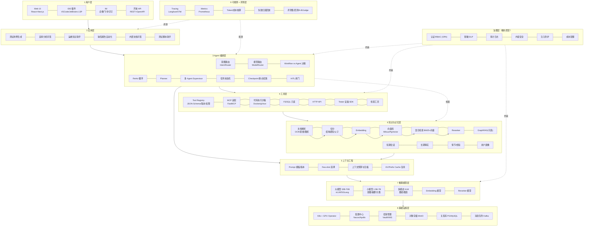
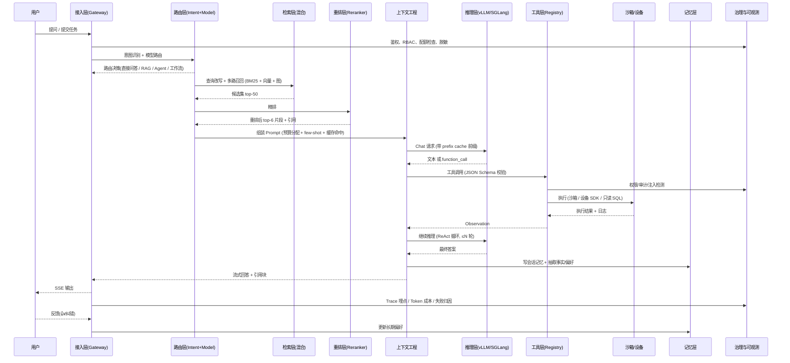

# 工业级 RAG + Agent 技术架构方案与模块划分

> **文档目标**：为中科飞测（半导体测试设备公司）AI Agent / AI 工具方向从 0 到 1 建设提供可直接落地执行的技术架构蓝图、模块边界划分、技术选型决策与分阶段路线图。
> **适用读者**：新任 AI Agent / AI 工具方向负责人、平台研发工程师、架构评审委员会、算法工程师。
> **文档状态**：v1.0（初稿，供架构评审与立项讨论使用）
> **适用阶段**：M0 立项 / M1 PoC / M2 生产灰度 / M3 规模化

---

## 0. 摘要（TL;DR）

中科飞测的 AI 工具建设不应从"做一个问答机器人"起步，而应建设一套**企业级 Agent 平台**：以统一 Tool Registry 为核心资产，以 RAG 解决"知识不可信"问题，以 Agent 编排解决"任务复杂"问题，以治理与可观测层保证"可上线、可审计、可降级"。

本方案给出 8 层（用户层 / 应用层 / Agent 编排层 / 工具层 / 上下文工程 / 知识与记忆层 / 推理层 / 基础设施层）+ 2 条横向贯穿（治理层、可观测层）的总体架构，划分 60+ 个模块并给出 P0/P1/P2 优先级与双备选技术栈；针对半导体测试场景（测试用例生成、良率分析问答、Tester 运维知识助手、缺陷报告自动化、内部文档 RAG、测试脚本辅助）给出模块组合映射；给出 4 个月 M0–M3 路线图、量化非功能 SLA 与 12 项风险对策。

核心判断：**先做"可信的 RAG 问答 + 少量高价值只读工具"，再做"能写代码/跑量测的自主 Agent"**；沙箱与 HITL 闸门从第一天就位，不可后补。

---

## 1. 总体架构

### 1.1 架构设计原则

| # | 原则 | 落地含义 |
|---|---|---|
| 1 | **工具优先（Tool-first）** | Tool Registry 是核心资产，模型只是"决策器"。所有外部能力必须注册为 Tool，禁止模型直连数据库 |
| 2 | **知识可信 > 知识丰富** | 所有知识型回答必须携带引用（引用块 + 文档 + 段落定位），无引用不回答 |
| 3 | **确定性优先于自主性** | 流程明确的任务走工作流（Workflow/DAG），不确定任务才走自主 Agent（ReAct） |
| 4 | **只读先行，写操作必须有闸门** | M0–M2 工具默认只读；写/执行类工具强制 HITL 人工确认 + 幂等键 + 审计 |
| 5 | **可观测是准入条件** | 任何模块上线前必须有 Trace、Token 成本、失败归因三个视图 |
| 6 | **模型可替换** | 通过 Model Router 隔离厂商，Prompt、评测集、Tool Schema 三者解耦 |
| 7 | **私有化优先** | 敏感数据不出厂内网；推理侧主用自建 vLLM/SGLang 集群，云端仅做降级兜底 |

### 1.2 图 1：端到端总体分层架构（ASCII 版）

```text
╔══════════════════════════════════════════════════════════════════════════════════════╗
║                          G 治 理 层  （横向贯穿所有层）                                   ║
║  身份认证/RBAC(OPA) │ 敏感数据脱敏(DLP) │ 审计日志(不可篡改) │ 内容安全(输入/输出)      ║
║  Prompt注入防护 │ 成本配额与预算 │ 模型合规白名单 │ 数据分级与留存策略                 ║
╚══════════════════════════════════════════════════════════════════════════════════════╝
╔══════════════════════════════════════════════════════════════════════════════════════╗
║ 1 用户层        Web UI │ IDE插件(VSCode/JetBrains) │ IM(企微/飞书/钉钉) │ 开放API │ 报表看板   ║
║                 技术栈: React+Next.js │ LSP/LSP4E │ 企业微信JS-SDK/飞书SDK │ REST+OpenAPI  ║
╚══════════════════════════════════════════════════════════════════════════════════════╝
╠══════════════════════════════════════════════════════════════════════════════════════╗
║ 2 应用层        领域应用: 测试用例生成 │ 良率分析问答 │ 运维知识助手 │ 缺陷报告           ║
║                 内部文档问答 │ 测试脚本助手 │ 统一工作台(聊天+任务+结果)                ║
║                 技术栈: LangServe/FastAPI │ Dify/自研低代码编排 │ SSE+WebSocket         ║
╚══════════════════════════════════════════════════════════════════════════════════════╝
╠══════════════════════════════════════════════════════════════════════════════════════╗
║ 3 Agent编排层   ┌意图路由 IntentRouter┐ ┌模型路由 ModelRouter┐ ┌Workflow/Agent 决策┐    ║
║                 │ReAct循环 │ Planner │ 多Agent(Supervisor/Peer) │ 任务状态机(StateMachine) ║
║                 │Checkpoint/断点续跑 │ HITL闸门 │ 预算与超时控制 │ 事件总线(AsyncIO)      ║
║                 技术栈: LangGraph │ 自研 DAG引擎(轻量) │ Temporal │ Celery/Arq         ║
╚══════════════════════════════════════════════════════════════════════════════════════╝
╠══════════════════════════════════════════════════════════════════════════════════════╗
║ 4 工具层  ToolRegistry(统一JSON-Schema注册/版本/权限/租户可见性) │ MCP Client/Server    ║
║                 沙箱代码执行 │ 文件系统 │ SQL(只读视图) │ HTTP API │ Tester/量测设备SDK   ║
║                 知识检索工具(检索+重排) │ 工单/Jira/PLM(研华?MES)                     ║
║                 技术栈: FastMCP │ Docker/gVisor │ SQLAlchemy │ httpx │ Python SDK      ║
╚══════════════════════════════════════════════════════════════════════════════════════╝
╠══════════════════════════════════════════════════════════════════════════════════════╗
║ 5 上下文工程层  Prompt模板与版本管理 │ Few-shot选择 │ 上下文预算分配 │ 上下文压缩/摘要      ║
║                 KV-Cache前缀复用 │ Prompt缓存(Anthropic-style) │ 注入检测               ║
║                 技术栈: Jinja2+Prompt Registry │ vLLM prefix caching │ token counting库  ║
╠══════════════════════════════════════════════════════════════════════════════════════╣
║ 6 知识与记忆层  ┌── 知识库 ──┐ ┌── 记忆库 ──┐                                          ║
║                 │文档解析(OCR/表格/图纸/EDA) │ 切分(结构感知/父子/语义) │ Embedding     ║
║                 │向量库(Milvus/PgVector) │ 混合检索(BM25+向量) │ Reranker │ GraphRAG     ║
║                 │记忆: 短期会话 │ 长期事实 │ 情节经验 │ 用户画像(RLHF式偏好)             ║
║                 技术栈: Unstructured/Docling │ Milvus │ ES+BM25 │ BGE-Reranker │ Neo4j    ║
╚══════════════════════════════════════════════════════════════════════════════════════╝
╠══════════════════════════════════════════════════════════════════════════════════════╣
║ 7 推理模型层   大模型(32B-70B 通用/代码) │ 小模型(1.5B-7B 意图/摘要/分类) │ 多模态(VLM)  ║
║                 Embedding模型 │ Reranker模型 │ 向量数据库 │ 权重/量化(GPTQ/AWQ/FP8)      ║
║                 技术栈: vLLM / SGLang / TensorRT-LLM │ Ray Serve │ KServe              ║
╠══════════════════════════════════════════════════════════════════════════════════════╣
║ 8 基础设施层   K8s │ GPU Operator │ 配置中心(Nacos/Apollo) │ 密钥管理(Vault/KMS)         ║
║                 对象存储(MinIO/S3) │ 关系库(MySQL/PG) │ 消息队列(Kafka) │ CI/CD(GitLab)  ║
║                 技术栈: K8s 1.28+ │ NVIDIA GPU Operator │ ArgoCD │ Harbor               ║
╚══════════════════════════════════════════════════════════════════════════════════════╝
╠══════════════════════════════════════════════════════════════════════════════════════╣
║ 9 可观测+评测层  Trace(Langfuse/Phoenix/OTel) │ Metrics(Prometheus+Grafana) │ 日志(Loki)  ║
║                 Token/成本核算 │ 失败归因回放 │ 评测集管理 │ 离线回测 │ 在线A/B │ LLM-Judge ║
║                 技术栈: Langfuse(优先) │ OpenTelemetry Collector │ Prometheus │ Ragas  ║
╚══════════════════════════════════════════════════════════════════════════════════════╝
```

### 1.3 图 1（续）：Mermaid 版



### 1.4 图 2：一次 Agent 请求的完整时序（ASCII 版）

```text
用户        前端/API      接入层      路由层      检索层     重排层    上下文    LLM     工具层    沙箱/设备   记忆    治理/观测
 │            │            │          │           │          │        │        │       │        │         │      │
 │─提问──────▶│            │          │           │          │        │        │       │        │         │      │
 │            │─鉴权/配额─▶│          │           │          │        │        │       │        │         │      │
 │            │            │─意图识别+模型路由─▶│           │          │        │       │        │         │      │
 │            │            │          │◀─路由结果(小模型? 直接LLM)─┘│        │       │        │         │      │
 │            │            │          │─查询改写+多路召回(BM25/向量/图)─▶│      │        │       │        │         │      │
 │            │            │          │           │─候选集──▶│  重排 top-k      │       │        │         │      │
 │            │            │          │           │          │─top-k片段─▶│ 组装Prompt     │       │        │         │      │
 │            │            │          │           │          │          │  │─Token→模型─▶│       │        │         │      │
 │            │            │          │           │          │          │  │◀─工具调用请求─│────▶│        │         │      │
 │            │            │          │           │          │          │  │  (function call)         │        │      │
 │            │            │          │          │          │          │  │                │─参数校验/权限/沙箱─▶│      │
 │            │            │          │          │          │          │  │                │◀──执行结果(日志/量测数据)─┘      │
 │            │            │          │          │          │          │  │─观察Observation─▶│       │        │         │      │
 │            │            │          │          │          │          │  │◀─继续推理/最终回答┤       │        │         │      │
 │            │            │          │          │          │          │  │                │       │        │         │      │
 │            │◀─SSE流式回答──│            │          │           │          │        │  │                │       │        │         │      │
 │            │            │─写入会话记忆─▶│          │           │          │        │        │       │        │         │      │
 │            │            │            │          │           │          │        │        │       │        │         │      │
 │            │            │            │◀─────── Trace/Token/审计/成本上报（同步旁路）───────────────────────────────┘
 │            │            │          │◀──────────── 反馈(点赞/纠错) → 长期记忆/偏好更新 ────────────┘
```

### 1.5 图 2（续）：Mermaid 时序版



---

## 2. 模块划分（核心章节）

> **难度标注**：L=低（配置/胶水，1–2 周）、M=中（需工程抽象，3–6 周）、H=高（需核心算法或复杂分布式，2–3 人月）。
> **优先级**：P0=M0–M1 必须交付；P1=M2 前交付；P2=M3+ 交付。

### 2.1 接入层

| 模块名 | 职责 | 关键输入/输出 | 推荐技术选型 | 难度 | 优先级 |
|---|---|---|---|---|---|
| Web 工作台 | 统一入口：对话、任务列表、引用查看、成本可见 | 输入：会话消息/文件；输出：SSE 流、引用卡片 | **A. 自研 Next.js + AI SDK**（可定制、贴合内部权限体系）<br/>**B. Dify / Open WebUI**（开箱即用，但定制受限） | L/M | P0 |
| IDE 插件 | 代码/测试脚本补全、解释、单测生成 | 输入：当前文件/选区/上下文；输出：diff 建议 | **A. Continue（Cline）二次开发**（生态成熟、已有多模型适配）<br/>**B. 自研 LSP + Copilot 协议**（可控但工作量大） | M | P1 |
| IM 机器人 | 企微/飞书/钉钉内问答、告警推送、审批 | 输入：Webhook 消息/卡片回调；输出：Markdown 卡片、交互按钮 | **A. 企微智能机器人 + 卡片回调**（审批/确认天然适配）<br/>**B. 飞书多维表格 + 机器人**（知识库强、易做结构化卡片） | M | P0 |
| 开放 API 网关 | 对内对外统一 API、鉴权、限流、SDK | 输入：HTTP/JSON；输出：REST + SSE + OpenAPI 文档 | **A. Kong/APISIX + 内嵌鉴权**（企业级策略丰富）<br/>**B. FastAPI 直出 + Redis 限流**（轻量，M1 更快） | L/M | P0 |
| 文件上传与解析入口 | 接收 PDF/Excel/图纸/源码包，异步入队 | 输入：文件；输出：解析任务 ID + 文档对象 | **A. MinIO 直传 + Kafka 异步解析**（大文件可靠）<br/>**B. 同步上传 + Celery 任务**（简单，小规模够用） | L | P0 |

**取舍说明**：M1 阶段坚决用"自研轻量前端 + FastAPI + MinIO"，不要一上来上 Dify——Dify 的工作流编排很快会撞上"需要自定义沙箱执行 Tester 脚本"的需求天花板；到 M2 若确需低代码，可把 Dify 作为**独立业务应用**接入平台 API，而不是平台底座。

### 2.2 对话与会话管理

| 模块名 | 职责 | 关键输入/输出 | 推荐技术选型 | 难度 | 优先级 |
|---|---|---|---|---|---|
| Session Manager | 会话生命周期、多轮上下文、并发写 | 输入：session_id + 消息；输出：有序消息链 | **A. 自研 + Redis（会话元数据）+ PG（消息明细）**（可审计、可回放）<br/>**B. LangGraph Checkpointer + PostgresSaver**（与编排层打通） | M | P0 |
| 上下文窗口管理 | Token 预算、按时间/相关性裁剪、工具结果压缩 | 输入：完整消息链；输出：裁剪后窗口 | **A. 自研预算器**（工具结果可单独设上限，如"单工具结果最多 4K token"）<br/>**B. LLM 摘要式压缩**（长会话体验更好，但有信息漂移与成本） | M | P0 |
| 多轮引用一致性 | 保证跨轮次引用同一文档段落不冲突 | 输入：历史引用 ID；输出：修订后引用 | **A. 引用基于稳定 chunk_id（非向量序）**（推荐，成本低）<br/>**B. 引用绑定语义指纹**（防文档更新后失效） | M | P1 |
| 会话分支 / 重生成 | 从某一轮分支、重跑、对比 | 输入：目标轮次；输出：新会话分支 | **A. 自研分支树（PG 存 parent_id）**<br/>**B. 依赖 LangGraph checkpoint 分支** | M | P1 |
| 用户/租户隔离 | 数据行级隔离、跨租户不可见 | 输入：user/org；输出：过滤后数据 | **A. PG RLS + 应用层双重过滤**<br/>**B. 分库分表（仅在 M3 有多租户需求时）** | M | P1 |

### 2.3 路由层

| 模块名 | 职责 | 关键输入/输出 | 推荐技术选型 | 难度 | 优先级 |
|---|---|---|---|---|---|
| 意图识别 | 区分 QA / 任务执行 / 代码 /闲聊 /拒答域 | 输入：用户文本 + 会话历史；输出：意图标签 + 置信度 | **A. 小模型分类（Qwen3-4B / bge-reranker 复用）+ 规则兜底**<br/>**B. 大模型零样本分类 + JSON Schema**（准确但慢、贵） | L/M | P0 |
| 模型路由 | 大/小模型分流、多模型选择、降级链 | 输入：任务类型 + 预算；输出：模型 ID + 参数 | **A. 自研 ModelRouter + OpenAI 兼容接口**（可控、可插拔）<br/>**B. LiteLLM 代理**（100+ 模型统一路由、缓存、预算） | M | P0 |
| 工作流 vs 自主 Agent 判定 | 判"流程固定"走 DAG，判"不确定"走 ReAct | 输入：意图 + 任务描述；输出：执行模式 | **A. 规则 + 任务类型元数据**（推荐：大部分场景可预定义）<br/>**B. 分类器判定**（灵活但不稳定，需评测校准） | M | P0 |
| 复杂度分级 | 估算任务难度 → 决定是否升级到大模型/多 Agent | 输入：任务 + 工具清单；输出：难度分 | **A. 启发式（工具数量/文件数/关键词规则）**<br/>**B. LLM 一次性评分（便宜模型）** | L | P1 |
| 兜底与澄清 | 低置信度时反问用户澄清 | 输入：置信度 + 缺失槽位；输出：澄清问题 | **A. 槽位填充（Slot Filling）框架**<br/>**B. 纯自由生成反问** | L | P0 |

### 2.4 Agent 编排层

| 模块名 | 职责 | 关键输入/输出 | 推荐技术选型 | 难度 | 优先级 |
|---|---|---|---|---|---|
| ReAct 循环 | 思考-行动-观察循环、终止条件 | 输入：目标 + 工具集；输出：轨迹 | **A. LangGraph**（状态机强、可观测、易回放）<br/>**B. 自研 ReAct Runner**（轻、可控，但需自建可观测） | M | P0 |
| Planner（规划器） | 复杂任务分解为子任务 DAG | 输入：复杂目标；输出：子任务列表 + 依赖 | **A. Plan-and-Execute（独立 Planner 模型 + Executor）**（主流、易调）<br/>**B. LLMCompiler / Hierarchical**（并行度高，工程复杂） | H | P1 |
| 多 Agent 协作 | 角色分工（检索/分析/生成/评审） | 输入：多角色定义；输出：协同产物 | **A. Supervisor 模式（自研，单主控）**（可控、成本可控）<br/>**B. LangGraph 多图 + AutoGen**（灵活、易失控） | H | P2 |
| 任务状态机 | 任务生命周期、状态持久化、事件 | 输入：任务事件；输出：状态迁移 + 事件流 | **A. 自研显式状态机（推荐，P0）+ Temporal 承接长任务（M2）**<br/>**B. 直接上 Temporal**（强保证，但 M1 成本高） | M/H | P0 |
| Checkpoint / 断点续跑 | 每步落盘、失败可续、结果可重放 | 输入：执行状态；输出：可恢复快照 | **A. LangGraph Sqlite/PG Saver**（开箱可用）<br/>**B. 自研 Snapshot（JSON + 对象存储大对象）** | M | P0 |
| HITL 人工确认闸门 | 高风险动作前挂起等审批 | 输入：待执行动作 + 风险等级；输出：批准/拒绝/修改 | **A. 状态机挂起 + IM 卡片审批**（体验与审计最佳）<br/>**B. 同步阻塞等待（仅短任务可用）** | M | P0 |
| 预算与超时控制 | 最大轮次、最大 token、最大时长 | 输入：任务预算；输出：终止原因 | **A. 自研 BudgetGuard**（M1 必备，成本红线）<br/>**B. 依赖 LangGraph recursion_limit + LiteLLM 预算 | L | P0 |
| 失败重规划 | 工具连续失败时改计划而非死循环 | 输入：失败历史；输出：新计划 | **A. 规则触发重规划（≥2 次同类失败）**<br/>**B. 模型自主判断**（更灵活，需评测约束） | M | P1 |

### 2.5 工具层（Tool Registry 为核心资产）

| 模块名 | 职责 | 关键输入/输出 | 推荐技术选型 | 难度 | 优先级 |
|---|---|---|---|---|---|
| Tool Registry | 统一注册、JSON-Schema 校验、版本管理、租户可见性、权限标签 | 输入：工具定义；输出：可调用工具清单 | **A. 自研 Registry（推荐，资产化）**<br/>**B. MCP Tool Server + Registry 服务**（协议标准，跨团队共享） | M | P0 |
| 工具描述与版本 | 描述、参数变更、废弃策略、回归评测 | 输入：变更 diff；输出：版本号 + 兼容策略 | **A. Registry 内版本表 + CI 校验**（工具变更必须跑评测）<br/>**B. Git Tag + Changelog 约定** | M | P0 |
| 权限与风险分级 | 只读/可写/可执行/高危，绑定 RBAC | 输入：角色 + 工具；输出：放行/拒绝 | **A. 工具级权限标签 + OPA 策略**<br/>**B. 应用层硬编码白名单**（初期最简单） | M | P0 |
| MCP 适配层 | 以 MCP 协议接入外部/第三方工具 | 输入：MCP Server；输出：标准化工具 | **A. FastMCP / mcp-python-sdk**（Python 原生）<br/>**B. TypeScript MCP SDK**（Node 生态工具） | M | P1 |
| 代码执行沙箱 | 执行 LLM 生成代码（Python/SQL/脚本） | 输入：代码 + 依赖；输出：stdout/stderr/产物 | **A. gVisor（runsc）容器**（推荐，见 §3.3）<br/>**B. Firecracker microVM**（隔离最强，密度与冷启动需权衡） | H | P0 |
| 文件系统工具 | 读写指定目录、列举、上传产物 | 输入：路径 + 内容；输出：文件/内容 | **A. 受限路径沙箱挂载 + 路径逃逸检测**<br/>**B. 对象存储直传（适合大产物）** | L | P0 |
| 数据库 / SQL 工具 | 只读查询、聚合、良率统计 | 输入：SQL；输出：表格 + 摘要 | **A. 只读视图 + SQLGlot AST 校验 + 行数/超时限制**（必需）<br/>**B. 语义层（Text2SQL + 指标定义服务）**（更准，M2） | M | P0 |
| HTTP API 工具 | 调用 MES/工单/PLM 等内部系统 | 输入：方法 + URL + 参数；输出：JSON | **A. httpx + 出站白名单 + 凭据注入**<br/>**B. API Gateway 统一代理** | L | P0 |
| Tester / 量测设备 SDK | 读取机台状态、日志、测试结果、触发停机 | 输入：机台 ID + 命令；输出：结构化数据 | **A. 厂商 SDK 适配层（Python）**<br/>**B. 通过机台 REST/OPC-UA 网关**（解耦硬件） | H | P1 |
| 测试用例生成工具 | 生成 STW/程序式测试用例（基于规范） | 输入：器件规格/测试规范；输出：用例草稿 | **A. 模板 + 规则库 + LLM 填充**<br/>**B. 纯 LLM 生成 + 人工审校** | M | P0 |
| 工具可观测埋点 | 每个工具调用的耗时、成功率、错误类型 | 输入：调用事件；输出：Trace span | **A. OpenTelemetry 装饰器统一包裹**<br/>**B. 依赖 Langfuse Tool 回调** | L | P0 |

### 2.6 上下文工程层

| 模块名 | 职责 | 关键输入/输出 | 推荐技术选型 | 难度 | 优先级 |
|---|---|---|---|---|---|
| Prompt 模板与版本管理 | 模板、变量、版本、灰度、回滚 | 输入：场景 + 变量；输出：最终 prompt 字符串 | **A. Prompt Registry（PG 表 + Jinja2）**（可回滚、可评测）<br/>**B. Langfuse Prompt Management**（与评测一体） | M | P0 |
| Few-shot 示例选择 | 按当前 query 动态挑选示例 | 输入：query + 示例池；输出：k 个示例 | **A. 基于 Reranker 分数选 Top-k**（质量最好）<br/>**B. 固定示例 + 人工精选**（零成本、延迟最低，M1 用这个） | L/M | P0→P1 |
| 上下文预算分配 | 系统提示/历史/检索/工具结果各占多少 | 输入：模型窗口；输出：分配方案 | **A. 固定比例 + 动态回收**（推荐）<br/>**B. 纯等分**（不推荐） | L | P0 |
| 上下文压缩 | 长历史摘要、工具结果裁剪、表格降维 | 输入：超长上下文；输出：压缩上下文 | **A. 规则裁剪 + 表格抽稀**（无模型成本、可控）<br/>**B. 小模型摘要**（效果好、成本低） | M | P0 |
| 前缀缓存复用 | 固定前缀命中 KV cache，降延迟与成本 | 输入：稳定前缀；输出：cache 命中标识 | **A. vLLM `enable_prefix_caching` + 前缀稳定化设计**（推荐）<br/>**B. Anthropic 显式 cache_control**（云端才适用） | M | P1 |
| 注入检测 | 检测用户/文档中的 Prompt 注入 | 输入：不可信文本；输出：风险标记 | **A. 规则 + 分类模型双检**（可信度更高）<br/>**B. 隔离与最小权限（真正的解药）**（必须做） | M | P0 |

### 2.7 知识层

| 模块名 | 职责 | 关键输入/输出 | 推荐技术选型 | 难度 | 优先级 |
|---|---|---|---|---|---|
| 文档接入与解析 | PDF/Word/Excel/PPT/源码/图片/图纸 | 输入：原始文件；输出：结构化中间表示 | **A. Docling / MinerU**（版面与表格还原好）<br/>**B. Unstructured.io**（插件生态广） | M | P0 |
| OCR / 图纸理解 | 扫描件 OCR、电路图/版图提取 | 输入：图片/图纸；输出：文本 + 结构化标注 | **A. PaddleOCR + 版面模型**（中文好、成本低）<br/>**B. 多模态 VLM 直接读图**（强但慢且贵，仅用于关键图纸） | M/H | P1 |
| 表格结构化 | 良率表、测试参数表 → 行列结构 | 输入：表格；输出：Markdown + 语义字段 | **A. Docling TableFormer / PP-Structure**<br/>**B. LLM 结构化抽取** | M | P0 |
| 切分策略 | 语义/结构感知/父子分块 | 输入：中间表示；输出：chunk 列表 + 层级 | **A. 父子分块 + 标题层级感知**（推荐，检索命中后回填父块）<br/>**B. 纯固定长度 + 重叠**（零成本、质量一般） | M | P0 |
| Metadata 与 ACL | 来源、版本、密级、所属产品线、可见角色 | 输入：chunk；输出：带 metadata 的 chunk | **A. 结构化 metadata 字段（自研 Schema）**<br/>**B. 无（纯向量）**（不推荐，无法做权限与时效） | L | P0 |
| Embedding 服务 | 文本/代码/表格向量化，批量推理 | 输入：chunk 列表；输出：向量 | **A. BGE-M3 / Qwen3-Embedding（本地 vLLM）**（中英混合好）<br/>**B. OpenAI text-embedding-3-large（云端，效果稳但数据出网）** | L | P0 |
| 向量库 | 存储、ANN 检索、过滤、元数据过滤 | 输入：向量 + metadata；输出：相似集 | **A. Milvus（推荐）**：分布式、亿级、metadata 过滤强<br/>**B. PG + pgvector**：运维最简，M1 规模足够（<500 万 chunk） | M | P0 |
| 全文检索 | BM25、关键词精确匹配（型号、Pin 名） | 输入：query；输出：关键词命中集 | **A. Elasticsearch / OpenSearch（BM25）**<br/>**B. Milvus 全文（2.4+ 支持）**（省一套组件） | M | P0 |
| 混合检索融合 | 向量 + BM25 融合排序 | 输入：两路结果；输出：融合排序 | **A. RRF（Reciprocal Rank Fusion）**（无需调参，最稳）<br/>**B. 加权线性融合（0.6 向量 + 0.4 BM25）**（可解释，但需调参） | L | P0 |
| Reranker | 交叉编码精排 | 输入：query + 候选段落；输出：精排 top-k | **A. BGE-Reranker-v2-m3 / bge-reranker-large（本地部署）**（中英混合强）<br/>**B. Cohere Rerank（云端，效果稳定但成本/合规）** | L | P0 |
| GraphRAG（可选） | 实体-关系图谱，全局/局部问题 | 输入：文档集；输出：子图/社区摘要 | **A. Neo4j + LightRAG / GraphRAG 官方实现**（贵且慢，谨慎）<br/>**B. 暂不做，用结构化 metadata + 关系表替代** | H | P2 |
| 知识图谱 | 器件型号-测试项-机台-故障 的关系网 | 输入：结构化源数据；输出：三元组 | **A. 自研关系表 + 图查询（轻）**<br/>**B. Neo4j（图算法强）** | M/H | P1 |
| 知识库运营 | 增量更新、失效、版本、反馈闭环 | 输入：新增/修改文档；输出：索引更新 | **A. 事件驱动增量（Kafka + 消费端）**<br/>**B. 定时全量重建（M1 简单方案）** | M | P1 |

### 2.8 记忆层

| 模块名 | 职责 | 关键输入/输出 | 推荐技术选型 | 难度 | 优先级 |
|---|---|---|---|---|---|
| 短期会话记忆 | 当前会话内的对话与工具轨迹 | 输入：消息；输出：上下文 | **A. PG + Redis 混合**（热数据 Redis、审计 PG）<br/>**B. LangGraph Checkpointer** | M | P0 |
| 长期事实记忆 | 用户/项目的稳定事实（偏好、常查器件） | 输入：抽取事实；输出：可检索事实条目 | **A. 独立 Memory Store（PG 表 + 定期向量索引）**<br/>**B. 与知识库共用向量库（用 namespace 隔离）** | M | P1 |
| 情节 / 经验记忆 | 成功/失败的任务轨迹与"教训" | 输入：任务轨迹 + 反馈；输出：经验条目 | **A. 轨迹压缩为经验卡（自研抽取规则 + 小模型）**<br/>**B. 直接存全轨迹 + 检索时让模型总结** | M/H | P2 |
| 用户画像 | 角色、职级、常用产品线、交互偏好 | 输入：行为 + 显式设置；输出：画像向量/结构 | **A. 结构化画像表 + 轻量规则**<br/>**B. LLM 定期从历史摘要更新** | M | P1 |
| 记忆写入策略 | 何时写、写什么、如何防污染 | 输入：会话结束事件；输出：记忆写入动作 | **A. 显式确认（"记住这个"）+ 白名单自动抽取**（推荐）<br/>**B. 全自动抽取（易污染，M2 前避免）** | M | P1 |

### 2.9 推理层（模型服务）

| 模块名 | 职责 | 关键输入/输出 | 推荐技术选型 | 难度 | 优先级 |
|---|---|---|---|---|---|
| 推理引擎部署 | 高吞吐低延迟的 LLM 服务 | 输入：OpenAI 兼容请求；输出：生成结果 | **A. vLLM**（生态最全、PagedAttention、prefix caching 成熟）<br/>**B. SGLang**（RadixAttention 前缀复用更强、多轮/Agent 场景更优） | M | P0 |
| 模型选型与部署 | 通用/代码/多模态/小模型分工 | 输入：能力需求；输出：模型清单 + 部署规格 | **A. Qwen3 系列（32B/14B/4B）+ 内部数据微调**<br/>**B. 混合：Qwen3 + DeepSeek-Coder + InternVL（多模态）** | M | P0 |
| 量化与显存优化 | 压显存、提并发 | 输入：模型权重；输出：量化权重 | **A. FP8（Hopper 卡）/ AWQ-GPTQ（4bit）**<br/>**B. FP16 基线 + 动态批处理**（质量优先时） | M | P0 |
| 推理缓存 | 前缀缓存 + 语义缓存 + 结果缓存 | 输入：请求；输出：缓存命中 | **A. vLLM prefix caching + 精确匹配缓存（相同 query）**<br/>**B. 语义缓存（embedding 相似度阈值）**（有误命中风险，谨慎启用） | M | P1 |
| 批处理与调度 | 动态批、优先级队列、离线任务优先 | 输入：请求队列；输出：批执行 | **A. vLLM continuous batching + 优先级**<br/>**B. Ray Serve / KServe 弹性伸缩 | M | P1 |
| 限流与降级 | GPU 满载时的排队、拒绝、模型降级 | 输入：负载；输出：响应或降级 | **A. 网关限流 + 排队 + 小模型降级链**（必须）<br/>**B. 依赖 K8s HPA 扩容（分钟级，不够快）** | M | P0 |
| 多租户/多模型网关 | 统一 OpenAI 兼容入口、配额 | 输入：多模型请求；输出：统一响应 | **A. LiteLLM Proxy**<br/>**B. 自研薄网关（只做路由与计费）** | L/M | P1 |

### 2.10 治理层（横向）

| 模块名 | 职责 | 关键输入/输出 | 推荐技术选型 | 难度 | 优先级 |
|---|---|---|---|---|---|
| 身份认证 | 员工 SSO、OAuth2/OIDC | 输入：token；输出：用户身份 | **A. 公司 IAM / Keycloak (OIDC)**<br/>**B. 企业微信/飞书 OAuth**（内部工具够用） | L | P0 |
| RBAC 授权 | 角色 → 数据/工具/知识库权限 | 输入：身份 + 动作；输出：allow/deny | **A. OPA / Casbin 策略引擎**（灵活可审计）<br/>**B. RBAC 表 + 应用层校验**（M1 最快） | M | P0 |
| 敏感数据脱敏 | 入参/出参中的客户、专利、器件数据脱敏 | 输入：文本；输出：脱敏文本 + 掩码映射 | **A. 正则 + 词典 + 小模型识别 三级**<br/>**B. 纯正则（便宜，漏召）** | M | P0 |
| 审计日志 | 谁、何时、调了什么工具、看了什么数据 | 输入：全量事件；输出：不可篡改日志 | **A. OpenTelemetry → Kafka → 冷存储（对象存储 WORM）**<br/>**B. 直接写审计 PG 表** | M | P0 |
| 内容安全 | 输入输出双向审核、涉政涉密拦截 | 输入：prompt / 生成结果；输出：放行/拦截/改写 | **A. 敏感词 + 分类模型 + 人工复核队列**<br/>**B. 纯敏感词**（成本低但召回差） | M | P1 |
| Prompt 注入防护 | 外部文档/网页内容中的指令劫持 | 输入：检索内容；输出：可信标记 + 隔离指令 | **A. 隔离策略（检索内容包裹为"数据"而非"指令"）+ 只读工具 + 最小权限**（根本解）<br/>**B. 注入检测模型作为补充** | M | P0 |
| 成本配额 | 按人/按部门/按场景的预算与熔断 | 输入：Token/算力消耗；输出：配额状态 | **A. LiteLLM 预算 + 自研成本台账**<br/>**B. 自研计量（统一出口拦截）** | M | P0 |
| 模型/数据合规 | 允许使用的模型、允许出境的数据分级 | 输入：策略；输出：准入判定 | **A. 策略配置文件 + 准入校验中间件**（必须）<br/>**B. 仅靠流程约束**（不可靠） | M | P1 |

### 2.11 可观测层

| 模块名 | 职责 | 关键输入/输出 | 推荐技术选型 | 难度 | 优先级 |
|---|---|---|---|---|---|
| 全链路 Trace | 每次请求的完整链路（检索→工具→LLM） | 输入：埋点；输出：Trace 树 | **A. Langfuse**（RAG/Agent 语义友好、自带评测，优先选）<br/>**B. Phoenix (arize-ai)** / **OpenTelemetry + Jaeger**（厂商中立但要自建看板） | M | P0 |
| 指标监控 | QPS、TTFT、端到端延迟、错误率、GPU 利用率 | 输入：运行指标；输出：面板与告警 | **A. Prometheus + Grafana**<br/>**B. VictoriaMetrics（更省资源）** | L | P0 |
| Token / 成本核算 | 按会话/用户/场景归集成本 | 输入：用量；输出：成本报表 | **A. 自研成本台账（模型单价表 + 用量明细）**<br/>**B. LiteLLM 自带 spend 报表** | L/M | P0 |
| 失败归因回放 | 失败样本一键重放、对比两版差异 | 输入：失败 trace；输出：重放结果 diff | **A. Langfuse Playground 回放 + 自研 Diff 视图**<br/>**B. 自研回放脚本** | M | P1 |
| 用户反馈采集 | 点赞/点踩/纠错/引用点击 | 输入：交互事件；输出：反馈数据 → 评测集 | **A. 前端反馈组件 + 事件入库**<br/>**B. 依赖 IM 卡片按钮** | L | P0 |
| 日志与告警 | 异常日志、值班告警 | 输入：日志流；输出：告警 | **A. Loki + Alertmanager**<br/>**B. ELK 全家桶**（重） | L | P1 |

### 2.12 评测层

| 模块名 | 职责 | 关键输入/输出 | 推荐技术选型 | 难度 | 优先级 |
|---|---|---|---|---|---|
| 评测集管理 | 构造、维护、分层抽样 gold set | 输入：case；输出：版本化评测集 | **A. Git 管理 + 评测集 Schema 自研**<br/>**B. Langfuse Dataset**（与 Trace 打通，可直接采样） | M | P0 |
| 离线回测 | 批量跑评测集，对比版本 | 输入：版本 + 评测集；输出：指标报告 | **A. 自研 Runner（容器化批量调 API）**<br/>**B. Ragas / DeepEval / promptfoo** | M | P0 |
| 在线 A/B | 灰度分流、实时对比 | 输入：流量；输出：实验指标 | **A. 网关层分流 + 指标看板（推荐）**<br/>**B. Feature Flag 平台接入** | M | P1 |
| LLM-as-Judge | 语义质量打分（相关性/完整性/忠实度） | 输入：问答对 + 评分标准；输出：分数 | **A. 强模型 Judge + 人工校准子集**<br/>**B. RAGAS metrics（faithfulness/answer relevancy）** | M | P0 |
| 检索质量评估 | Recall@k、MRR、NDCG | 输入：标注 query-doc 对；输出：检索指标 | **A. 自研指标计算（标准做法，依赖标注集）**<br/>**B. BEIR/Rerank 工具链** | L/M | P0 |
| 回归与门禁 | CI 中跑评测，劣于阈值则阻断发布 | 输入：代码变更；输出：Pass/Fail | **A. GitLab CI + 评测 Job + 阈值门禁**<br/>**B. 人工评审放行** | M | P1 |

### 2.13 工程基座

| 模块名 | 职责 | 关键输入/输出 | 推荐技术选型 | 难度 | 优先级 |
|---|---|---|---|---|---|
| 配置中心 | 多环境配置、热更新 | 输入：配置；输出：运行时配置 | **A. Nacos**（内部通常已有）<br/>**B. Apollo**（功能全，略重） | L | P0 |
| 密钥管理 | 模型 Key、DB 密码、机台凭据 | 输入：密钥引用；输出：运行时注入 | **A. HashiCorp Vault / 云 KMS**<br/>**B. K8s Secret + SealedSecret**（最小可行） | M | P0 |
| CI/CD | 构建、镜像、发布、灰度 | 输入：commit；输出：镜像 + 部署 | **A. GitLab CI + Harbor + ArgoCD（GitOps）**<br/>**B. Jenkins + Helm** | M | P0 |
| K8s 部署 | 服务编排、弹性伸缩 | 输入：Manifest；输出：运行实例 | **A. K8s + Helm Chart（自研）**<br/>**B. KubeSphere（内部已有则用）** | M | P0 |
| GPU Operator | GPU 节点管理、驱动/监控 | 输入：节点；输出：GPU 资源池 | **A. NVIDIA GPU Operator + NVIDIA NIM/LMDeploy 打包**<br/>**B. 裸机 + systemd（仅 M0 应急）** | M | P0 |
| 对象存储 | 原始文档、产物、轨迹快照 | 输入/输出：文件 | **A. MinIO（内网）**<br/>**B. 公司 NAS/S3 兼容服务** | L | P0 |
| 关系数据库 | 元数据、会话、审计、配置 | 输入/输出：结构化数据 | **A. PostgreSQL 16（推荐，JSONB + RLS 都好用）**<br/>**B. MySQL 8（若公司统一）** | L | P0 |
| 消息队列 | 异步任务、解析、索引、事件 | 输入/输出：消息 | **A. Kafka**<br/>**B. RabbitMQ / Redis Stream（轻量场景）** | L | P1 |
| 服务网格/网关 | 灰度、限流、路由 | 输入/输出：请求 | **A. APISIX / Kong**<br/>**B. Ingress + 自研中间件** | M | P1 |

---

## 3. 关键流程设计

### 3.1 RAG 检索增强流程（详细步骤）

| 步骤 | 动作 | 策略与参数建议 | 为什么 |
|---|---|---|---|
| 1 | 查询理解 | 小模型判定：改写为 2–3 个查询（多查询召回）；抽取实体/型号/时间/产品线槽位 | 半导体场景里 "STW-2100" 这类型号必须精确命中，查询改写显著提升召回 |
| 2 | 权限与密级过滤 | 在**检索前**按用户权限过滤 metadata（密级/产品线/部门） | 检索后过滤有信息泄漏风险与 top-k 被稀释问题 |
| 3 | 多路召回 | BM25 通道 + 向量通道 + (可选) 表格结构化通道 | 型号/管脚/参数名靠 BM25；语义问题靠向量 |
| 4 | 融合 | **RRF（k=60）**：`score = Σ 1/(k + rank_i)` | 无需调参、对两路量纲差异鲁棒；比线性加权更稳 |
| 5 | 候选规模 | 召回 **top-50**，去重（按 chunk_id + 内容哈希） | 50 条是重排质量与延迟的平衡点；低于 20 召回不足，高于 100 延迟与成本翻倍 |
| 6 | 重排 | Reranker 精排取 **top-6**；片段超长按 token 截断 | 6 段 × 约 500 token ≈ 3K 上下文，与 8K–32K 窗口匹配 |
| 7 | 上下文组装 | System(1–2K) + Few-shot(0–2K) + 历史(≤2K) + 检索(≤3K) + 工具结果(≤4K) | 固定预算分配，避免检索挤占工具结果导致工具调用质量下降 |
| 8 | 生成 | 要求逐句附引用标记 `[doc_id:chunk_id]`；无引用即视为幻觉 | 强制可溯源是半导体行业最硬的合规要求 |
| 9 | 校验 | 引用块存在性校验；答案与检索片段的蕴含度校验（轻量 NLI） | 捕获"检索到了但没答"和"编造参数"两类高危错误 |
| 10 | 兜底 | 召回为空或最高分低于阈值 → 明确说"未在知识库中找到"，转人工 | 宁可拒答，不可编造测试参数 |

**关键取舍说明**：

- **召回率 vs 上下文长度**：本方案选"召回 50 → 重排 6 → 上下文 3K 检索预算"。理由：半导体知识高度重复（多个机型共用同一手册），表面召回率高但有效信息密度低；重排比盲目加长上下文更划算。
- **混合权重**：默认用 RRF 而非固定 0.6/0.4。若评测显示 BM25 明显更强（型号类 query 占比高），可切到加权模式并以评测集回归验证。
- **父子分块的价值**：命中 300 token 的子块，回填 1200 token 的父块（章节级），既保证召回精度，又保证模型看到完整上下文（"该参数的适用前提条件"往往在父块里）。

### 3.2 Agent 工具调用可靠性设计

| 机制 | 设计 | 参数/实现 |
|---|---|---|
| 参数校验 | 双层：JSON Schema（结构） + 语义校验（业务枚举、量程、必填联动） | Schema 校验在 Tool Registry 执行；语义校验下沉到各工具内部，失败返回结构化错误供模型自修正 |
| 超时控制 | 三层超时：连接 / 读取 / 整体；Agent 任务另有总时限 | 连接 3s、读取 30s、工具整体 60s、任务总时长 15min（可按场景配） |
| 重试 | 仅对**幂等失败**重试（网络抖动、限流、5xx） | 指数退避 1s/2s/4s，最多 3 次；4xx 参数错误**不重试**，直接返回给模型修正 |
| 幂等 | 写/执行类工具必须带 `idempotency_key`（会话ID+步骤号+参数哈希） | 服务端 24h 内去重；重放不会产生二次副作用 |
| 熔断降级 | 连续失败或 P95 超标 → 工具下线并告警，Agent 改走备选路径 | 熔断阈值：1 分钟内失败率 > 50% 或连续 10 次失败 |
| 失败归一 | 所有错误返回统一结构：`{code, message, retryable, hint}` | `hint` 面向模型（如"字段 device_serial 不存在，请先调用 list_devices"），能显著降低无效重试 |
| HITL 人工闸门 | 风险分级 ≥ 写操作 的动作挂起，等待 IM 卡片审批 | 审批人由工具元数据定义（如"停机需设备主管审批"）；超时自动拒绝（fail-safe） |
| 不可逆动作二次确认 | 停机、修改测试程序、删除数据 | 必须展示"将要执行什么 + 影响范围 + 可回滚性"，并要求显式点击确认 |
| 循环与预算 | 最多 8 轮 ReAct、同一工具同一参数连续 2 次失败即终止 | 终止原因记录到 Trace，便于失败归因 |
| 状态与补偿 | 事务性状态机 + 补偿动作 | 部分失败时执行已定义补偿（如已下发的用例草稿标记为"待确认"而非直接生效） |

### 3.3 沙箱隔离方案对比与选型

| 方案 | 隔离强度 | 冷启动 | 资源密度 | 运维复杂度 | 适用 |
|---|---|---|---|---|---|
| **Docker（runc）** | 弱（共享内核，仅 cgroup/ns 隔离） | <1s | 高 | 低 | 可信内部代码；**不适合执行外部不可信内容** |
| **gVisor（runsc）** | 中强（用户态内核，应用层 syscall 拦截） | 1–3s | 中（10–20% 开销） | 低–中（Docker 原生可用） | **推荐默认**：执行 LLM 生成的 Python/Shell、解析不可信 PDF |
| **Firecracker** | 强（轻量 microVM，硬件虚拟化） | <125ms（有快照） | 中（每 VM ~128MB） | 中（需自研编排/快照管理） | 高危任务、需要接近裸机性能/强隔离的场景 |
| **Kata Containers** | 强（microVM + K8s 原生） | 秒级（受镜像拉取影响） | 低–中 | 中（依赖 QEMU/KVM 虚拟化底座） | 已有虚拟化基础设施的团队，追求 K8s 体验 |

**选型建议（分层）**：

1. **默认（M0–M2）：gVisor + Docker**。代码执行沙箱用 `--runtime=runsc`，配合：非 root 用户、只读根文件系统 + tmpfs、内存/CPU/进程数上限、禁网或出口白名单、镜像签名与定期清理。理由：性价比最高，团队 1–2 人即可运维；实测性能损耗可接受（Python 计算型任务 <15%）。
2. **高危通道（M2+）：Firecracker / Kata**，用于"执行测试脚本触碰真机""运行第三方仓库代码"等场景，配合一次性 microVM + 快照回滚。
3. **永远不要做的事**：把 LLM 生成的代码直接 `exec` 在 Agent 服务进程内；沙箱与推理服务共用宿主机 root 权限；沙箱默认允许出网（应默认拒绝 + 白名单出站）。

---

## 4. 技术选型清单与决策记录

| 能力 | 推荐方案 | 备选 | 为什么 | 风险 |
|---|---|---|---|---|
| Agent 编排框架 | LangGraph | 自研轻量状态机 | 状态机显式、可 checkpoint、可回放、社区活跃；自研省依赖但可观测要重建 | 版本 API 变动快，需锁版本 + 封装一层自研 Facade |
| 推理引擎 | vLLM | SGLang | 生态成熟、prefix caching 稳定、运维资料多；SGLang 在多轮/Agent 场景前缀复用更强 | GPU 驱动/依赖踩坑，需固定镜像并做压测基线 |
| 通用大模型 | Qwen3-32B (FP8) | DeepSeek / Llama 系列 | 中文与制造业知识好、许可宽松、便于内网部署与微调 | 领域术语需 RAG/微调补齐，评测需自建 |
| 向量数据库 | Milvus | PG + pgvector | 亿级规模、metadata 过滤强、分布式；pgvector 运维简单，适合 M1 | Milvus 运维复杂，团队需 1 人月学习曲线 |
| 全文检索 | Elasticsearch (BM25) | Milvus 内置全文 | ES 关键词/模糊/高亮成熟，型号检索强 | 组件多，需与 Milvus 双写一致性设计 |
| Reranker | BGE-Reranker-v2-m3 (本地) | Cohere Rerank | 中文+英文+代码混合都好、可私有化 | 多路召回的延迟叠加，需异步并行调用 |
| Embedding | BGE-M3 / Qwen3-Embedding (自部署) | text-embedding-3-large | 中英混合、长文本、代码语义兼顾，不出网 | 需与切分策略联合调优，维度变更需全量重建索引 |
| 文档解析 | Docling / MinerU | Unstructured.io | 版面/表格/公式还原好，国产化友好 | 复杂图纸仍需 VLM 兜底，成本上升 |
| 沙箱 | gVisor (Docker) | Firecracker / Kata | 性能与隔离平衡最好，运维门槛最低 | 内核兼容性问题偶发；内核敏感的 numpy/CUDA 需验证 |
| 工具协议 | MCP (FastMCP) | 自研 REST Tool | 标准化、可跨团队/跨语言共享、厂商工具现成 | 生态仍在演进，需自研 Registry 兜底权限与版本 |
| 观测 | Langfuse | Phoenix / OTel+Jaeger | RAG/Agent 语义友好、自带数据集与评测，减少自建 | 自托管需 PG+对象存储，运维量中等 |
| 网关/路由 | LiteLLM Proxy | 自研路由 | 多模型统一入口、预算、缓存开箱即用 | 自定义策略表达力有限，需自研旁路逻辑 |
| 身份与策略 | OPA / Casbin | 应用层 RBAC 表 | 策略即代码、可审计、便于合规审计 | 学习成本；M1 可先用表 + 预留策略接口 |
| 评测 | 自研 Runner + Ragas + LLM-Judge | promptfoo / DeepEval | Runner 完全可控可 CI 化；Ragas 指标成熟 | LLM-Judge 有偏，需人工校准子集与双 Judge 交叉验证 |
| 工作流引擎 | 自研显式状态机 + Temporal（长任务） | Airflow / Dagster | Agent 任务与数据 ETL 特性不同，分开治理 | 两套引擎运维成本；M2 前只留自研 |

---

## 5. 中科飞测场景映射

| 场景 | 业务描述 | 使用模块组合 | 关键风险控制 | 交付优先级 |
|---|---|---|---|---|
| **测试用例自动生成** | 从器件规格书/测试规范生成 STW 或程序式测试用例草稿 | 应用层(用例生成) + 文档解析(表格/规格书) + 混合检索(规格段落) + 模板引擎 + 代码沙箱(语法/静态检查) + HITL(用例评审) + 审计 | 用例必须由资深工程师审核后入正式库；沙箱内只做静态检查，不连真机 | P0（首场景，最易量化收益） |
| **测试数据 / 良率分析问答** | "某型号近三个月良率趋势与主要失效模式" | SQL 工具(只读视图) + 语义层 + 图表生成 + SQL 沙箱 + 路由层(BI类 query) + 结果缓存 | 只读账号 + AST 校验 + 行数/超时上限 + 聚合查询强制；复杂查询走缓存预聚合表 | P0 |
| **Tester 设备运维知识助手** | 查报警码含义、换件步骤、校准规程 | 知识库(手册/报警码表) + 结构化报警码库(精确检索) + 混合检索 + Reranker + 引用强制 + IM 接入 | 步骤类回答必须带"适用机型 + 文档版本 + 页码"；涉及停机的步骤加 HITL | P1 |
| **缺陷分析报告自动化** | 汇总失效数据、生成结构化分析报告 | Planner + 多工具编排(SQL + 日志检索 + 图表) + 模板生成 + DOCX/HTML 导出 + 人工复核 | 结论必须可回溯到原始数据行；自动生成的报告标注"AI 生成待审" | P1 |
| **内部文档 RAG 问答** | 制度、SOP、项目文档统一问答 | 文档解析 + 切分 + Embedding + Milvus + ES + RRF + Reranker + 引用 + 反馈闭环 | 按部门/密级 ACL；引用缺失则拒答；提供"文档未收录"上报入口反哺知识库 | P0 |
| **代码 / 测试脚本辅助** | 写测试程序、解释报错、生成单测 | IDE 插件 + 代码检索(仓库级索引) + 代码模型 + 代码沙箱(跑单测) + 检索工具 | 仅允许在项目仓库沙箱内运行；禁止访问生产机台网络；提交必须走 Code Review | P1 |
| **（扩展）机台实时状态助手** | 自然语言查询机台状态/最近报警 | HTTP 工具 + 机台 SDK + 缓存(30s TTL) | 严格只读；机台命令白名单；高并发下走缓存而非直连 | P2 |

**优先级建议**：以「内部文档 RAG 问答」和「良率分析问答」作为 M1 的两个试点——前者风险最低、数据现成、见效快；后者最能体现业务价值且数据已在数仓。测试用例生成作为 M2 的"第一个 Agent 场景"（需要完整工具链与 HITL）。代码辅助放 M2–M3（需要 IDE 插件与代码索引，配合成本更高）。

---

## 6. 分阶段演进路线图（M0–M3）

### M0：立项与地基（第 1 个月）

| 项 | 内容 |
|---|---|
| 基础设施 | K8s 命名空间与 GPU 节点申请（≥2 卡）；PostgreSQL + MinIO + Redis 部署；GitLab 仓库组与 CI 模板；代码规范与 Commit 规范 |
| 交付物 | ①架构设计文档（本文件）②技术选型 ADR 清单 ③评测框架骨架（含 30 条种子用例）④Tool Registry 设计稿 ⑤推理服务 vLLM 单实例（1 个 32B 模型）⑥基础 Trace 接入 |
| 验收标准 | vLLM 服务可稳定提供 OpenAI 兼容接口，TTFT P95 < 2s（8K 输入）；Trace 可完整展示一次问答全链路；CI 可跑通构建与镜像推送；30 条种子用例可批量执行并出报告 |
| 团队配置 | 1 名技术负责人（你）+ 1 名后端/平台工程师 + 0.5 名算法工程师 + 0.5 名测试/评测（可兼职） |
| 风险 | 硬件审批慢 → 提前 3 周发起；模型许可证/安全评估 → 同步启动 |

### M1：可用的 RAG 问答 MVP（第 2 个月）

| 项 | 内容 |
|---|---|
| 基础设施 | Milvus（或 pgvector）+ Elasticsearch 集群；文档解析流水线（Kafka + 消费者）；Tool Registry v1；K8s Helm 化与多环境（dev/staging/prod） |
| 交付物 | ①内部文档 RAG 问答（Web + 企微/飞书入口）②混合检索 + RRF + Reranker 全链路 ③引用强制与"未找到"拒答 ④Prompt Registry 与版本管理 ⑤反馈采集（点赞/点踩/纠错）⑥评测集扩充到 200 条 + LLM-Judge 评分报告 |
| 验收标准 | 检索 Recall@20 ≥ 85%（自建标注集）；LLM-Judge 平均分 ≥ 4.0/5；答案引用覆盖率 100%；端到端 P95 ≤ 8s；单问成本 ≤ ¥0.3（自建成本台账核算） |
| 团队配置 | 3–4 人 + 1 名业务专家（兼职 0.5，做标注与评测） |
| 风险 | 文档质量差 → 同步推动知识库治理清单；用户不信任 → 首屏展示引用与"问得不好点这里反馈" |

### M2：第一个 Agent 场景 + 生产化（第 3 个月）

| 项 | 内容 |
|---|---|
| 基础设施 | 代码执行沙箱（gVisor）；HITL 审批（企微/飞书卡片）；只读 SQL 视图与语义层；GPU 扩容到 4–8 卡 + 限流降级链；成本配额系统 |
| 交付物 | ①测试用例生成 Agent（LangGraph 编排 + Planner + 工具调用 + HITL 评审 + checkpoint 续跑）②良率分析问答（SQL 工具 + 图表）③模型路由（小模型分流，节省 ≥ 40% 成本）④失败归因回放面板 ⑤评测 CI 门禁（劣于阈值阻断发布） |
| 验收标准 | Agent 任务成功率 ≥ 70%（测试用例草稿被工程师采纳率 ≥ 50%）；沙箱逃逸测试 0 通过；写操作 100% 走 HITL 且有审计；成本 P95 下降 ≥ 30%（模型路由后） |
| 团队配置 | 4–6 人（+1 沙箱/安全方向工程师、+1 评测工程师）+ 2 名一线工程师做试点用户 |
| 风险 | 一线工程师不愿用 → 嵌入现有 IM 流程，不要求换工具；用例质量不稳 → 坚持 HITL 与模板优先 |

### M3：规模化与多场景（第 4 个月）

| 项 | 内容 |
|---|---|
| 基础设施 | 多租户隔离（PG RLS）；A/B 实验平台；离线批量推理队列（良率日报/周报自动生成）；多模型网关与配额；知识库运营闭环（增量索引 + 反馈反哺） |
| 交付物 | ①运维知识助手（IM 侧）②缺陷分析报告自动化 ③Tester 设备运维问答（P1 场景上线）④插件分发的 IDE 插件 Beta ⑤评测体系 v2（在线 A/B + 业务指标关联）⑥成本看板与部门配额 |
| 验收标准 | 覆盖 ≥ 5 个场景；平台月活用户 ≥ 50（工程师）；线上任务成功率 ≥ 85%；P95 端到端 ≤ 10s；单月推理成本可归集到部门且偏差 < 5% |
| 团队配置 | 6–8 人（+0.5 名运维/SRE、+0.5 名安全）+ 各业务线设 1 名"AI 联络人"（兼职，负责需求与验收） |
| 风险 | 场景铺开导致质量稀释 → 建立场景准入 checklist（必须有评测集与 owner）；GPU 成本超预算 → 配额熔断 + 小模型路由 + 缓存 |

---

## 7. 非功能性要求（NFR）

| 维度 | 目标值（M2 生产基线 / M3 目标） | 说明与实现手段 |
|---|---|---|
| **并发** | 在线 QPS 20（M2）→ 100（M3）；峰值 3 倍可降级 | 网关限流 + 排队；模型侧 continuous batching；检索侧副本扩容；大文件解析走异步队列，不占在线链路 |
| **延迟 SLA** | 首 token TTFT P95 ≤ 2.5s；简单问答端到端 P95 ≤ 6s；带工具的 Agent 首响应 P95 ≤ 5s；Agent 全流程 P95 ≤ 60s（不含 HITL 等待） | 手段：prompt 前缀稳定化命中 prefix cache、检索与重排并行、流式输出、工具结果预取、M2 目标 top-k 与 chunk 长度上限 |
| **可用性** | 月可用性 ≥ 99.5%（工作时段 ≥ 99.9%）；RTO ≤ 30min，RPO ≤ 5min | 多副本 + 滚动发布；PG 主备；Milvus/ES 多副本；模型服务 ≥ 2 副本（GPU 不足时降级到小模型保可用） |
| **降级策略** | L1：GPU 满 → 排队 2s 后切小模型；L2：小模型也满 → 返回"稍后重试"+预置答案；L3：检索不可用 → 仅模型直答并明确标注"未检索"；L4：全站故障 → 保留静态 FAQ 与工单入口 | 每级降级必须写清楚触发条件、观测指标与告警阈值 |
| **数据规模假设** | 内部文档 ≤ 50 万份 / 500 万 chunk（3 年内）；向量 1024 维 ≈ 20GB（FP16）；ES 索引 ≈ 30GB；会话消息 5 亿条/年（PG 分区 + 冷存）；单次检索候选 ≤ 50 | 依据：按当前研发/工艺文档体量估算并预留 3 倍余量；超过 1000 万 chunk 再评估 HNSW 分片与磁盘型索引 |
| **扩容路径** | ①纵向：单卡换更大卡（32B→70B）②横向：模型副本 HPA（K8s）+ 检索副本 HPA ③分层：高峰用云 API 溢出（需合规审批）④分区：按业务线/租户分片 | 每层给出触发阈值与切换开关，避免临时救火 |
| **安全与合规** | 零越权数据访问；所有写操作 100% 审计；Prompt 注入攻击通过率 < 5%（含人工红队测试） | 检索前 ACL、只读工具、最小权限、审计不可篡改存储 |
| **可维护性** | 新增一个 Tool 的接入成本 ≤ 0.5 人日（含 schema、权限、测试、文档） | Tool Registry 提供脚手架模板与自动生成的测试骨架 |

---

## 8. 风险与对策

| 风险 | 影响 | 概率 | 对策 | 责任人角色 |
|---|---|---|---|---|
| 领域知识缺失导致"答得像但不对" | 高：误导工程决策 | 高 | 强制引用 + 未检索到即拒答；建立 200 条领域评测集；上线前业务专家盲测通过率 ≥ 80% | 算法工程师 + 业务专家 |
| Prompt 注入 / 越权检索 | 高：数据泄漏 | 中 | 检索前 ACL 过滤、检索内容包裹为"数据"、只读工具 + 最小权限、注入检测模型兜底、红队测试用例入库 | 安全工程师 |
| GPU 资源不足或被抢占 | 高：服务不可用 | 中 | 提前锁定配额；小模型降级链；排队与熔断；云 API 仅作审批后溢出 | 平台/SRE |
| LLM 生成错误代码影响真机 | 高：设备损坏/停线 | 中 | 沙箱隔离 + 只读试运行 + HITL 审批 + 灰度到单台测试机 + 全量审计 | 平台工程师 + 设备主管 |
| 文档质量差、版本混乱 | 中：召回噪声 | 高 | 知识库治理清单（Owner、版本、生效日期）；过期文档下线；反馈反哺 | 知识运营（业务侧） |
| 成本不可控/超预算 | 中：预算被质疑 | 中 | 成本台账到部门级；小模型路由 + 前缀缓存 + 结果缓存；配额熔断 | 技术负责人 |
| 评测集缺乏真实分布 | 中：指标虚高 | 中 | 从线上真实 query 采样构建评测集；每月更新；保留"线上难例"专区 | 评测工程师 |
| 一线工程师不用 | 高：项目失败 | 中 | 嵌入现有 IM/IDE 流程而非要求换工具；先做"省事"场景（报警码速查）；设试点用户与反馈周会 | 技术负责人 + 业务 Champion |
| 供应商锁定 / 模型迭代 | 中：迁移成本 | 中 | Model Router 抽象 + Prompt 与 Tool 解耦；每月评估替代模型 | 技术负责人 |
| 数据合规（客户/专利数据） | 高：合规问题 | 低–中 | 数据分级与脱敏；模型白名单；出境数据禁止；审计留痕 | 安全/合规 + 技术负责人 |
| 依赖单一框架（LangGraph 等）API 变动 | 中：开发阻塞 | 中 | 封装内部编排 Facade，只暴露自研接口；锁版本；核心状态机自研可控 | 平台工程师 |
| 多租户/权限体系后补导致返工 | 中：大改 | 中 | M1 即落地 user/org 维度 ACL 与 PG RLS 预留；M3 才做分片 | 平台工程师 |
| 沙箱逃逸 | 高：安全事故 | 低 | gVisor + 非 root + 无网默认 + 定期逃逸演练；高危走 microVM | 安全工程师 |

---

## 附录 A：术语表

| 术语 | 说明 |
|---|---|
| **RAG（Retrieval-Augmented Generation，检索增强生成）** | 先从外部知识源检索相关片段，再连同问题一起交给大模型生成答案的技术，用于解决模型知识过时与幻觉 |
| **Agent（智能体）** | 能自主规划、调用工具、多步执行任务并根据观察结果调整策略的大模型应用 |
| **ReAct** | Reason + Act 交替的推理范式：模型先思考、再调用工具、拿到观察后继续思考，直至给出答案 |
| **Tool Calling / Function Calling** | 模型输出结构化"调用意图 + 参数"，由宿主程序实际执行并回传结果 |
| **MCP（Model Context Protocol）** | 开放协议，标准化大模型与外部工具/数据源之间的接入方式，类比"AI 时代的 USB-C" |
| **Tool Registry** | 工具的统一注册与管理中心：Schema、版本、权限、可观测、审计的唯一事实来源 |
| **Reranker（重排模型）** | 交叉编码器模型，对初筛候选文档做精细相关性打分，提升 top-k 精度 |
| **Embedding（向量嵌入）** | 把文本/图像映射为稠密向量，语义相近则向量距离近，用于语义检索 |
| **混合检索（Hybrid Search）** | 结合关键词检索（BM25）与向量检索的方案，兼顾精确匹配与语义泛化 |
| **RRF（Reciprocal Rank Fusion，倒数排名融合）** | 按名次倒数加权融合多路检索结果的排序方法，无需归一化分数 |
| **Chunk / 分块** | 文档切分后的最小检索单元；父子分块指子块用于检索、父块用于补全上下文 |
| **GraphRAG** | 结合知识图谱实体关系的检索增强方法，适合需要全局归纳与多跳推理的问题 |
| **HitL（Human-in-the-Loop，人在回路）** | 在高风险动作执行前由人工确认的机制，本方案中作为高危工具的强制闸门 |
| **Checkpoint / 检查点** | Agent 每一步执行状态的快照，用于失败恢复、断点续跑与问题回放 |
| **Prefix Caching（前缀缓存）** | 复用 KV Cache 中相同前缀的计算结果，降低延迟与成本，需保证提示词前缀稳定 |
| **TTFT（Time To First Token）** | 首 token 延迟，用户感知的核心体验指标 |
| **LLM-as-Judge** | 用较强模型按评分标准对模型输出自动打分，用于自动化评测 |
| **Recall@k / MRR / NDCG** | 检索质量指标：召回率、平均倒数排名、归一化折损累计增益 |
| **vLLM / SGLang** | 高性能大模型推理服务框架，前者生态成熟，后者前缀复用与 Agent 场景性能强 |
| **量化（Quantization）** | 用更低精度（INT4/INT8/FP8）存储与计算模型权重，以降低显存占用、提升并发 |
| **gVisor / Firecracker / Kata** | 容器隔离的三种强度路线：用户态内核、轻量 microVM、K8s 原生 microVM |
| **DLP（Data Loss Prevention）** | 数据防泄漏/脱敏机制，识别并遮蔽敏感字段 |
| **OPA（Open Policy Agent）** | 通用策略引擎，用 Rego 语言统一表达授权与合规规则 |
| **OpenTelemetry / Langfuse** | 前者是厂商中立的观测标准，后者是面向 LLM 应用的追踪与评测平台 |
| **RAGAS** | 常用 RAG 评测框架，提供忠实度、答案相关性等自动化指标 |
| **M0–M3** | 本方案的四个建设阶段：地基 / MVP / Agent 与生产化 / 规模化 |

---

*文档结束。如需进一步细化，建议下一步产出：《Tool Registry 接口规范》《知识库切分与 Metadata Schema》《评测集构建规范与标注手册》《GPU 资源容量测算表》四份配套文档。*
